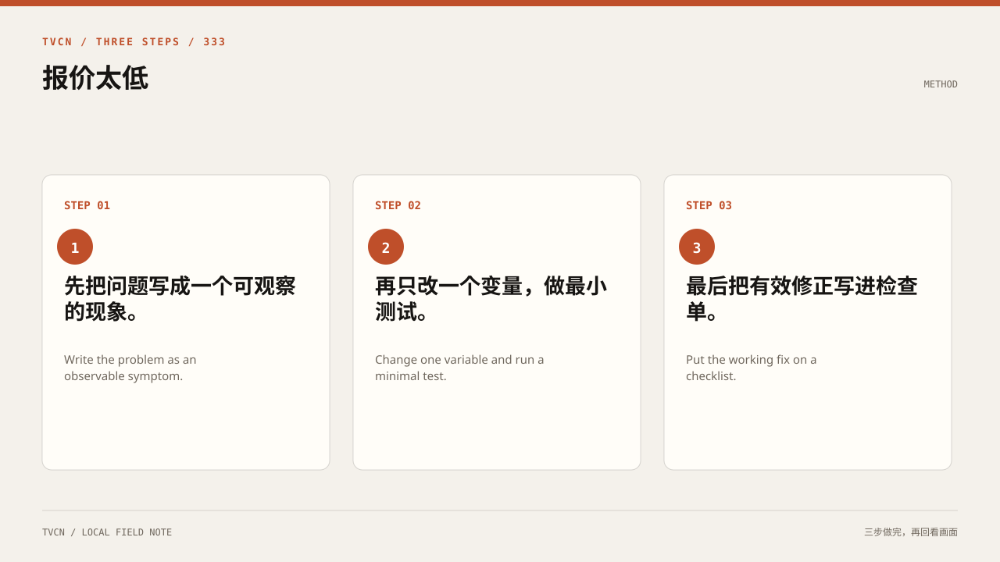

报价太低，先算天数、设备、后期和修改次数；低价接单会赶走好客户。

<!-- DIAGRAM_START -->
<h2>图解</h2>
<figure>
  
  <figcaption>把三步按顺序做完，再回看画面或文件。</figcaption>
</figure>
<!-- DIAGRAM_END -->
<h2>现场</h2>

算天数、设备、后期、修改次数；低价接单会赶走好客户。

<h2>怎么做</h2>

报价太低，先算天数、设备、后期和修改次数；低价接单会赶走好客户。
<ol><li>算保本价：天数乘日费，加设备、场地、后期和税。</li><li>加百分之十到二十的风险，写清修改轮次和超时费。</li><li>给三档报价：基础、标准、加急；让客户选范围，不是砍单价。</li></ol>
<h2>别踩</h2>

别用“先接住再说”；低价会变成长期标准。

<h2>验收</h2>
<ul><li>保本价算过：天数乘日费，加设备、场地、后期和税。</li><li>加了百分之十到二十风险，写了修改轮次和超时费。</li><li>三档报价让客户选范围，不是砍单价。</li></ul>

<!-- DEEP_DIVE_START -->
## 深读

<strong>约 7 分钟。</strong> 报价低不是竞争力，是把你未来的修改、设备和时间免费送人。

### 先算成本底线

把一天的真实成本写出来：拍摄天数、器材折旧或租金、软件、保险、交通、税费、备用金。算完再加利润；没有利润的报价，不是便宜，是借钱做项目。

不要用“别人多少钱”当唯一参考；别人的团队规模、器材、交付范围和你不一样。先算自己做完这个范围要几天。

### 按使用范围报价

自然流量、付费投放、区域、期限、独家，五项分开写。客户买的是使用范围，不只是拍摄天数；一条片子投一年和投一个月，不是同一个价格。

修改次数、加急、额外尺寸、源文件，都单独列价。不要把这些藏进“包含”，否则每次加活都在吃你的利润。

### 谈判砍范围，不砍单价

客户预算低，就减地点、减机位、减版本、减拍摄天数；不要直接把日费砍半。砍单价会让你以后每一个项目都按这个价做。

定金、尾款、取消条款写进合同；取消时按已投入时间收费。报价低但收款快，不如报价合理且能收到。

### 五分钟练习：一张成本表

写一个三天项目：每天几个人、什么器材、多少后期小时、多少税和保险。算出一个底线价，再加百分之二十利润，看看比你原来报的高多少。

把高出部分写成“范围说明”，不要心虚删掉。客户可以不买，但你不应该用低价换一个做不完的项目。

### 报价，十项检查
<ul><li>成本底线含器材软件保险税</li><li>利润单独加</li><li>按拍摄天数算工作量</li><li>使用范围五项分开</li><li>自然流量和付费投放不同价</li><li>修改轮次单独列</li><li>加急和额外尺寸单独列</li><li>源文件单独列</li><li>谈判砍范围不砍日费</li><li>定金尾款取消写进合同</li></ul>
低价换来的不是客户，是一次性客户；合理报价换来的才是能重复合作的人。

<!-- DEEP_DIVE_END -->
