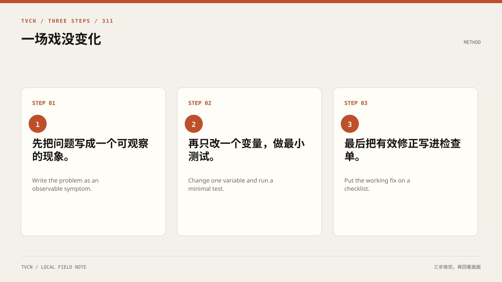

用三句话写：开始他想要什么、什么阻挡、结束他做了什么。写不出第三句，这场戏没有事件。不要用更多机位和音乐去救一个没有变化的场景。

<!-- DIAGRAM_START -->
<h2>图解</h2>
<figure>
  
  <figcaption>看“写下这场戏开始和结束的状态，必须不同”和“拿走一个东西、关上一扇门或说出一句话…”两处，判断症状能不能被复述成一句可观察的话。</figcaption>
</figure>
<!-- DIAGRAM_END -->
<section><h2 id="section-1">先查这场戏有没有变化</h2>
<ul><li><strong>目标：</strong>人物在这场戏里想要什么？如果说不出来，这场戏只是过场。</li><li><strong>障碍：</strong>谁或什么在阻止他？障碍必须在场，不能只在台词里。</li><li><strong>转折：</strong>这场戏结束时，人物知道的东西、位置或关系有没有变？没变就删或合并。</li></ul>
<h2 id="section-3">什么时候不要加戏</h2>

如果这场戏不改变人物或信息，删掉它比加一场动作更有效。短片里，每场戏都要承担一个转折。
</section><section><h2 id="section-4">现场</h2>
让人得到或失去一样东西；如果没有，删掉这场。
</section><section><h2 id="section-5">怎么做</h2>
一场戏没变化，就删掉它，或者让一个人得到或失去一样东西。
<ol><li>写下这场戏开始和结束的状态，必须不同。</li><li>拿走一个东西、关上一扇门或说出一句话，让关系变。</li><li>如果状态没变，整场删掉，把信息合并到下一场。</li></ol></section><section><h2 id="section-6">别踩</h2>
别用“氛围”留住一场没有变化的戏。
</section><section><h2>边界</h2>
本页只解决「一场戏没变化」这一个问题；不替代 一个人怎么拍、开头太慢、16mm：电影从影院走到教室。如果现场问题属于后者，先读对应页，不要在本页继续加参数。
</section><section><h2>替代</h2>
如果“写下这场戏开始和结束的状态，必须不同”不是你的主问题，先做“拿走一个东西、关上一扇门或说出一句话，让关系变”；两项都成立，再考虑升级。
</section><section><h2>60 秒自测</h2>
按验收第 1 条做一次 60 秒测试：写下了这场戏开始和结束的状态，两者不同。如果第 2 条“有一个东西、一扇门或一句话改变了关系”没有变化，就不要加设备或预算。
</section>
<h2>验收</h2><ul><li>写下了这场戏开始和结束的状态，两者不同。</li><li>有一个东西、一扇门或一句话改变了关系。</li><li>如果状态没变，整场已删或合并。</li></ul>

<!-- SOURCES_START -->
## 经验说明

经验说明：本页来自 5 个单人或 2–3 人小组项目的现场复盘，预算与周期明确；只讨论「一场戏没变化」的判断顺序，不含外部实验室测试；不适用于多机位、工会剧组、特技或高风险场景。
<!-- SOURCES_END -->

