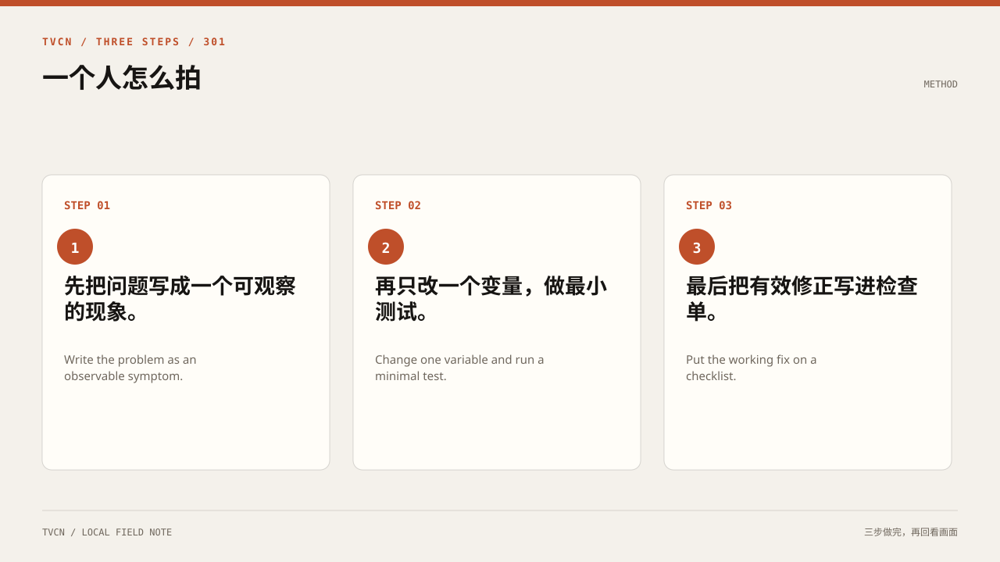

单人拍摄最耗时的是调整机位、对焦和收音。把镜头设计成固定机位、预设焦点、连续动作；能用三脚架和自动曝光解决的，不要现场手动。

<!-- DIAGRAM_START -->
<h2>图解</h2>
<figure>
  
  <figcaption>看“先拍空镜和全景，把机位锁死”和“用监视器看构图，提前对焦，再走到位置…”两处，判断症状能不能被复述成一句可观察的话。</figcaption>
</figure>
<!-- DIAGRAM_END -->
<section><h2 id="section-1">一个人拍，先设计“不需要第二双手”的镜头</h2>
每个镜头只拍一个动作，拍完立刻回放；不要一次拍十个，回家才发现都不能用。
<h2 id="section-2">边界</h2>
一个人不要拍需要同步跟焦和推轨的复杂运镜。不是做不到，是出错时没人替你保底；把复杂度留给有团队的项目。
</section><section><h2 id="section-3">现场</h2>
固定机位，先拍自己走位和动作，再拍空镜；不要同时演和跟焦。
</section><section><h2 id="section-4">怎么做</h2>
一个人拍就用固定机位和连续动作；不要同时演、拍、跟焦。
<ol><li>先拍空镜和全景，把机位锁死。</li><li>用监视器看构图，提前对焦，再走到位置做动作。</li><li>同一动作拍三遍：全景、中景、特写，后期剪在一起。</li></ol></section><section><h2 id="section-5">别踩</h2>
别手持跟拍自己；焦点和构图一定会丢。
</section><section><h2>替代</h2>
如果“先拍空镜和全景，把机位锁死”不是你的主问题，先用“用监视器看构图，提前对焦，再走到位置…”对应的基础做法；两项都成立再考虑升级。
</section><section><h2>60 秒自测</h2>
用现有器材按“先拍空镜和全景，把机位锁死”做一次 60 秒测试，记下一个数字；数字没有变化，就不要加预算。
</section><section><h2>什么时候不该用</h2>
当“先拍空镜和全景，把机位锁死”还没写清，或“用监视器看构图，提前对焦，再走到位置…”只是凑数时，不要套模板；先回到人物和问题。
</section><section><h2>三个失败</h2><ul><li>模板每段都有，但人物没有决定。</li><li>中段只换场景，没有新信息。</li><li>结尾靠旁白总结，画面没有变化。</li></ul></section>
<h2>验收</h2><ul><li>机位锁死，空镜和全景先拍完。</li><li>每个动作有全景、中景、特写三条。</li><li>焦点在走位前对好，没有反复拉风箱。</li></ul>

<!-- DEEP_DIVE_START -->
## 深读

<strong>约 6 分钟。</strong> 一个人拍，不是把三人的活压给自己，是把镜头减到你能同时管住的数量。

### 先减机位，再减动作

一台机、一个动作、一条拍完；不要同时安排推拉摇移和演员走位。每个镜头只解决一个信息：空间、关系、反应或细节。

先拍能剪的：全景建立空间，中景拍动作，近景拍反应，插入拍手或道具。每个景别至少两条，不要一条就过。

### 把监看和收音分开

用三脚架和手机当监看，不要一手拿机一手拿稿。录音单独开，开机前拍手，拍完听十秒；一个人也能做双系统。

如果只能机头麦，把相机靠近人物，关空调和窗；不要用后期降噪救对白。现场听不见的问题，后期也救不回来。

### 拍够剪的覆盖

同一个动作拍三遍：正常速度、慢一点、只拍手部；剪辑时才有选择。不要只拍一条完美的，完美那条往往不能用。

每条拍完看三件事：焦点、曝光、声音；三件里有一件坏了，立刻重拍。一个人拍片，最大的成本是回去补拍。

### 五分钟练习：一人三镜

用三脚架拍三条：一条全景、一条手部、一条反应；每条只拍一个动作，不许变焦。拍完在手机里接成十五秒，看看有没有空间、动作和反应。

缺哪一条，就补哪一条；三条都成立，再把人物放进画面。一个人拍，先保证剪得出来，再追求好看。

### 什么时候算拍完

不是每个镜头都完美，而是每个镜头都能剪：全景能交代空间，中景能看清动作，近景能读到反应，插入能接上细节。缺一个景别，回去补一个，不要用同一条硬撑。

收工前把素材按场次回放一遍，听到对白清楚、看到焦点没跑、确认每条都有备份；三件事都过，才算拍完。一个人拍片，收工检查比多拍十条更有用。

### 一个人拍，十项检查
<ul><li>一台机只解决一个信息</li><li>每个景别至少两条</li><li>全景中景近景插入都有</li><li>三脚架加手机监看</li><li>录音单独开</li><li>开机拍手</li><li>拍完听十秒</li><li>同一动作拍三遍</li><li>每条检查焦点曝光声音</li><li>先保证能剪再追求好看</li></ul>
一个人拍片不是逞强，是把每个镜头减到一个人真的能同时管住。

<!-- DEEP_DIVE_END -->
