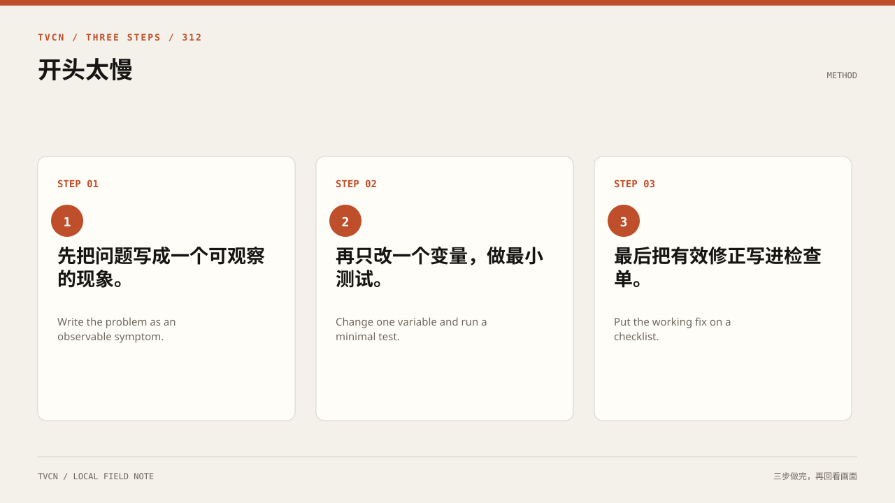

把前 8 秒单独放给没看过的人，关掉声音，问他：你看到谁、想要什么、被什么挡住？如果答不出，开头就还没开始。不要用音乐和字幕补答案。

<!-- DIAGRAM_START -->
<h2>图解</h2>
<figure>
  
  <figcaption>看“找到第一个“人物必须做点什么”的镜头…”和“把背景信息拆成两三条，塞进后面的动作…”两处，判断症状能不能被复述成一句可观察的话。</figcaption>
</figure>
<!-- DIAGRAM_END -->
<section><h2 id="section-1">先看前 8 秒发生了什么</h2>
<ul><li><strong>只有环境：</strong>开场是空镜、字幕和音乐，人物还没想要什么。把第一个有目标的人提前。</li><li><strong>只有解释：</strong>旁白在讲背景，画面没有动作。删掉解释，用一个可见的动作替代。</li><li><strong>冲突太晚：</strong>人物过了 30 秒才遇到障碍。把障碍提到第一个镜头里。</li></ul>
<h2 id="section-3">什么时候不要加快</h2>

如果人物还没建立，直接加速只会让人更不明白。先补一个动作或一句有信息的台词，再谈节奏。
</section><section><h2 id="section-4">现场</h2>
删前 30 秒，从人物已经在做事的地方开始；背景后补。
</section><section><h2 id="section-5">怎么做</h2><ol><li>找到第一个“人物必须做点什么”的镜头，从那里开场。</li><li>把背景信息拆成两三条，塞进后面的动作里。</li><li>前三十秒只留一个问题和一个动作，别交代世界观。</li></ol></section><section><h2 id="section-6">别踩</h2>
别用旁白或字幕把背景念完；观众是来看事的。
</section><section><h2>边界</h2>
本页只解决「开头太慢」这一个问题；不替代 字幕难读、封面没人点、16mm：电影从影院走到教室。如果现场问题属于后者，先读对应页，不要在本页继续加参数。
</section><section><h2>替代</h2>
如果“找到第一个“人物必须做点什么”的镜头，从那里开场”不是你的主问题，先做“把背景信息拆成两三条，塞进后面的动作里”；两项都成立，再考虑升级。
</section><section><h2>60 秒自测</h2>
按验收第 1 条做一次 60 秒测试：开场从人物已经在做事的地方开始。如果第 2 条“前三十秒只有一个问题和一个动作”没有变化，就不要加设备或预算。
</section>
<h2>验收</h2><ul><li>开场从人物已经在做事的地方开始。</li><li>前三十秒只有一个问题和一个动作。</li><li>背景信息拆成两三条，藏在后面的动作里。</li></ul>

<!-- SOURCES_START -->
## 经验说明

经验说明：本页来自 3 个单人或 2–3 人小组项目的现场复盘，预算与周期明确；只讨论「开头太慢」的判断顺序，不含外部实验室测试；不适用于多机位、工会剧组、特技或高风险场景。
<!-- SOURCES_END -->

