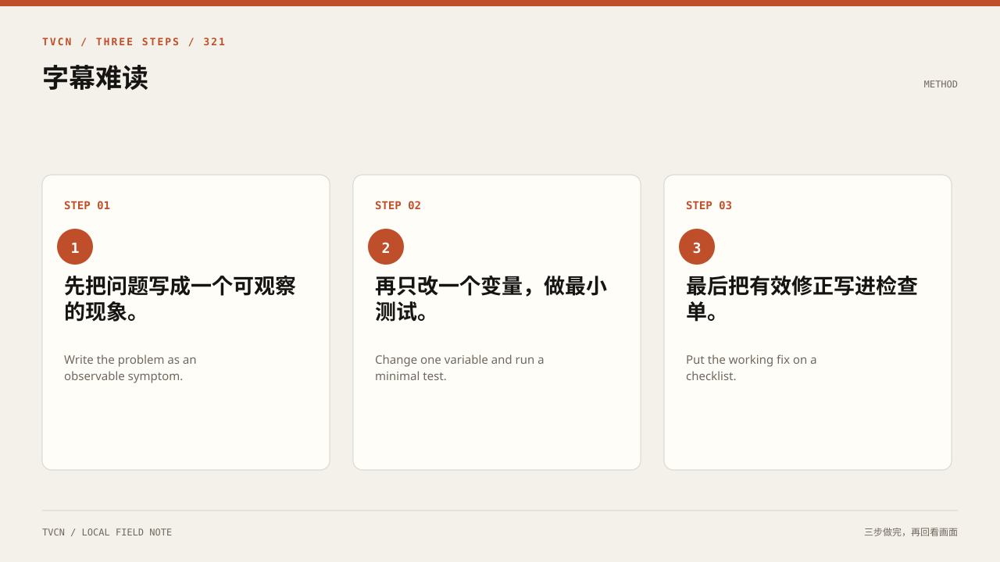

字幕难读先减字数、提对比、避开嘴和手；不要靠描边加粗解决。

<!-- DIAGRAM_START -->
<h2>图解</h2>
<figure>
  
  <figcaption>把三步按顺序做完，再回看画面或文件。</figcaption>
</figure>
<!-- DIAGRAM_END -->
<h2>现场</h2>

减字数、提对比、避开嘴和手；每行 16 字以内。

<h2>怎么做</h2>

字幕难读先减字数、提对比、避开嘴和手；不要靠描边加粗解决。
<ol><li>每行压到十二到十六个汉字，或三十二到四十二个英文字符，最多两行。</li><li>放在安全区上方，避开嘴、手和平台界面。</li><li>用半透明底或轻阴影提高对比，不要描粗到糊。</li></ol>
<h2>别踩</h2>

别把台词全打出来；字幕是护栏，不是逐字稿。

<h2>验收</h2>
<ul><li>每行十二到十六个汉字或三十二到四十二个英文字符，最多两行。</li><li>字幕在安全区上方，避开嘴、手和平台界面。</li><li>半透明底或轻阴影提高对比，没有描粗到糊。</li></ul>
