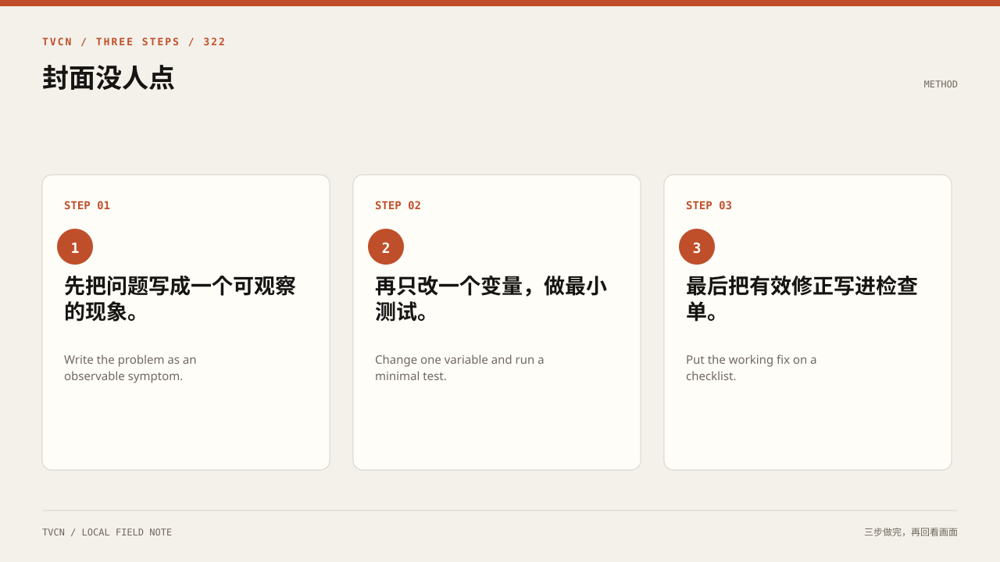

把三张候选封面并排缩到手机宽度，挡住标题，只看图：3 秒内能说出“这是关于什么”吗？再放开标题，看图和字是否说同一件事。选那张不用解释的。

<!-- DIAGRAM_START -->
<h2>图解</h2>
<figure>
  
  <figcaption>看“选一个有人、有动作、有反差的画面，不…”和“把主体放大到占画面三分之一以上，背景…”两处，判断症状能不能被复述成一句可观察的话。</figcaption>
</figure>
<!-- DIAGRAM_END -->
<section><h2 id="section-1">先判断是没人看见，还是看见不想点</h2>
<ul><li><strong>曝光不足：</strong>平台没有把封面推给目标观众。先看发布时间、标题关键词和首帧，不要只改图。</li><li><strong>信息不清：</strong>缩到 120px 宽还看不出主体。裁掉背景，只留一张脸、一个物件或一个动作。</li><li><strong>标题与画面对不上：</strong>封面承诺的内容正文没有。点击进来会立刻掉线，长期更伤。</li><li><strong>对比不足：</strong>脸和背景同色、字压在花背景上。用纯色块或暗角把主体推出来。</li></ul>
<h2 id="section-3">什么时候不要做标题党</h2>

封面可以具体，但不能承诺正文没有的东西。一次骗点会换来长期不信任；平台也会用完播和负反馈惩罚。
</section><section><h2 id="section-4">现场</h2>
给一张有动作的脸：谁在做什么、结果是什么；缩到 200 像素还认得出。
</section><section><h2 id="section-5">怎么做</h2><ol><li>选一个有人、有动作、有反差的画面，不要空景。</li><li>把主体放大到占画面三分之一以上，背景压暗。</li><li>缩到手机尺寸看三秒，能不能说出“谁在做什么”。</li></ol></section><section><h2 id="section-6">别踩</h2>
别堆大字和箭头；封面先讲事，再讲风格。
</section><section><h2>边界</h2>
本页只解决「封面没人点」这一个问题；不替代 标题没信息、片子太长、16mm：电影从影院走到教室。如果现场问题属于后者，先读对应页，不要在本页继续加参数。
</section><section><h2>替代</h2>
如果“选一个有人、有动作、有反差的画面，不要空景”不是你的主问题，先做“把主体放大到占画面三分之一以上，背景压暗”；两项都成立，再考虑升级。
</section><section><h2>60 秒自测</h2>
按验收第 1 条做一次 60 秒测试：封面有人、有动作、有反差，不是空景。如果第 2 条“主体占画面三分之一以上，背景压暗”没有变化，就不要加设备或预算。
</section>
<h2>验收</h2><ul><li>封面有人、有动作、有反差，不是空景。</li><li>主体占画面三分之一以上，背景压暗。</li><li>手机尺寸看三秒能说出谁在做什么。</li></ul>

<!-- SOURCES_START -->
## 经验说明

经验说明：本页来自 6 个单人或 2–3 人小组项目的现场复盘，预算与周期明确；只讨论「封面没人点」的判断顺序，不含外部实验室测试；不适用于多机位、工会剧组、特技或高风险场景。
<!-- SOURCES_END -->

