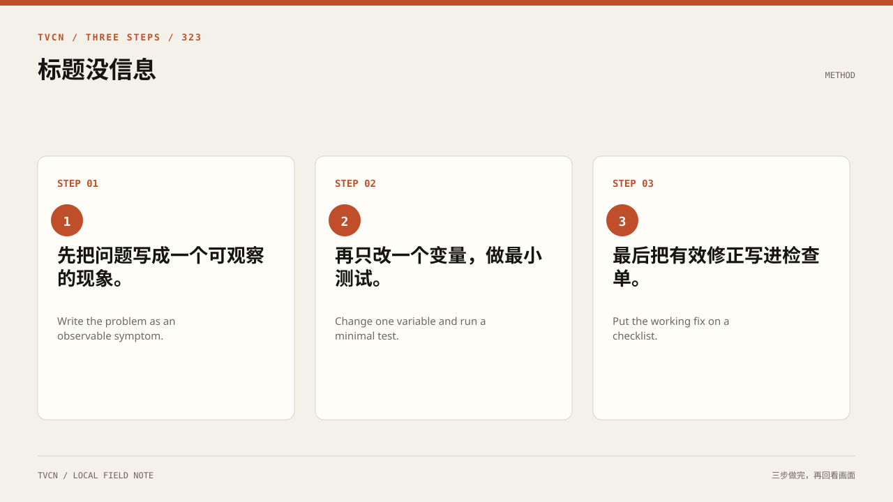

别用夸张承诺换点击；正文接不住会掉粉。

<!-- DIAGRAM_START -->
<h2>图解</h2>
<figure>
  
  <figcaption>看“用“人物加动作加结果或代价”写三版标…”和“删掉“震撼、高级、必看”这类空词”两处，判断症状能不能被复述成一句可观察的话。</figcaption>
</figure>
<!-- DIAGRAM_END -->
<section><h2 id="section-1">现场</h2>
写谁遇到什么结果；形容词越少越好；标题和正文同一件事。
</section><section><h2 id="section-2">怎么做</h2><ol><li>用“人物加动作加结果或代价”写三版标题。</li><li>删掉“震撼、高级、必看”这类空词。</li><li>选一个和正文完全对得上的，别做标题党。</li></ol></section><section></section><section><h2 id="section-4">三种原因</h2>
针对“标题没信息”，先按三个方向排查；每次只改一个变量，改完录 30 秒对比，看变化跟着哪个环节走。

<table class="data-table"><thead><tr><th>原因</th><th>现场信号</th><th>5 分钟验证</th></tr></thead><tbody><tr><td>只有抽象名词</td><td>“成长”“选择”“告别”没有对象，观众不知道会发生什么</td><td>把名词换成一个人和一个动作</td></tr><tr><td>没有冲突</td><td>标题说完结论，正文没有悬念</td><td>补一个具体的障碍或代价</td></tr><tr><td>关键词堆砌</td><td>标题像搜索框，读者读完不知道片子讲谁</td><td>删掉两个关键词，留下一个具体动作</td></tr></tbody></table>
</section><section><h2 id="section-5">现场诊断</h2><ol><li>把标题读给一个没看过片子的人，问他“你觉得会发生什么”。</li><li>如果对方只能重复标题里的抽象词，说明信息不足。</li><li>把标题和正文第一场对照：标题承诺的动作，第一场是否出现。</li></ol></section><section><h2 id="section-6">修法</h2>
好标题不是概括主题，是给出一个人、一个动作和一个代价。它应该能预测第一场，而不是替片子总结。
<ol><li>用“谁 + 想做什么 + 被什么挡住”写一版，再压到 12 字以内。</li><li>把最具体的道具写进标题：猫、旧外套、最后一单。</li><li>保留一个未知：不要告诉观众结果，只告诉他要付出的代价。</li><li>如果标题像论文，改成片中人物会说的话。</li></ol></section><section><h2 id="section-7">失败案例</h2>
处理“标题没信息”时，下面三种做法会更糟；先选一个替换动作，别同时改三个变量。

<table class="data-table"><thead><tr><th>失败做法</th><th>为什么会更糟</th><th>替换动作</th></tr></thead><tbody><tr><td>标题党</td><td>正文兑现不了标题，观众立刻离开</td><td>标题只承诺第一场能发生的动作</td></tr><tr><td>同义反复</td><td>标题和摘要说了同一句</td><td>标题给动作，摘要给条件</td></tr><tr><td>关键词塞满</td><td>读起来像标签列表</td><td>最多保留一个搜索词</td></tr></tbody></table>
</section><section><h2 id="section-8">验收表</h2>
验收不是“感觉好了”，是这四项都能指认、能回放、能记录。

<table class="data-table"><thead><tr><th>验收项</th><th>通过线</th><th>记录</th></tr></thead><tbody><tr><td>具体对象</td><td>标题里有人或物，不是纯抽象词</td><td>圈出名词</td></tr><tr><td>动作</td><td>标题能回答“发生了什么”</td><td>让陌生人复述</td></tr><tr><td>代价</td><td>标题暗示失去什么</td><td>写出一句代价</td></tr><tr><td>兑现</td><td>第一场出现标题承诺的动作</td><td>对照正文</td></tr></tbody></table>
</section><section><h2>边界</h2>
本页只解决「标题没信息」这一个问题；不替代 片子太长、转场很硬、16mm：电影从影院走到教室。如果现场问题属于后者，先读对应页，不要在本页继续加参数。
</section><section><h2>替代</h2>
如果“用“人物加动作加结果或代价”写三版标题”不是你的主问题，先做“删掉“震撼、高级、必看”这类空词”；两项都成立，再考虑升级。
</section><section><h2>60 秒自测</h2>
按验收第 1 条做一次 60 秒测试：标题有“人物加动作加结果或代价”。如果第 2 条““震撼、高级、必看”这类空词已删”没有变化，就不要加设备或预算。
</section>
<h2>验收</h2><ul><li>标题有“人物加动作加结果或代价”。</li><li>“震撼、高级、必看”这类空词已删。</li><li>标题和正文完全对得上，没有标题党。</li></ul>

<!-- SOURCES_START -->
## 经验说明

经验说明：本页来自 5 个单人或 2–3 人小组项目的现场复盘，预算与周期明确；只讨论「标题没信息」的判断顺序，不含外部实验室测试；不适用于多机位、工会剧组、特技或高风险场景。
<!-- SOURCES_END -->

