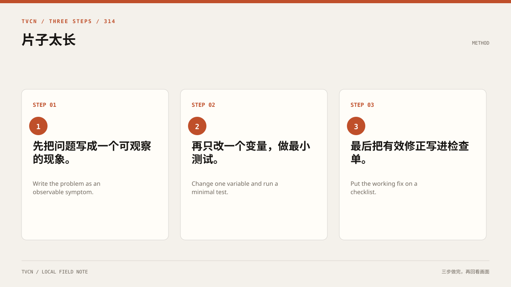

片子太长先找重复：同一个信息出现两次，就删掉较弱的那次。

<!-- DIAGRAM_START -->
<h2>图解</h2>
<figure>
  
  <figcaption>把三步按顺序做完，再回看画面或文件。</figcaption>
</figure>
<!-- DIAGRAM_END -->
<h2>现场</h2>

找重复信息：同一个信息出现两次，删较弱的一次；每场只留一个变化。

<h2>怎么做</h2>

片子太长先找重复：同一个信息出现两次，就删掉较弱的那次。
<ol><li>给每一场标“提供了什么新信息”，没有就删。</li><li>合并功能相同的角色和场景。</li><li>做一次试放映，记录观众走神点，从那里再删三十秒。</li></ol>
<h2>别踩</h2>

别靠加速或快剪硬塞；信息重复不会因为剪快就消失。

<h2>验收</h2>
<ul><li>每场都标了新信息，没有就删。</li><li>功能相同的角色和场景已合并。</li><li>试放映的走神点之后又删了三十秒。</li></ul>
