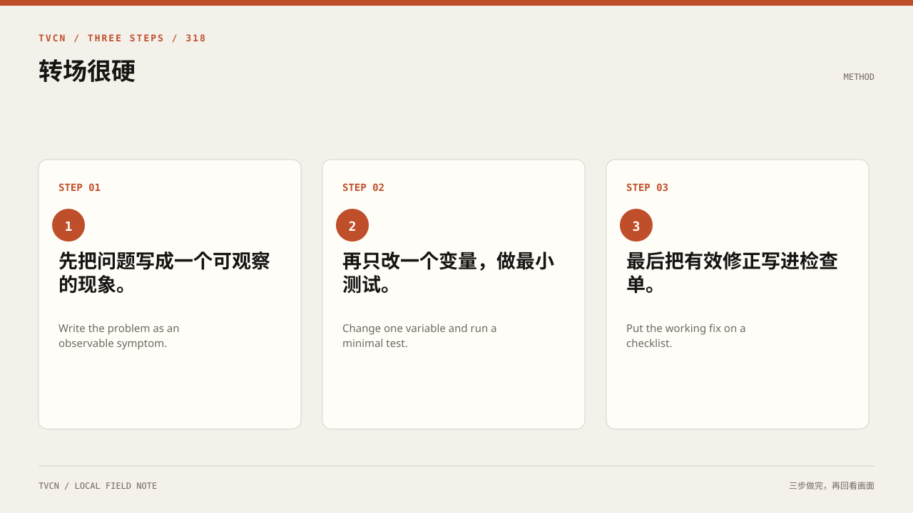

转场硬先找动作、声音或形状的接点；白闪和推拉只能救一次。

<!-- DIAGRAM_START -->
<h2>图解</h2>
<figure>
  
  <figcaption>把三步按顺序做完，再回看画面或文件。</figcaption>
</figure>
<!-- DIAGRAM_END -->
<h2>现场</h2>

找动作、声音或形状的接点；白闪只能救一次。

<h2>怎么做</h2>

转场硬先找动作、声音或形状的接点；白闪和推拉只能救一次。
<ol><li>在上一镜末尾留一个未完成的动作，下一镜接后半段。</li><li>用声音先到或后到，把两个空间连起来。</li><li>找相同形状、颜色或构图做匹配剪辑。</li></ol>
<h2>别踩</h2>

别用白闪或旋转台标当万能胶；用多了会出戏。

<h2>验收</h2>
<ul><li>上一镜留了未完成动作，下一镜接后半段。</li><li>声音先到或后到，把两个空间连起来。</li><li>用了形状、颜色或构图匹配，不是白闪。</li></ul>
