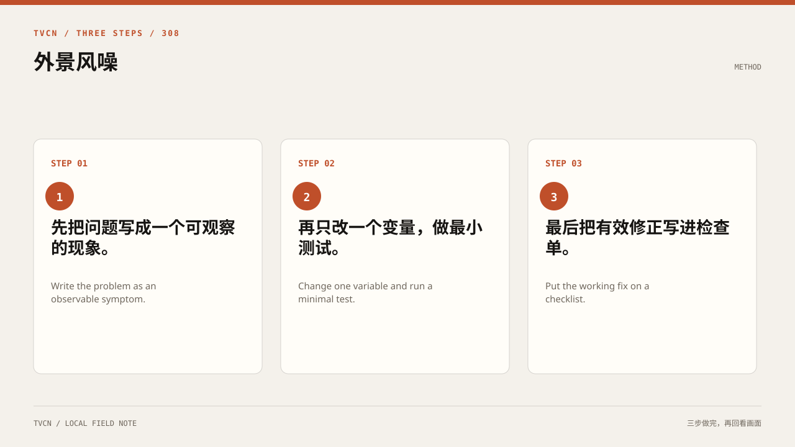

外景风噪先给麦克风套防风罩，再找背风处；后期降噪救不回被风吞掉的字。

<!-- DIAGRAM_START -->
<h2>图解</h2>
<figure>
  
  <figcaption>把三步按顺序做完，再回看画面或文件。</figcaption>
</figure>
<!-- DIAGRAM_END -->
<h2>现场</h2>

给麦套防风罩，找背风处，用身体挡风；后期降噪救不回被风吞的字。

<h2>怎么做</h2>

外景风噪先给麦克风套防风罩，再找背风处；后期降噪救不回被风吞掉的字。
<ol><li>给枪麦套防风毛套或笼，领夹加防风罩。</li><li>用身体、背包或墙挡风，麦离嘴近一点。</li><li>录一条背风参考音，后期只做轻降噪。</li></ol>
<h2>别踩</h2>

别用“后期能修”安慰自己；风噪会吃掉辅音。

<h2>验收</h2>
<ul><li>枪麦套了防风罩，领夹有防风毛。</li><li>拍摄点有身体、背包或墙挡风。</li><li>对白辅音没被风吞，后期只轻降噪。</li></ul>
