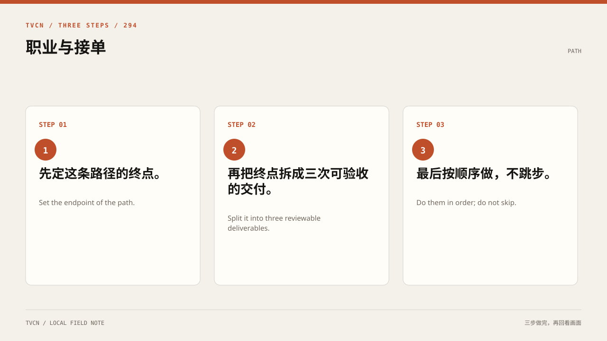

职业路径先活下来，再谈风格；报价、合同、作品集和复购，比多会一个插件重要。

<!-- DIAGRAM_START -->
<h2>图解</h2>
<figure>
  
  <figcaption>把三步按顺序做完，再回看画面或文件。</figcaption>
</figure>
<!-- DIAGRAM_END -->
<h2>现场</h2>

先做三条能力片，再定价：天数乘日费加设备、后期、修改；合同写修改次数。

<h2>怎么做</h2>

职业路径先活下来，再谈风格；报价、合同、作品集和复购，比多会一个插件重要。
<ol><li>先做三条能力片，各自证明一种可交付的能力。</li><li>定价按天数乘日费，加设备、后期、修改。</li><li>合同写修改次数，作品集只放能复述过程的项目。</li></ol>
<h2>别踩</h2>

别用作品数量代替能力；三条能讲清过程的片，比三十条合集有用。

<h2>验收</h2>
<ul><li>三条能力片各对应一种可交付能力，不重复。</li><li>报价拆成天数、日费、设备、后期、修改五项。</li><li>合同写清修改次数，作品集里的项目能讲清过程。</li></ul>
