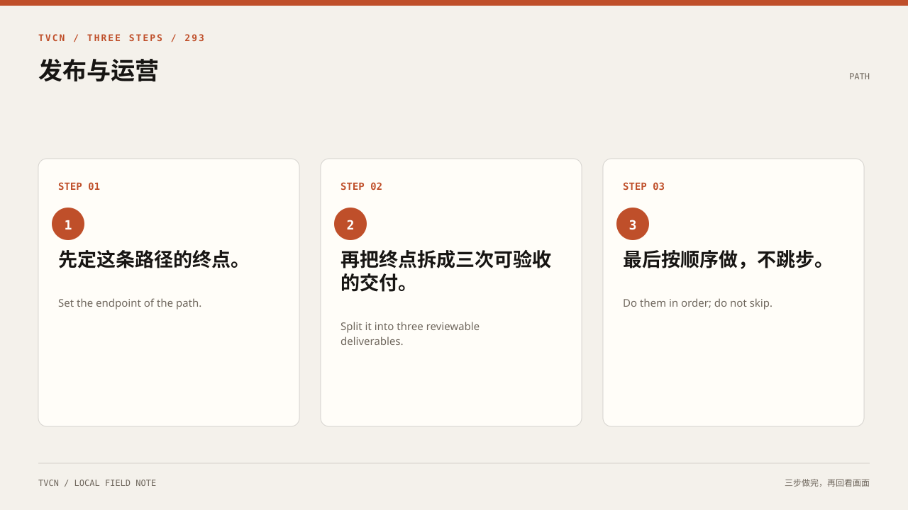

先确认：你有一条定版母版；知道主平台和两个分发平台；能拿到平台的画幅、时长、字幕、封面规格；发布后 48 小时能回来看数据。

<!-- DIAGRAM_START -->
<h2>图解</h2>
<figure>
  
  <figcaption>看“第 1 步：母版 ：母版不改，平台版…”和“第 2 步：平台规格 ：不要凭记忆写…”两处，判断症状能不能被复述成一句可观察的话。</figcaption>
</figure>
<!-- DIAGRAM_END -->
<section><h2 id="section-1">先修要求</h2></section><section><h2 id="section-2">这条路怎么走</h2>
发布顺序：先锁母版，再按平台派生，最后才写标题和封面。不要先做封面，最后发现母版要改。
<ol><li><strong>第 1 步：母版</strong>：母版不改，平台版都从它派生。文件名写“片名_master_日期”；另存一份只读。母版要包含最全的字幕和最高画质，平台版只做裁切、压缩和改字幕。 <em>产出：一个只读母版；一张母版参数表。</em></li><li><strong>第 2 步：平台规格</strong>：不要凭记忆写规格，发布前打开平台帮助页核对。竖版不是把横版裁中间：主体、字幕、安全区都要重画。每个平台单独一列，做完打勾。 <em>产出：一张平台规格表。</em></li><li><strong>第 3 步：标题与封面</strong>：标题只承诺片子里有的东西：谁、遇到什么、结果是什么。封面要能看出一个动作，不要只放一张好看的脸。标题和封面要回答同一个问题，不要一个讲情绪、一个讲信息。 <em>产出：5 个标题、3 张封面、1 个选择理由。</em></li><li><strong>第 4 步：字幕与无障碍</strong>：平台字幕按平台安全区放，不挡脸和手。开放字幕烧进画面，适合静音观看；听障字幕要标声音事件，不只写对白。中文一行不超过 16 字，英文不超过 42 字符。 <em>产出：三种字幕文件；一张字幕检查表。</em></li><li><strong>第 5 步：上传与搜索</strong>：搜索不是堆关键词，是让人一眼知道“这条片解决什么问题”。标题放主题，简介前两行放结果和受众，标签放片型、工具、场景。上传后自己搜一次关键词，看能不能找到。 <em>产出：标题/简介/标签三件套。</em></li><li><strong>第 6 步：上线</strong>：上线前发一条预告，不要提前把片子拆完。上线后前两小时盯评论和完播，遇到具体问题记下来，不要只回“谢谢”。不要在发布当天同时改标题、封面和简介，否则不知道哪个变量起作用。 <em>产出：一张上线清单；一条预告；一份评论问题记录。</em></li><li><strong>第 7 步：48 小时复盘</strong>：48 小时内记四个数：完播率、3 秒留存、来源、评论里重复出现的问题。不要用一次数据判死刑；只找“下一次改哪一个”。复盘表写一条具体改动，例如“前 3 秒从风景改成人物动作”。 <em>产出：一张复盘表；一条下一次改动。</em></li></ol></section><section><h2 id="section-3">三个练习</h2><ol><li><strong>练习 1：五个标题三张封面</strong>：同一片子写 5 个标题、做 3 张封面，找人选一个并说理由。 <em>产出：5 标题、3 封面、1 个理由。</em></li><li><strong>练习 2：一个平台版</strong>：从母版做一个竖版，重画主体、字幕和安全区，不直接裁中间。 <em>产出：一个平台版。</em></li><li><strong>练习 3：48 小时复盘</strong>：发布后 48 小时记四个数，写一条具体改动。 <em>产出：一张复盘表。</em></li></ol></section><section><h2 id="section-4">交付物</h2><ul><li>只读母版与参数表</li><li>平台规格表</li><li>5 个标题、3 张封面</li><li>三种字幕文件</li><li>标题/简介/标签</li><li>上线清单与预告</li><li>48 小时复盘表</li></ul></section><section><h2 id="section-5">常见走偏</h2><ul><li>一版通投：平台不是管道，观众在里面的观看方式不一样。</li><li>发布当天才做封面：赶出来的封面没人点。</li><li>同一天改标题、封面、简介：数据动了也不知道为什么。</li></ul></section><section><h2 id="section-6">下一步</h2>
走完这条路径，下一步去 path-career 把发布结果变成作品集和报价；或者回 path-post 补交付质量。
</section>
<h2>验收</h2><ul><li>母版唯一，平台版能追溯。</li><li>每个平台有独立规格。</li><li>标题只承诺片子里有的东西。</li><li>字幕不挡主体，听障版有声音事件。</li><li>搜一个关键词能找到。</li><li>上线当天只改一个变量。</li><li>复盘有四个数和一条具体改动。</li></ul>
