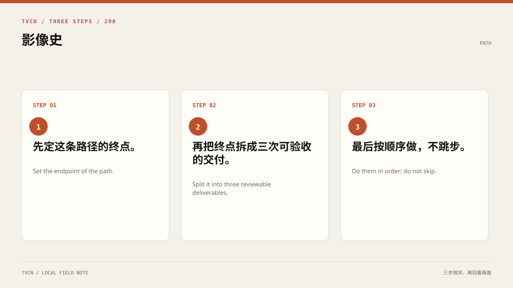

先选四件作品：一张 19 世纪照片、一部 1920 年代默片、一段 1950 年代电视节目、一条 2020 年代生成视频。每件只看 5 分钟，不做笔记。

<!-- DIAGRAM_START -->
<h2>图解</h2>
<figure>
  
  <figcaption>看“1839：摄影把真实变成可复制 ：摄…”和“1895：电影开始收钱 ：电影把影像…”两处，判断症状能不能被复述成一句可观察的话。</figcaption>
</figure>
<!-- DIAGRAM_END -->
<section><h2 id="section-1">先修要求</h2></section><section><h2 id="section-2">这条路怎么走</h2>
这条路径不背年表。每个节点只回答两个问题：它替代了什么旧办法？它新增了什么限制？
<ol><li><strong>1839：摄影把真实变成可复制</strong>：摄影把“证据感”带进图像：一个人可以声称“这是当时在那里”。但它也带来新的问题：曝光时间、构图选择、谁被拍、谁没被拍。看照片时先问“谁站在相机前”，再问“谁不在”。 <em>产出：一条“摄影替代了什么”的笔记。</em></li><li><strong>1895：电影开始收钱</strong>：电影把影像从单人观看变成公共事件：屏幕、座位、黑暗、集体反应。剪辑随后出现，因为观众需要在一小时内看懂多个地点。电影史不是设备史，是“观众如何被组织”的历史。 <em>产出：一条“公共观看改变了什么”的笔记。</em></li><li><strong>1927：声音进入画面</strong>：同步对白让演员不能再用夸张肢体解释一切，镜头也不能随便切，因为声音要连续。录音设备限制了机位，反过来逼出了新的调度。技术不是背景，它直接改写表演和剪辑。 <em>产出：两条对比笔记：表演、剪辑。</em></li><li><strong>1950s：电视把影院搬回家</strong>：屏幕变小，观众距离变近，景别也跟着变近；栏目、广告、季播把内容切成固定时长。电视不是“小电影”，它发明了自己的时间单位：30 分钟、60 秒、每周同一时间。 <em>产出：一条“电视时间单位”的笔记。</em></li><li><strong>2000s：数字把成本打下来</strong>：数字拍摄让条数变便宜，剪辑从机房搬到笔记本，发行从影院/电视台搬到网页。但成本没有消失，它转移到存储、备份、版本管理和注意力。数字不是免费，是账单换了一个地方。 <em>产出：一张“旧成本/新成本”对照表。</em></li><li><strong>2020s：影像开始被生成</strong>：生成把“拍摄”变成“采样”：镜头不必先存在，可以被描述出来。旧问题是布景、演员、天气、预算；新问题是一致性、来源、版权、标注和“这段到底拍过没有”。技术越像，证据越难。 <em>产出：一条“生成新增了什么问题”的笔记。</em></li></ol></section><section><h2 id="section-3">三个练习</h2><ol><li><strong>练习 1：一页四条时间线</strong>：画四条横线：摄影、电影、声音/电视、数字/生成；每条只放 5 个节点。 <em>产出：一页时间线。</em></li><li><strong>练习 2：一件作品的“前后”</strong>：选一件作品，写它之前的人怎么解决同一个问题，之后又怎么解决。 <em>产出：两段各 200 字。</em></li><li><strong>练习 3：技术的三条限制</strong>：选一个你正在用的技术，写三条它做不到的事。 <em>产出：三条限制。</em></li></ol></section><section><h2 id="section-4">交付物</h2><ul><li>一页四条时间线</li><li>三条作品分析</li><li>一张“旧问题/新问题”表</li><li>一条技术限制清单</li></ul></section><section><h2 id="section-5">常见走偏</h2><ul><li>把影像史背成年表：年份记不住没关系，能说出替代关系才有用。</li><li>只写导演和杰作：技术史也是工人、观众、发行和审查的历史。</li><li>技术决定论：技术提供可能，人决定怎么用、谁被排除。</li></ul></section><section><h2 id="section-6">下一步</h2>
走完这条路径，下一步去 path-literacy 把影像史变成判断来源和语境的能力；或者去 context 分站读具体历史节点。
</section>
<h2>验收</h2><ul><li>每个节点都能说出它替代了什么旧办法。</li><li>每个节点也能说出它新增了什么限制。</li><li>至少分析一件作品，不是只背年份。</li><li>不用“新”直接等于“好”。</li><li>时间线允许模糊，但因果关系要清楚。</li><li>能说出一个你正在用的技术的限制。</li></ul>

<!-- SOURCES_START -->
## 经验说明

经验说明：本页来自 5 次客户需求梳理与项目复盘，条件为单人或 2–3 人小组、预算与周期明确；页面讨论的具体对象是「影像史」；不含外部实验室测试，条件变化时结论可能失效。
<!-- SOURCES_END -->

