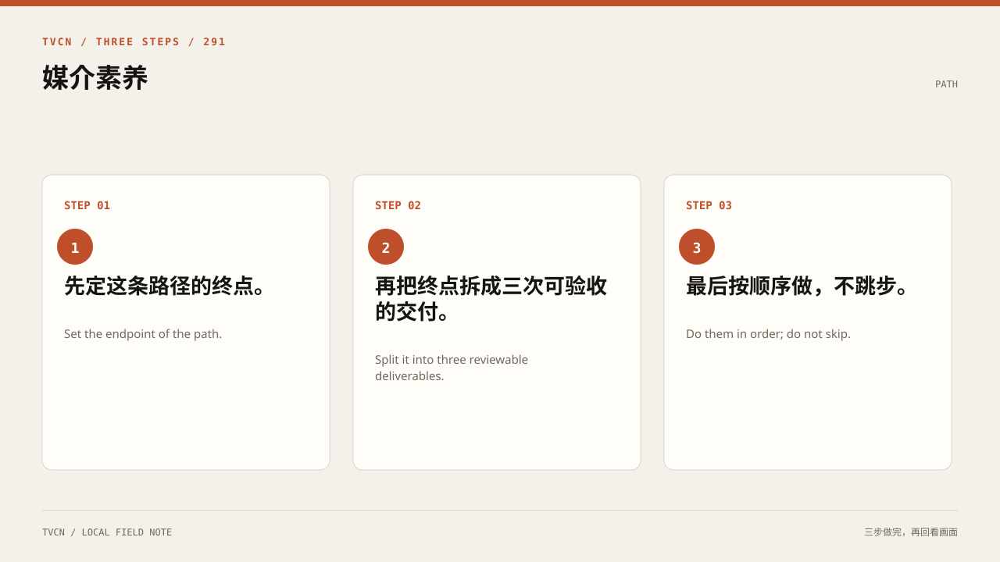

<!-- DIAGRAM_START -->
<h2>图解</h2>
<figure>
  
  <figcaption>把三步按顺序做完，再回看画面或文件。</figcaption>
</figure>
<!-- DIAGRAM_END -->
<h2>先修要求</h2>
准备三条最近刷到的视频：一条让你生气、一条让你感动、一条你觉得“肯定是假的”。先不要查证，只写下你第一反应。
<h2>这条路怎么走</h2>
媒介素养不是“什么都别信”，是有一套可重复的顺序。顺序不能跳：先来源，再剪辑，再语境，再钱和权利。
<ol><li><strong>第 1 步：来源</strong>：不要从转发链开始，从最早版本开始。看账号历史、首发时间、多平台版本、画面地理。四个里至少找到两个证据，再判断“这是谁”。找不到首发，就写“来源未知”，不要补脑。 <em>产出：一张来源表：账号、时间、首发链接。</em></li><li><strong>第 2 步：剪辑</strong>：情绪最强的地方，通常也是剪切最密的地方。找动作接、声音接、反应镜头：两个镜头之间省略了哪一步？把顺序调换，看看结论是否还成立。 <em>产出：三个剪切点 + 三个“删掉了什么”。</em></li><li><strong>第 3 步：语境</strong>：断章取义常见三种：掐头、去尾、换语境。回到原片，补上前一句和后一句；再看标题、封面、配乐是否改变了意思。语境不是背景，它决定这句话是陈述、玩笑还是反讽。 <em>产出：一段原片上下文；一张“标题/配乐改了什麼”表。</em></li><li><strong>第 4 步：钱</strong>：看广告标识、赞助、带货链接、付费推广、账号主体。没有明确广告标识，不代表没有商业关系。钱不一定让内容假，但能解释它为什么现在出现、为什么用这个说法。 <em>产出：一张“钱的关系”图。</em></li><li><strong>第 5 步：AI 痕迹</strong>：痕迹只能说明工具有问题，不能单独证明事实真假。五个检查点都记录，再结合来源。生成视频也可能被用来讲真事，实拍视频也可能被剪成假话。 <em>产出：五格检查表。</em></li><li><strong>第 6 步：图表</strong>：纵轴从零开始吗？样本是谁？时间范围挑了哪段？分母是什么？相关不等于因果。图表最常骗人的地方不是数字，是“没画出来的那部分”。 <em>产出：四条图表检查笔记。</em></li><li><strong>第 7 步：权利</strong>：“能下载”不等于“能商用”。音乐、字体、素材、肖像、场地，五项缺一项都可能下架。自己做内容时，把授权文件放进项目文件夹；看别人的内容时，先问“这条片有没有权利问题”。 <em>产出：一张五项授权清单。</em></li></ol><h2>三个练习</h2><ol><li><strong>练习 1：一条视频的来源表</strong>：找首发、账号历史、多平台版本、画面地理；找不到就写未知。 <em>产出：一张来源表。</em></li><li><strong>练习 2：把顺序倒过来</strong>：找一条因果视频，把两个镜头调换，看结论是否还成立。 <em>产出：一段 200 字分析。</em></li><li><strong>练习 3：五项授权清单</strong>：给自己的下一条片列音乐、字体、素材、肖像、场地五项。 <em>产出：一张可执行的清单。</em></li></ol><h2>交付物</h2><ul><li>一张来源表</li><li>三个剪切点分析</li><li>一段原片上下文</li><li>一张钱关系图</li><li>五格 AI 检查表</li><li>四条图表检查</li><li>一张五项授权清单</li></ul><h2>常见走偏</h2><ul><li>把“有 AI 痕迹”直接当成假：痕迹只能说明工具有问题，不能单独证明事实。</li><li>只看一个来源就下结论：至少两个独立来源，或者明确写未知。</li><li>把“能下载”当成“能商用”：授权是五项，不是一张图。</li></ul><h2>下一步</h2>
走完这条路径，下一步去 path-history 补技术从哪来；或者去 context 分站读平台规则、版权和伦理。

<h2>验收</h2><ul><li>先找首发，再评论。</li><li>能说出剪辑删掉了哪一步。</li><li>至少补回一处被截断的语境。</li><li>能指出一个受益方，或明确写未发现。</li><li>不把 AI 痕迹单独当成真假结论。</li><li>图表检查至少找到一处省略。</li><li>五项授权都写有/无/未知。</li></ul>
