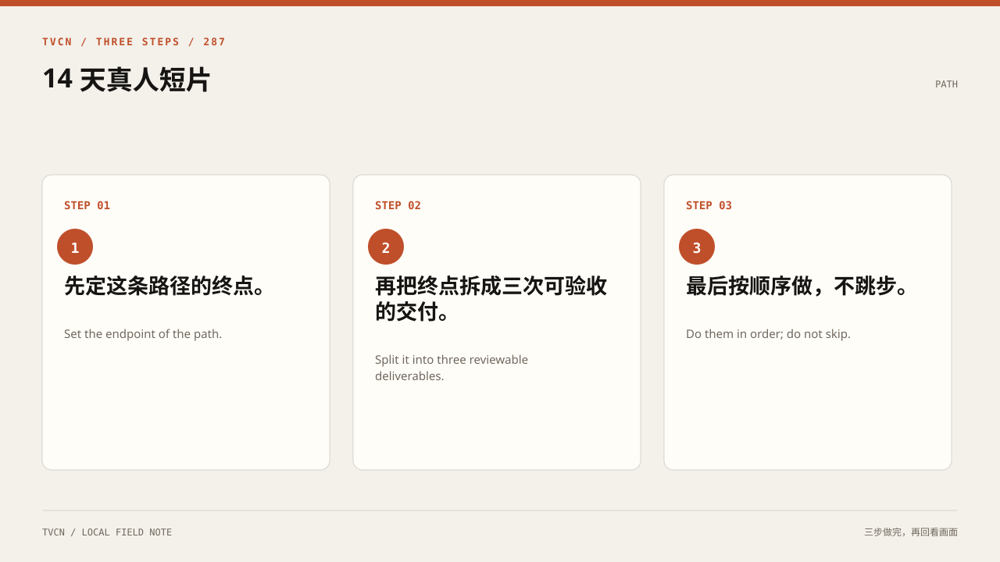

十四天真人短片不是把七天拉长，而是把前期、拍摄、后期各留出一次返工。

<!-- DIAGRAM_START -->
<h2>图解</h2>
<figure>
  
  <figcaption>把三步按顺序做完，再回看画面或文件。</figcaption>
</figure>
<!-- DIAGRAM_END -->
<h2>现场</h2>

14 天分成 3、6、5：3 天写和找人和场地，6 天拍，5 天剪、调、混；第 7 天留半天做备份和补拍。

<h2>怎么做</h2>

十四天真人短片不是把七天拉长，而是把前期、拍摄、后期各留出一次返工。
<ol><li>14 天分成 3、6、5：3 天写和找人和场地，6 天拍，5 天剪、调、混。</li><li>第 7 天留半天做备份和补拍。</li><li>每个阶段结束交一个可看的文件，不交口头进度。</li></ol>
<h2>别踩</h2>

别把 14 天排成 7 天的两倍工作量；多出来的天是给返工的。

<h2>验收</h2>
<ul><li>14 天明确分成 3、6、5 三段，日期能对上。</li><li>第 7 天有半天备份和补拍，不是满拍。</li><li>每个阶段结束都有一个可播放文件作为交付。</li></ul>
