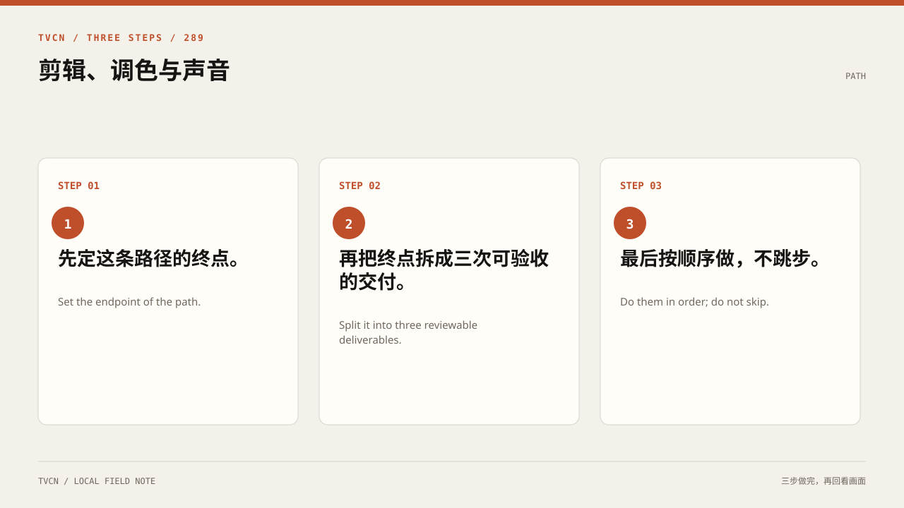

后期路径按素材、结构、声音、颜色、交付五道门走，任何一道没锁，都不要进下一道。

<!-- DIAGRAM_START -->
<h2>图解</h2>
<figure>
  
  <figcaption>把三步按顺序做完，再回看画面或文件。</figcaption>
</figure>
<!-- DIAGRAM_END -->
<h2>现场</h2>

五道门：素材整理、粗剪、细剪、声音、颜色与交付；每道门留一次回看。

<h2>怎么做</h2>

后期路径按素材、结构、声音、颜色、交付五道门走，任何一道没锁，都不要进下一道。
<ol><li>第一道门：素材整理、备份、代理。</li><li>第二、三道：粗剪定结构，细剪定节奏。</li><li>第四、五道：声音、颜色与交付，每道留一次回看。</li></ol>
<h2>别踩</h2>

别在粗剪没定时调色；结构一改，颜色全白做。

<h2>验收</h2>
<ul><li>五道门各有明确的通过条件，写在项目文档里。</li><li>粗剪结构锁定后才进细剪和声音。</li><li>每道门有一次回看记录，问题没有带到下一道。</li></ul>
