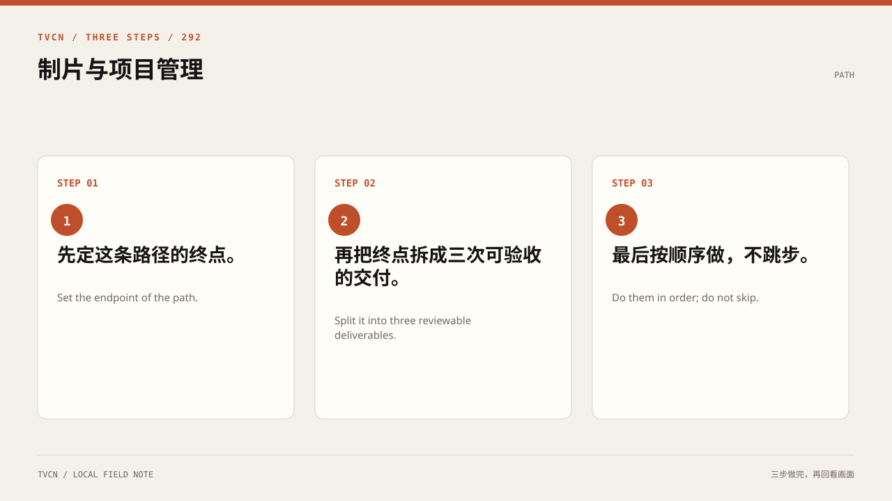

制片不是订盒饭，是把范围、钱、人、时间四件事锁在同一张表上。

<!-- DIAGRAM_START -->
<h2>图解</h2>
<figure>
  
  <figcaption>把三步按顺序做完，再回看画面或文件。</figcaption>
</figure>
<!-- DIAGRAM_END -->
<h2>现场</h2>

一张表四列：范围、钱、人、时间；每周对一次，变更写进变更单。

<h2>怎么做</h2>

制片不是订盒饭，是把范围、钱、人、时间四件事锁在同一张表上。
<ol><li>建一张表四列：范围、钱、人、时间。</li><li>每周对一次，任何变更写进变更单。</li><li>范围一扩，钱或时间必须同时改，不接受免费加量。</li></ol>
<h2>别踩</h2>

别用“先做再说”扩范围；钱和时间没改，最后一定烂尾。

<h2>验收</h2>
<ul><li>范围、钱、人、时间四列在同一张表上，能互相对照。</li><li>每周有对表记录，变更都进了变更单。</li><li>最近一次范围扩大同时调整了钱或时间。</li></ul>

<!-- DEEP_DIVE_START -->
## 深读

<strong>约 7 分钟。</strong> 制片不是管人，是让钱、时间、人、许可四件事在同一张表上。

### 预算四块

前期、拍摄、后期、备用金；四块各自有上限，不要互相拆借。备用金至少百分之十，放在拍摄前，不要放在最后。涉及演员、场地、音乐、字体的授权，单独列一行。

预算表要能回答“如果少一天，砍哪一块”；答不出，说明预算只是数字，不是决策工具。

### 排期与通告

把剧本拆成条：场景、页数、人物、道具、机位；同场景同一天拍，先拍难的光线和孩子。每天留一个“补拍窗口”，不要排满。

通告单写清时间、地址、联系人、停车、吃饭、最近医院；前一天发，不要当天早上发。每个人要知道自己几点到、来做什么。

### 风险、许可与交付

开机前做一页风险评估：谁可能受伤、什么会掉、谁负责、最近医院在哪；全组读一遍。公共场所、商铺、地铁、公园，先问许可，不要拍了再补。

交付前定一个唯一母版，写清分辨率、码率、字幕、响度、文件命名；备份三份，一份异地。制片收尾不是杀青，是文件和授权都能被下一个人找到。

### 五分钟练习：一页制片表

拿一个小项目，写一页：预算四块、拍摄两天、五个场景、三个人名、三项许可、一个交付规格。每行都要有负责人和日期。

把这张表给一个没参加项目的人看，问他“如果明天下雨，先改哪一行”。他答得出，说明表能用；答不出，回去补优先级。

### 制片，十项检查
<ul><li>预算分四块</li><li>备用金至少百分之十</li><li>授权单独列一行</li><li>预算能回答先砍哪块</li><li>剧本拆成条</li><li>同场景同一天拍</li><li>每天留补拍窗口</li><li>通告单提前一天发</li><li>风险评估全组读一遍</li><li>交付有唯一母版和三份备份</li></ul>
制片不是让所有人听你，是让所有人在同一天知道钱在哪、时间在哪、下一步谁做。

<!-- DEEP_DIVE_END -->
