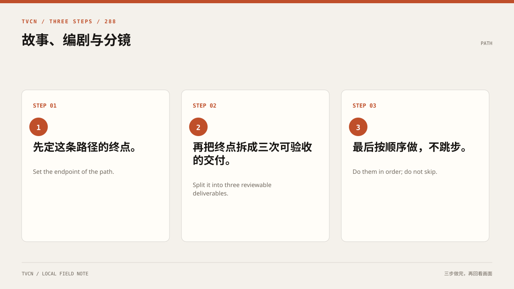

先准备三样东西：一个你想拍的具体地点、一个你能找到的人、一个你见过的真实动作。不要从“主题”开始，从一个人想要什么开始。

<!-- DIAGRAM_START -->
<h2>图解</h2>
<figure>
  
  <figcaption>看“一句话：谁想要什么 ：每句不超过 4…”和“欲望与赌注：输了会失去什么 ：想要必…”两处，判断症状能不能被复述成一句可观察的话。</figcaption>
</figure>
<!-- DIAGRAM_END -->
<section><h2 id="section-1">先修要求</h2></section><section><h2 id="section-2">这条路怎么走</h2>
这条路径只做六步：一句话、欲望与赌注、三场戏、8–12 个镜头、读稿、改写。每一步都要落到纸上，不能只在脑子里。
<ol><li><strong>一句话：谁想要什么</strong>：每句不超过 40 字，必须有一个具体动作和一个具体障碍。不要写“一个人很孤独”，写“一个夜班保安想让人看见他，但监控只拍到他打瞌睡”。圈那句你立刻能想到三个镜头的。 <em>产出：一句 logline；3 个能拍的画面。</em></li><li><strong>欲望与赌注：输了会失去什么</strong>：想要必须是具体的：拿到一份工作、留住一个房间、让一个人回头。失去必须是可见的：钱、住处、关系、尊严。愿意付出必须是动作：撒谎、借钱、辞职、走十公里。三列不能互相替代。 <em>产出：一张三列人物表。</em></li><li><strong>三场戏：每场一个变化</strong>：第一场让人物提出目标，第二场让同一目标遇到更大的阻碍，第三场让他换方法。每场结尾必须和开头不同：关系变了、信息变了、决定变了。删掉只负责解释背景的场。 <em>产出：三场戏，每场一页以内。</em></li><li><strong>8–12 个镜头：把戏拆开</strong>：先写“观众必须看见什么”，再决定景别。每个镜头只保留一个主要动作；一场戏至少要有一个全景、一个近景、一个插入。镜头表写清镜号、景别、动作、台词、时长。 <em>产出：8–12 个镜头的表；每场一张机位图。</em></li><li><strong>读稿：只记三个问题</strong>：读稿时不要解释，不要替演员辩护。让读者用铅笔标三处：哪里听不懂、哪里想走神、哪里不相信。读完后只问这三个问题，不要问“好不好”。 <em>产出：三处标注；一页修改清单。</em></li><li><strong>改写：先删解释，再补动作</strong>：把“因为……所以……”的句子删掉，换成人物做了什么。把“他很生气”换成“他把杯子放回桌上，杯底磕了一声”。改完再读一遍，确认每场变化还在。 <em>产出：一版改写稿；3 处删改标记。</em></li></ol></section><section><h2 id="section-3">三个练习</h2><ol><li><strong>练习 1：十个开头</strong>：给同一个故事写 10 个第一句，必须都是人物正在做的事。 <em>产出：选 1 个开头。</em></li><li><strong>练习 2：三场戏一张纸</strong>：每场只写目标、阻碍、转折、结束状态，一行一个。 <em>产出：一张能拍的三场戏表。</em></li><li><strong>练习 3：读稿后改三处</strong>：找两个人读，只改他们标出的前三处，不改别的地方。 <em>产出：一版 v2。</em></li></ol></section><section><h2 id="section-4">交付物</h2><ul><li>一句 logline</li><li>一张欲望/失去/付出表</li><li>三场戏，每场一页</li><li>8–12 个镜头表</li><li>一次读稿记录</li><li>一版改写稿</li></ul></section><section><h2 id="section-5">常见走偏</h2><ul><li>从“主题”开始：先写“我想讲孤独”，会写出解释；先写“他想要什么”，才会写出动作。</li><li>一场戏塞两个变化：观众来不及消化，剪辑也接不上。</li><li>分镜画成美术稿：镜头表是执行文件，不是插画；景别、动作、时长写清才有用。</li></ul></section><section><h2 id="section-6">下一步</h2>
走完这条路径，下一步去 path-live-film 把剧本变成 14 天可执行的拍摄；或者去 path-post 学怎么让三场戏在剪辑里成立。
</section>
<h2>验收</h2><ul><li>一句话能复述，且结尾是动作。</li><li>三场戏每场都有变化，删一场故事就不成立。</li><li>每个镜头只有一个主要动作。</li><li>读稿至少找到 3 处需要解释的地方。</li><li>改写后解释变少、动作变多。</li><li>8–12 个镜头能按现有条件拍完。</li></ul>

<!-- SOURCES_START -->
## 经验说明

经验说明：本页来自 6 次客户需求梳理与项目复盘，条件为单人或 2–3 人小组、预算与周期明确；页面讨论的具体对象是「故事、编剧与分镜」；不含外部实验室测试，条件变化时结论可能失效。
<!-- SOURCES_END -->

