<!-- DIAGRAM_START -->
## 图解

<figure>
  
  <figcaption>每天只做一件：定题、分镜、备机、拍完、补镜、粗剪、发布。第七天必须交片。</figcaption>
</figure>
<!-- DIAGRAM_END -->
<h2>先修要求</h2>
先确认三件事：你有手机或一台能拍 1080p 的相机；有一个能固定机器的东西；这 7 天每天能拿出 1–2 小时。不需要先学剪辑理论，也不需要买灯。
<h2>这条路怎么走</h2>
顺序不要跳。前三天都在纸上和现场准备，第 4–5 天才开机；第 6 天必须停下来剪，第 7 天只做交付和复盘。
<ol><li><strong>第 1 天：定题</strong>：写 10 句“谁 + 想要什么 + 被什么挡住”，每句不超过 40 字。圈出那句你能在现有条件下拍到具体动作的，不要选需要大场面、儿童或动物的。把落选 9 句留在纸上，后面改题时用。 <em>产出：一句能复述的 logline；一个能看见的结尾动作。</em></li><li><strong>第 2 天：八格镜头表</strong>：一张纸画 8 格，每格只写一个主要动作，景别在远景/全景/中景/近景/特写里选一个。先写“人物做什么”，再补台词；台词超过两句的镜头删掉。8 个镜头总时长控制在 60–90 秒。 <em>产出：一张 8 格镜头表；每格一个动作、一个景别。</em></li><li><strong>第 3 天：场景与最小设备</strong>：只选一个能控制的地点：自己家、朋友家、安静的咖啡馆角落。先找窗光，再决定机位；机器固定，不要手持。手机打开网格、锁定曝光和对焦、擦镜头。录 30 秒测试，戴耳机听。 <em>产出：一张机位图；一段可用的 30 秒测试素材。</em></li><li><strong>第 4–5 天：拍完</strong>：先拍保底条：构图、曝光、声音都合格。第二条只改一个变量：演员走位、镜头高度或光的方向。第三条再冒险。每条开机前报“第几场第几个镜头第几条”，场记单上打勾。拍完当天备份一次。 <em>产出：每个镜头 3 条素材；一张能对上号的场记单；一份备份。</em></li><li><strong>第 6 天：粗剪与声音</strong>：先按 8 格顺序拼，删掉每个镜头里多余的 1–2 秒。找一个不认识故事的人看一遍，问他“谁想要什么、最后发生了什么”。如果他答不出，回到开头补一个动作，不要加旁白解释。对白听不清就重录或补录，不要用音乐盖。 <em>产出：一条 60–90 秒的粗剪；一份问题清单。</em></li><li><strong>第 7 天：字幕、导出与复盘</strong>：字幕一行不超过 16 个汉字，按说话节奏断句；人名、数字、专业词逐条核对。导出 1080p、H.264、音频 48 kHz，文件名用“日期_片名_v1”。在本机和手机各播一遍，确认没有黑帧、断音和错字幕。 <em>产出：一条可播放的 1080p 文件；3 条复盘；下一步计划。</em></li></ol><h2>三个练习</h2><ol><li><strong>练习 1：10 句 logline</strong>：限时 20 分钟写 10 句，每句必须有一个能拍到的动作。圈出 1 句，其余 9 句留着改题。 <em>产出：10 句里选 1 句。</em></li><li><strong>练习 2：8 格镜头表</strong>：用一张 A4 纸画 8 格，每格写景别、动作、台词、时长；总时长写到 60–90 秒。 <em>产出：一张能直接拍的镜头表。</em></li><li><strong>练习 3：一分钟粗剪</strong>：把现有素材剪成 60 秒，只保留能推动故事的镜头；不加音乐，先让对白站住。 <em>产出：一条 60 秒 v1。</em></li></ol><h2>交付物</h2><ul><li>一句 logline</li><li>一张 8 格镜头表</li><li>每个镜头 3 条素材和场记单</li><li>一条 60–90 秒粗剪</li><li>一条 1080p 成片和 3 条复盘</li></ul><h2>常见走偏</h2><ul><li>拍到第 5 天才发现剧本要改：第 1 天定下的题，后面只做小修，不重写。</li><li>为了第一条片买设备：手机、窗光、一个固定点足够；买设备会把 7 天变成 7 周。</li><li>选三个以上地点：移动、布光、收音都会翻倍，第一条片只选一个能控制的地点。</li></ul><h2>下一步</h2>
走完这条路径，下一步去 path-story 把“一句话”练成三场戏；或者去 path-post 把粗剪、声音和交付各补一层。

<h2>验收</h2><ul><li>陌生人看一遍能说出谁想要什么、最后发生了什么。</li><li>每个镜头都有一个能看见的动作，不靠旁白解释。</li><li>每条对白不看字幕也能听清。</li><li>成片 60–90 秒，1080p，能在手机播放。</li><li>字幕没有错字，一行不超过 16 个汉字。</li><li>复盘写了 3 条，其中至少 1 条是下一次的具体改动。</li></ul>
