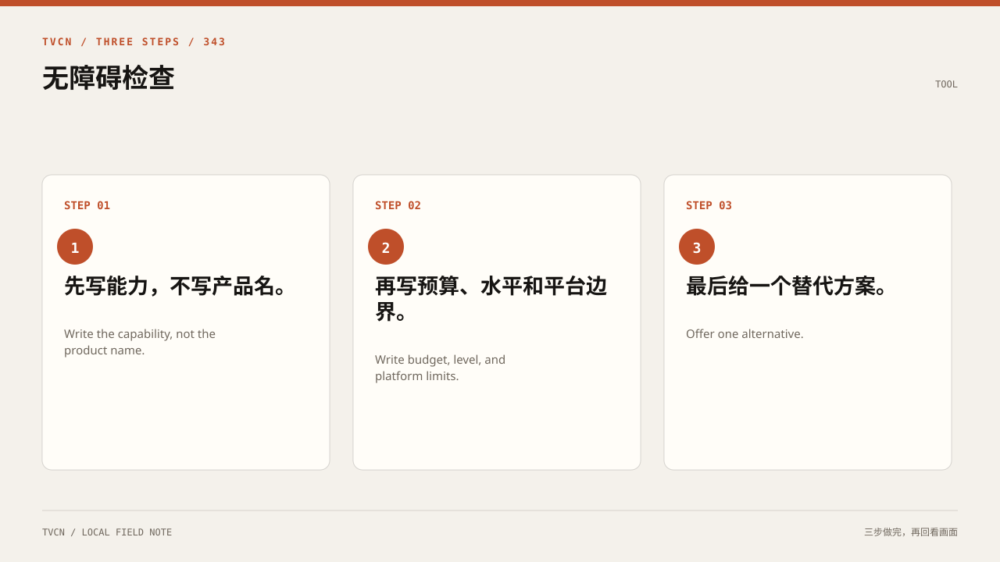

无障碍检查：字幕、对比度、口述影像、音量、闪烁；交付前逐项过。

<!-- DIAGRAM_START -->
<h2>图解</h2>
<figure>
  
  <figcaption>把三步按顺序做完，再回看画面或文件。</figcaption>
</figure>
<!-- DIAGRAM_END -->
<h2>现场</h2>

字幕、对比度、口述影像、音量、闪烁；交付前逐项过。

<h2>怎么做</h2>

无障碍检查：字幕、对比度、口述影像、音量、闪烁；交付前逐项过。
<ol><li>字幕查说话人、音效、语速。</li><li>查文字对比度、口述影像、整体音量。</li><li>查闪烁频率，交付前逐项打勾。</li></ol>
<h2>别踩</h2>

别只查字幕；对比度和闪烁不过，画面本身就不能看。

<h2>验收</h2>
<ul><li>字幕有说话人和关键音效，语速合规。</li><li>文字对比度、口述影像、音量三项都过。</li><li>闪烁频率合规，交付前五项全部打勾。</li></ul>
