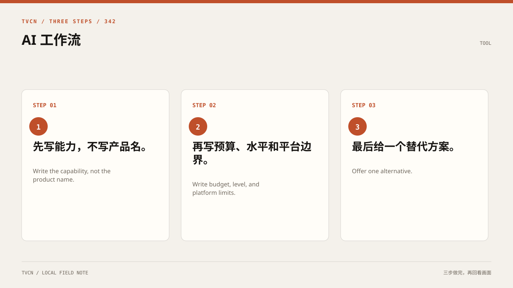

AI 工作流不是“写一句提示词就出片”。先锁剧本、人物设定、镜头清单、授权范围和交付规格，再决定哪几个镜头交给生成。

<!-- DIAGRAM_START -->
<h2>图解</h2>
<figure>
  
  <figcaption>看“最低档： 一个可用的生成模型、一组人…”和“工作档： 角色设定表、镜头提示模板、…”两处，判断症状能不能被复述成一句可观察的话。</figcaption>
</figure>
<!-- DIAGRAM_END -->
<section><h2 id="section-1">先锁住不能变的东西</h2>

<ul><li><strong>最低档：</strong>一个可用的生成模型、一组人物参考图、一个放大/修复工具、剪辑软件和一份授权记录。</li><li><strong>工作档：</strong>角色设定表、镜头提示模板、生成素材编号、合成与调色、人工检查清单。</li><li><strong>保险档：</strong>本地备份、模型/版本记录、可替换的实拍方案；生成失败时项目还能继续。</li></ul>
<h2 id="section-2">只用在可控位置</h2>

先用在空镜、背景、概念图和补插镜头；不要一上来就生成主角正脸和长对白。人手、文字、快速运动、镜面反射和复杂遮挡仍是高风险区。

<h2 id="section-3">三条验收</h2>
<ol><li>同一角色在三个角度下，脸型、发型、服装和光线方向一致。</li><li>连续 5 秒运动中没有明显形变、闪烁或肢体粘连。</li><li>输出文件、模型版本、提示词和授权来源都能在项目记录里找到。</li></ol>
<h2 id="section-4">什么时候不要用</h2>

新闻、纪录片、证词、真实人物代言和需要明确作者署名的项目，不要用生成画面冒充现场。没有授权链的素材，不进交付。
</section><section><h2 id="section-5">现场</h2>
脚本、参考图、生成工具、放大、合成、标注；每一步保留可回退版本。
</section><section><h2 id="section-6">别踩</h2>
别在生成里反复抽卡；没有脚本和参考，抽到也不能用。
</section>
<h2>验收</h2><ul><li>脚本和参考图在第一次生成前就存在。</li><li>生成、放大、合成三步各有版本号，可回退。</li><li>交付版本带 AI 标注，能指出版本链。</li></ul>
