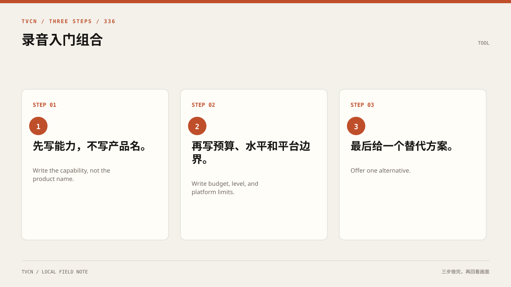

枪麦负责主对白，领夹做备份，录音机负责把两路分开录，监听耳机负责当场发现底噪。四件里少一件，现场就会靠猜。

<!-- DIAGRAM_START -->
<h2>图解</h2>
<figure>
  
  <figcaption>看“最低档： 枪麦直接进机身，领夹用手机…”和“工作档： 枪麦进 4 通道录音机，领…”两处，判断症状能不能被复述成一句可观察的话。</figcaption>
</figure>
<!-- DIAGRAM_END -->
<section><h2 id="section-1">一条能独立的信号链</h2>

<ul><li><strong>最低档：</strong>枪麦直接进机身，领夹用手机或第二台机器备份；只适合安静室内与单人。</li><li><strong>工作档：</strong>枪麦进 4 通道录音机，领夹单独占一轨，耳机实时监听；双人访谈和室外都够用。</li><li><strong>保险档：</strong>再加一支领夹、一台备用录音机和时间码；商单现场坏一条链，另一条还能交。</li></ul>
<h2 id="section-2">电平与备份</h2>

对白峰值留在 -12 到 -6 dBFS，别把 32-bit 浮点当保险。32-bit 能救爆点，救不了没戴麦、没按录制和风灌进咪头的对白。每个机位至少留一条独立音轨。

<h2 id="section-3">30 秒验收</h2>
<ol><li>让一个人正常说话，枪麦和领夹同时录；两条都能单独听懂。</li><li>录 30 秒安静房间，把增益推到你实际拍摄的位置，听底噪是否可接受。</li><li>在室外有风处录 10 秒，确认防风罩和背风位置有效，辅音没有被吞。</li></ol>
<h2 id="section-4">别用后期降噪掩盖</h2>

降噪只能去掉稳定底噪，去不掉风噪、衣服摩擦和房间反射。现场换位置、换麦距、加挡风，永远比后期便宜。
</section><section><h2 id="section-5">现场</h2>
枪麦、领夹、录音机、监听耳机；先录一条 30 秒对白，确认底噪。
</section><section><h2 id="section-6">别踩</h2>
别只带枪麦；室内对白没有领夹备份，风一吹就废。
</section>
<h2>验收</h2><ul><li>枪麦和领夹同时录，两条都能独立用。</li><li>30 秒对白测试里能听出底噪水平。</li><li>录音时有人戴监听耳机，不只看表。</li></ul>

<!-- SOURCES_START -->
## 经验说明

经验说明：本页来自 6 次客户需求梳理与项目复盘，条件为单人或 2–3 人小组、预算与周期明确；页面讨论的具体对象是「录音入门组合」；不含外部实验室测试，条件变化时结论可能失效。
<!-- SOURCES_END -->

