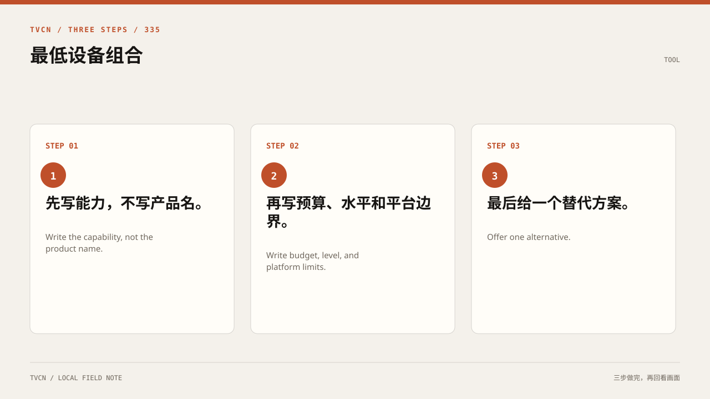

最低设备组合：能拍的机身、一支标准变焦、一个能固定的三脚架、一支能收音的麦。

<!-- DIAGRAM_START -->
<h2>图解</h2>
<figure>
  
  <figcaption>把三步按顺序做完，再回看画面或文件。</figcaption>
</figure>
<!-- DIAGRAM_END -->
<h2>现场</h2>

机身、标准变焦、三脚架、领夹麦；总预算先留 20% 买存储和电池。

<h2>怎么做</h2>

最低设备组合：能拍的机身、一支标准变焦、一个能固定的三脚架、一支能收音的麦。
<ol><li>先列能力：能开机、能变焦、能稳住、能收清对白。</li><li>总预算先留 20% 买存储和电池。</li><li>缺一件时写替代方案，比如手机加领夹麦。</li></ol>
<h2>别踩</h2>

别先选机身型号；先写它要完成哪四件事。

<h2>验收</h2>
<ul><li>四件设备各对应一项能力，能说出来。</li><li>预算里存储和电池占约 20%，没有被机身吃光。</li><li>每件缺失都有可执行的替代方案。</li></ul>
