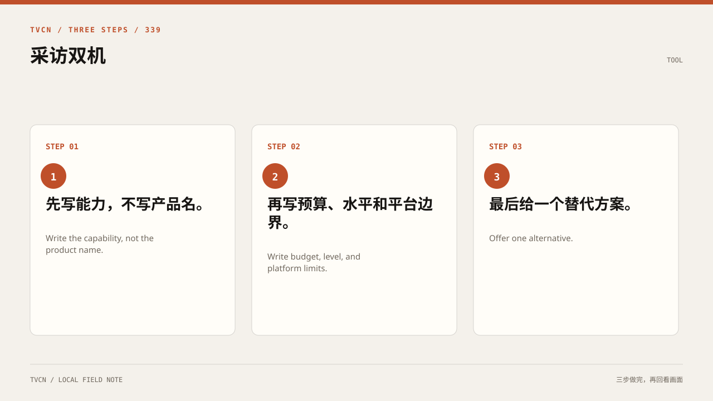

一台广角保全身和手，一台中近景保表情；两台用同一段声音，剪辑才有选择。两台完全相同的机位，只会给你两份一样的素材。

<!-- DIAGRAM_START -->
<h2>图解</h2>
<figure>
  
  <figcaption>看“最低档： 一台主机拍中景，一台备机拍…”和“工作档： 两台可手动曝光机身、两支定…”两处，判断症状能不能被复述成一句可观察的话。</figcaption>
</figure>
<!-- DIAGRAM_END -->
<section><h2 id="section-1">两台机不是两台同样的机</h2>

<ul><li><strong>最低档：</strong>一台主机拍中景，一台备机拍广角；领夹进主机，备机用机头麦只做参考。</li><li><strong>工作档：</strong>两台可手动曝光机身、两支定焦、两支领夹加枪麦、两盏灯、同步时间码或拍手同步。</li><li><strong>保险档：</strong>独立录音机、第三支领夹、备用电池和一张备用卡；主机故障时访谈不中断。</li></ul>
<h2 id="section-2">开拍前 10 分钟</h2>
<ol><li>让受访者正常说一段，确认两条机位都合焦、两路声音都不爆。</li><li>拍手或打时间码，现场回放一次同步。</li><li>拍一张空镜和一张带手部的构图，确认字幕安全区。</li></ol>
<h2 id="section-3">不要做的事</h2>

不要用两台不同品牌的机器还指望后期一键匹配；不要只给受访者戴一支领夹；不要在访谈中途换电池而不停机。访谈的价值在连续性，不在机位数量。
</section><section><h2 id="section-4">现场</h2>
A 机中景、B 机近景、枪麦、备用领夹；先拍双机位测试，确认同步。
</section><section><h2 id="section-5">别踩</h2>
别让两台机位拍同一个景别；剪的时候没有选择。
</section>
<h2>验收</h2><ul><li>A 机中景、B 机近景，景别明显不同。</li><li>枪麦和领夹各录一条，能独立使用。</li><li>双机测试里同步对齐，构图不重复。</li></ul>
