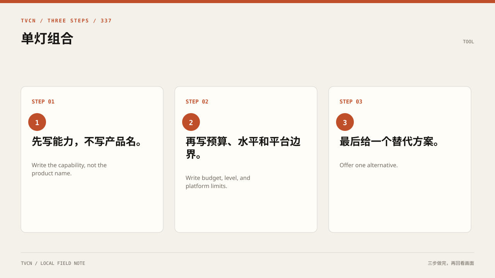

单灯组合：一盏 COB、一个柔光箱、一块反光板、两个沙袋；先有一个方向。

<!-- DIAGRAM_START -->
<h2>图解</h2>
<figure>
  
  <figcaption>把三步按顺序做完，再回看画面或文件。</figcaption>
</figure>
<!-- DIAGRAM_END -->
<h2>现场</h2>

一盏 COB、90 厘米柔光箱、反光板、两个沙袋；先拍半身，再补第二盏。

<h2>怎么做</h2>

单灯组合：一盏 COB、一个柔光箱、一块反光板、两个沙袋；先有一个方向。
<ol><li>一盏 COB 配 90 厘米柔光箱，先拍半身。</li><li>反光板补暗部，不要急着上第二盏。</li><li>两个沙袋压住灯架，室内也要压。</li></ol>
<h2>别踩</h2>

别先买第二盏灯；第一盏的方向没定，第二盏只会打架。

<h2>验收</h2>
<ul><li>一盏灯加柔光箱能拍出可用的半身光。</li><li>暗部先用反光板补，没有直接上第二盏。</li><li>灯架有两个沙袋，推一下不晃。</li></ul>
