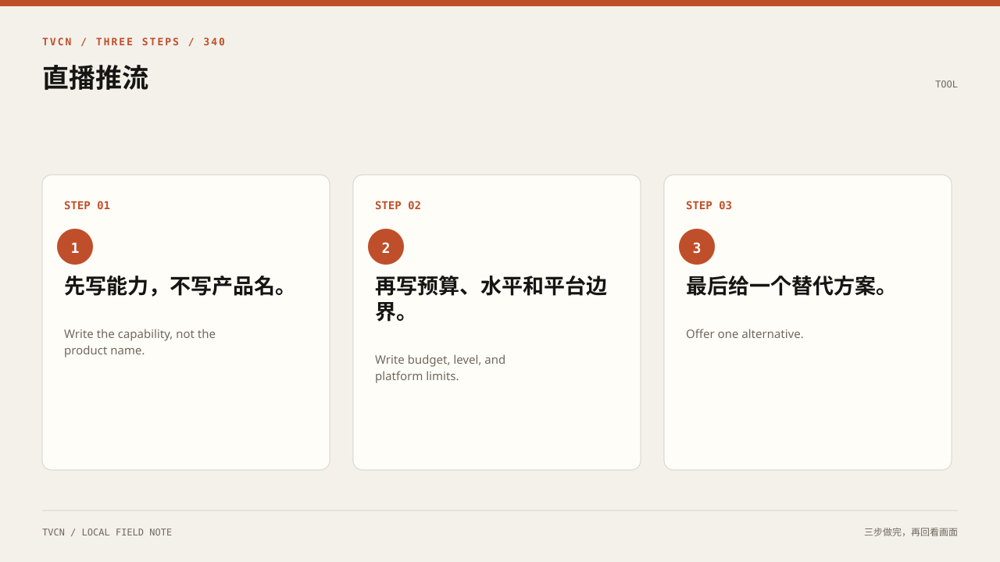

直播推流：相机、采集卡、有线网络、备用热点、本地录制；先保不中断。

<!-- DIAGRAM_START -->
<h2>图解</h2>
<figure>
  
  <figcaption>把三步按顺序做完，再回看画面或文件。</figcaption>
</figure>
<!-- DIAGRAM_END -->
<h2>现场</h2>

相机、采集卡、有线网络、备用热点、本地录制；断网一次演练。

<h2>怎么做</h2>

直播推流：相机、采集卡、有线网络、备用热点、本地录制；先保不中断。
<ol><li>相机进采集卡，有线网络推流。</li><li>备用热点提前测速，本地同时录一份。</li><li>断网一次演练，记录切换用了多少秒。</li></ol>
<h2>别踩</h2>

别只靠现场 Wi-Fi；断一次，整场直播就没了。

<h2>验收</h2>
<ul><li>有线网络推流，备用热点已测速。</li><li>本地同时录制一份完整文件。</li><li>断网演练记录切换秒数，能在 10 秒内恢复。</li></ul>
