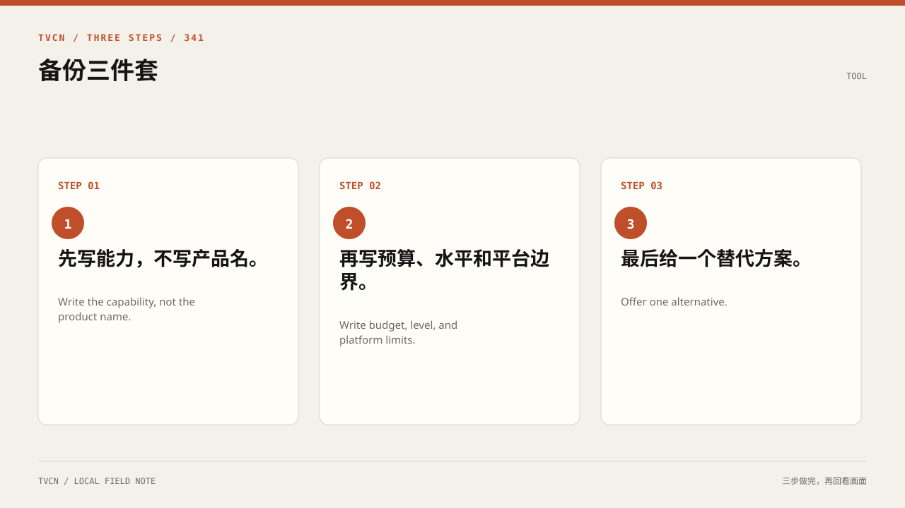

三份副本、两种介质、一份离开现场。RAID 不是备份，同步盘也不是备份；删除会同步删除，勒索软件也会同步加密。

<!-- DIAGRAM_START -->
<h2>图解</h2>
<figure>
  
  <figcaption>看“最低档： 工作 SSD 一份、现场移…”和“工作档： SSD 工作盘、NAS 或…”两处，判断症状能不能被复述成一句可观察的话。</figcaption>
</figure>
<!-- DIAGRAM_END -->
<section><h2 id="section-1">3-2-1 是底线，不是口号</h2>

<ul><li><strong>最低档：</strong>工作 SSD 一份、现场移动硬盘一份、收工后带回另一块硬盘或云盘一份。</li><li><strong>工作档：</strong>SSD 工作盘、NAS 或双盘备份、离线硬盘；关键项目加 LTO 或云冷备。</li><li><strong>团队档：</strong>校验和、版本命名、恢复日志、介质轮换；任何人能在一个月后找到并打开原素材。</li></ul>
<h2 id="section-2">拷完必须做的三件事</h2>
<ol><li>按项目/日期/机位命名，不把“新建文件夹”带进后期。</li><li>生成校验和或至少比对文件数量与总大小；不要只看进度条。</li><li>随机抽一个文件，从备份介质打开并播放 10 秒。</li></ol>
<h2 id="section-3">恢复演练</h2>

每月随机抽一个项目，从备份恢复到一台空机器，记录耗时和失败点。没有恢复演练的备份，只是心理安慰。
</section><section><h2 id="section-4">现场</h2>
读卡器、SSD、机械硬盘；当天拷、校验、异地；卡格式化前确认三份。
</section><section><h2 id="section-5">别踩</h2>
别在只拷了一份时格式化卡；那一刻没有备份。
</section>
<h2>验收</h2><ul><li>SSD 和机械硬盘各有一份，文件数一致。</li><li>当天完成校验，有记录。</li><li>卡格式化前确认三份，其中一份异地。</li></ul>

<!-- SOURCES_START -->
## 经验说明

经验说明：本页来自 3 次客户需求梳理与项目复盘，条件为单人或 2–3 人小组、预算与周期明确；页面讨论的具体对象是「备份三件套」；不含外部实验室测试，条件变化时结论可能失效。
<!-- SOURCES_END -->

