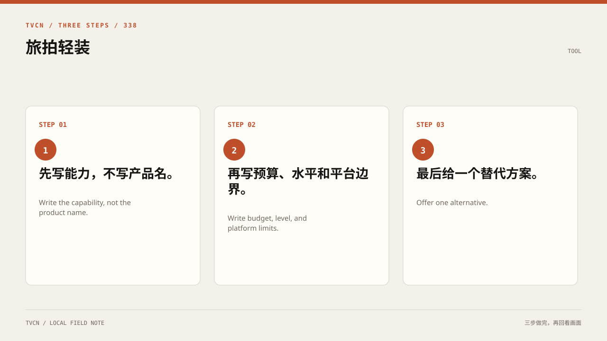

旅拍的第一限制是背包和步行，不是镜头数量。机身加两支镜头加录音加脚架，超过你走一小时还能举起的重量，就会开始漏拍。

<!-- DIAGRAM_START -->
<h2>图解</h2>
<figure>
  
  <figcaption>看“轻装： 一台机身、一支 24–70m…”和“完整： 加一支广角或长焦、备用电池、…”两处，判断症状能不能被复述成一句可观察的话。</figcaption>
</figure>
<!-- DIAGRAM_END -->
<section><h2 id="section-1">先算重量，再算焦段</h2>

<ul><li><strong>轻装：</strong>一台机身、一支 24–70mm 等效变焦、一支轻枪麦或领夹、一块 ND、两张卡、一块 SSD。脚架用轻量反折。</li><li><strong>完整：</strong>加一支广角或长焦、备用电池、轻量补光灯；所有配件能塞进一个登机包。</li><li><strong>不要带：</strong>没有拍摄计划的无人机、第三支重复焦段、超过现场能用的灯。</li></ul>
<h2 id="section-2">每天结束的 3 件事</h2>
<ol><li>把当天素材拷到 SSD，再从卡回放一遍，确认不是空文件。</li><li>给电池充电，给卡格式化前先确认备份完成。</li><li>写下第二天的第一个机位和光线时间，不要到现场再想。</li></ol>
<h2 id="section-3">现场测试</h2>

出发前把最终背包背上，走十分钟、爬一层楼，再拍 30 秒。如果肩带勒、脚架晃或录音线找不到，回桌上减东西，不要到目的地再减。
</section><section><h2 id="section-4">现场</h2>
一机一镜、小型稳定器、两块电池、ND、腰包；称总重，能走一天再出门。
</section><section><h2 id="section-5">别踩</h2>
别带三支镜头“以防万一”；走半天就背不动，什么也拍不到。
</section>
<h2>验收</h2><ul><li>总重称过，背着走一天肩膀能承受。</li><li>只有一机一镜，没有额外镜头。</li><li>电池、ND、稳定器都在腰包，能单手取。</li></ul>

<!-- SOURCES_START -->
## 经验说明

经验说明：本页来自 5 次客户需求梳理与项目复盘，条件为单人或 2–3 人小组、预算与周期明确；页面讨论的具体对象是「旅拍轻装」；不含外部实验室测试，条件变化时结论可能失效。
<!-- SOURCES_END -->

