<!-- DIAGRAM_START -->
<h2>Diagram</h2>
<figure>
  
  <figcaption>Diagram: an archive is five retrievable parts, not one zip. Without rights, footage cannot be reused.</figcaption>
</figure>
<!-- DIAGRAM_END -->
<h2>First decision: what is worth archiving</h2>
Three things are worth archiving: reusable shots (brand, person, place), versions that may change (a client may return), and rights that must be proven (releases, likeness, music). One-off, no-reuse, no-rights footage should not take archive space.

Ask what the next person will do with it. If there is no answer, keep the delivery package and project, not every source clip.
<h2>Archive package: five parts, none optional</h2>
Project file, source/proxies, LUTs and fonts, rights and likeness, index and metadata. The project must open offline; source must relink; LUTs and fonts must restore the look; rights must prove use; the index must be searchable.

Name every file with project, date, scene, version. No “final,” “New Folder,” or “copy.” The index lists filename, scene, person, rights, expiry, location.
<h2>Restore test: the pass line for an archive</h2>
After archiving, pick one random shot, open the project on another machine, relink, apply the LUT, and export. If it will not open, relink, or match color, the archive is not done. Restore testing is part of archiving, not optional.

Log the test: date, machine, software version, missing files, fix. Read the last log before the next archive.
<h2>Reuse: rights before creative</h2>
Before reusing, check three things: scope (organic/paid/advertising), term, territory. An organic license does not cover paid media; a one-year license expires; mainland-only footage cannot go to overseas platforms.

Reuse is not cutting the old film into the new one; it is extracting reusable shots, sound, graphics, and templates. Build a reusable-asset index tagged by person, scene, action, and light.
<h2>Failure case: three years archived, all media offline</h2>
A brand project archived only the project and proxies; source stayed on an old drive. Three years later the client wanted a re-cut. The project opened, but every clip was offline, the old drive interface was gone, and proxies were too weak to grade. The only option was a re-shoot.

The fix is not a new drive; it is a restore test at archive time. A project opening does not mean media relinks; media relinking does not mean color restores.
<h2>Cost and acceptance</h2>
Low: one project archive, index, one restore test, ¥1,000–3,000. Mid: multi-project library, LTO/cloud archive, rights ledger, ¥3,000–15,000. High: department MAM, migration, long-term verification, ¥15,000–50,000+.
<h2>Check</h2><ul><li>Reuse value is defined before archiving.</li><li>Five parts present: project/media/LUT/rights/index.</li><li>Project opens offline and media relinks.</li><li>Restore test runs on another machine.</li><li>Reuse checks scope, term, and territory.</li><li>Index tags person, scene, action, and light.</li></ul>

<section><h2>Boundary</h2>
This page only covers “Archive and Asset Reuse: Make the Next Film Faster”; it does not replace Audio Description: Say What Matters, Backup Recovery: Rehearse One Restore, Composition: Tell the Eye Where to Look. When the problem belongs to one of those pages, use that page instead of adding more parameters here.
</section>
<!-- SOURCES_START -->
## References and further reading

- [S70] [FFmpeg: Documentation](https://ffmpeg.org/documentation.html) — Accessed 2026-11-26. Used to check the terminology/method/rule in the “First decision: what is worth archiving” section against FFmpeg codec/muxing documentation, not a delivery spec; it does not verify numbers, model choices or on-set conclusions derived from this page, and is not a substitute for a test.
- [S35] [Avid: Resource Center](https://www.avid.com/resource-center) — Accessed 2026-11-26. Used to check the terminology/method/rule in the “Archive package: five parts, none optional” section against Avid resource center, not an independent review; it does not verify numbers, model choices or on-set conclusions derived from this page, and is not a substitute for a test.
- [S29] [YouTube: Upload Encoding Specs](https://support.google.com/youtube/answer/1722171) — Accessed 2026-11-26. Used to check the terminology/method/rule in the “Restore test: the pass line for an archive” section against YouTube upload encoding recommendations, not creative standards; it does not verify numbers, model choices or on-set conclusions derived from this page, and is not a substitute for a test.
<!-- SOURCES_END -->

