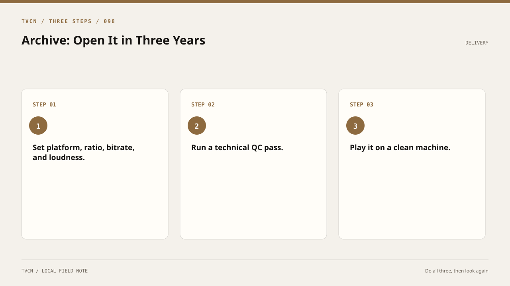

The package includes final project, originals or proxies, fonts, LUTs, music licenses, captions, delivery files and a one-page note. Missing fonts and LUTs means a wall of errors next time.

<!-- DIAGRAM_START -->
<h2>Diagram</h2>
<figure>
  
  <figcaption>Watch “Archive three things: media, project files, and documentation.” and “Document software versions, plugins, LUTs, and recovery steps.”; judge whether removing one shot makes the scene faster rather than muddier.</figcaption>
</figure>
<!-- DIAGRAM_END -->
<section><h2 id="section-1">Archiving is not zipping; it is opening next time</h2>
Generate a checksum manifest, keep two copies, one offline; restore-test one package a year.
<h2 id="section-2">Limits</h2>
Archiving is not every version. Keep the final project and necessary media; store old versions separately or the package becomes too big to open.
</section><section><h2 id="section-3">On set</h2>
Archive three things: media, project file, and a readme. The readme lists software versions, plugins, LUTs, and restore steps; test one restore.
</section><section><h2 id="section-4">Do this</h2>
Archiving is not dragging files onto a drive; it means finding, opening, and editing them in three years.
<ol><li>Archive three things: media, project files, and documentation.</li><li>Document software versions, plugins, LUTs, and recovery steps.</li><li>Restore one random file to another machine and open it.</li></ol></section><section><h2 id="section-5">Avoid</h2>
Do not archive media without the project; in three years you have a pile of unopenable cards.
</section><section><h2>Judge</h2>
This page passes on three observable checks, not slogans:
<ul><li><strong>1.</strong> Media, project files, and documentation are all present with matching paths.</li><li><strong>2.</strong> The notes list software, plugins, LUTs, and recovery steps.</li><li><strong>3.</strong> A random file restores on another machine and opens successfully.</li></ul></section><section><h2>Failures</h2>
Any one of these means stop and fix it before post:
<ul><li><strong>1.</strong> Check 1 is only staged (“Media, project files, and documentation are al…”); another camera position or location exposes it.</li><li><strong>2.</strong> Check 2 is left to post or a verbal explanation (“The notes list software, plugins, LUTs, and re…”); nothing on set can be rechecked.</li><li><strong>3.</strong> Do not archive media without the project; in three years you have a pile of unopenable cards.</li></ul></section><section><h2>Extend</h2>
<strong>10-minute exercise:</strong> Take 30 seconds of footage and make an A/B, changing only “Archive three things: media, project files, and documentation.”. Note one timecode and one difference before keeping it.
</section>
<h2>Check</h2><ul><li>Media, project files, and documentation are all present with matching paths.</li><li>The notes list software, plugins, LUTs, and recovery steps.</li><li>A random file restores on another machine and opens successfully.</li></ul>

<!-- SOURCES_START -->
## References and further reading

- [S35] [Avid Resource Center](https://www.avid.com/resource-center) — Accessed 2026-11-26. Used to check the terminology and public context in the opening paragraph (“Archiving is not dragging files to a drive; it means findabl”) against Resources for Media Composer, collaboration and delivery; not a substitute for an on-set test.
- [S61] [Apple: Compressor User Guide](https://support.apple.com/guide/compressor/welcome/mac) — Accessed 2026-11-26. Used to check the terminology and public context in the opening paragraph (“Archiving is not dragging files to a drive; it means findabl”) against Encoding, batch processing and delivery; not a substitute for an on-set test.
<!-- SOURCES_END -->

