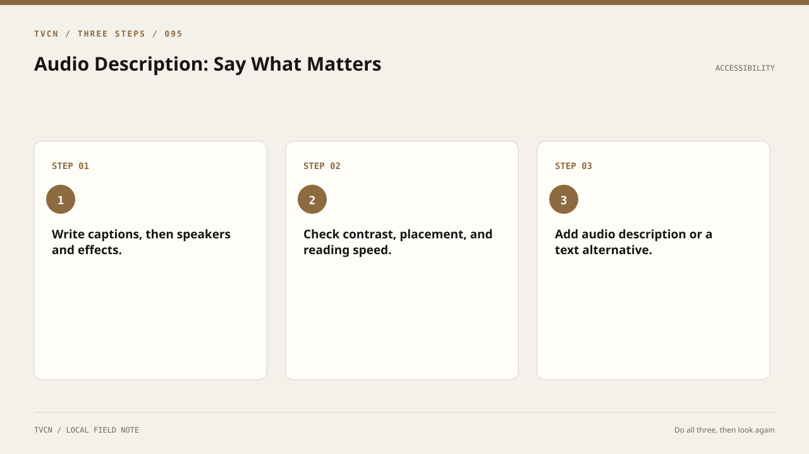

Audio description is not narrating every image. Write three kinds: who does what, spatial relations, on-screen text. Do not repeat what characters already say.

<!-- DIAGRAM_START -->
<h2>Diagram</h2>
<figure>
  
  <figcaption>Watch “Leave a gap every 20 to 30 seconds” and “Say who moves, where they go, and what”; judge whether removing one shot makes the scene faster rather than muddier.</figcaption>
</figure>
<!-- DIAGRAM_END -->
<section><h2 id="section-1">Describe what is unseen but necessary</h2>
Fit description into dialogue gaps and never cover a line. Time it first; if too long, cut adjectives, keep action and direction.
<h2 id="section-2">Limits</h2>
Description is not commentary. Do not write “she is sad”; write “she looks down and turns the photo over.” Let the listener judge.
<h2 id="section-3">Audio description: who and where first, then what happens</h2>

Audio description is not shot-by-shot narration. It fills the gaps between dialogue with what cannot be seen. Order: who, where, doing what. Do not describe camera movement first.

<ol><li>One information point per gap; prioritize relationships, spatial position and key action.</li><li>Avoid dialogue and important sound. Speak 10% slower and leave a one-second margin.</li><li>Do not judge or spoil. Not “he looks sad”; write “he lowers his head, hand stops on the door handle.”</li></ol>

Acceptance: with the picture off, the story is still followable; with it on, the description does not fight the dialogue. Both must pass.
</section><section><h2 id="section-4">On set</h2>
Leave a gap every 20 to 30 seconds and say who moves, where they go, and what is in hand. Do not describe feelings.
</section><section><h2 id="section-5">Do this</h2>
Audio description says only what cannot be seen but must be known: who moves, where, and what is in hand.
<ol><li>Leave a gap every 20 to 30 seconds and never cover dialogue.</li><li>Say who moves, where they go, and what they hold.</li><li>Do not describe emotions; let performance and sound carry them.</li></ol></section><section><h2 id="section-6">Avoid</h2>
Do not say “he is sad”; let action and sound say it.
</section><section><h2>Judge</h2>
This page passes on three observable checks, not slogans:
<ul><li><strong>1.</strong> Description lands in dialogue gaps and never covers a key line.</li><li><strong>2.</strong> Each passage names who moves, where, and what is held.</li><li><strong>3.</strong> No emotion is interpreted; the listener can judge from action and sound.</li></ul></section><section><h2>Failures</h2>
Any one of these means stop and fix it before post:
<ul><li><strong>1.</strong> Check 1 is only staged (“Description lands in dialogue gaps and never c…”); another camera position or location exposes it.</li><li><strong>2.</strong> Check 2 is left to post or a verbal explanation (“Each passage names who moves, where, and what…”); nothing on set can be rechecked.</li><li><strong>3.</strong> Do not say “he is sad”; let action and sound say it.</li></ul></section><section><h2>Extend</h2>
<strong>10-minute exercise:</strong> Take 30 seconds of footage and make an A/B, changing only “Leave a gap every 20 to 30 seconds”. Note one timecode and one difference before keeping it.
</section>
<h2>Check</h2><ul><li>Description lands in dialogue gaps and never covers a key line.</li><li>Each passage names who moves, where, and what is held.</li><li>No emotion is interpreted; the listener can judge from action and sound.</li></ul>

<!-- SOURCES_START -->
## References and further reading

- [S68] [W3C: WebVTT](https://www.w3.org/TR/webvtt1/) — Accessed 2026-11-26. Used to check the terminology/method/rule in the “Describe what is unseen but necessary” section against WebVTT caption format, not platform review rules; it does not verify numbers, model choices or on-set conclusions derived from this page, and is not a substitute for a test.
- [S06] [W3C: Captions and Subtitles](https://www.w3.org/WAI/media/av/captions/) — Accessed 2026-11-26. Used to check the terminology/method/rule in the “Limits” section against W3C caption guidance, not platform review rules; it does not verify numbers, model choices or on-set conclusions derived from this page, and is not a substitute for a test.
<!-- SOURCES_END -->

