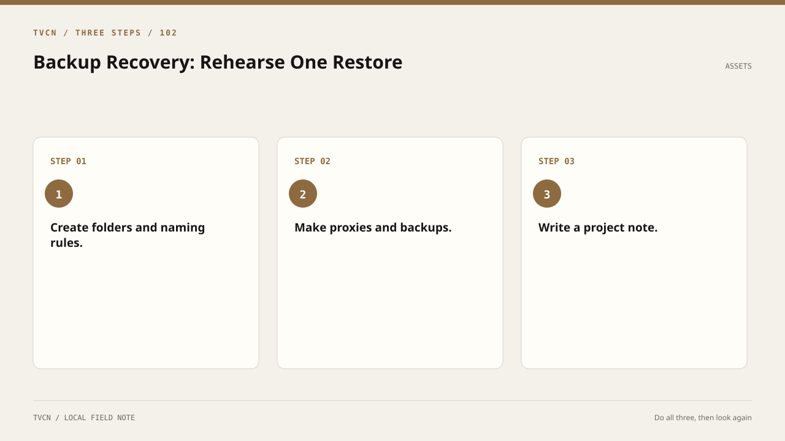

A backup is not done until a random file restores. Test recovery, not just copying.

<!-- DIAGRAM_START -->
<h2>Diagram</h2>
<figure>
  
  <figcaption>Watch “Follow 3-2-1: three copies, two media types, one” and “Restore one random file to another machine.”; judge whether removing one shot makes the scene faster rather than muddier.</figcaption>
</figure>
<!-- DIAGRAM_END -->
<section><h2 id="section-1">On set</h2>
Use 3-2-1: three copies, two media types, one offsite. Restore one random file to another machine and open it.
</section><section><h2 id="section-2">Do this</h2><ol><li>Follow 3-2-1: three copies, two media types, one off-site.</li><li>Restore one random file to another machine.</li><li>Open it, confirm playback or relink, and record the recovery time.</li></ol></section><section><h2 id="section-3">Avoid</h2>
Do not copy without restoring; a failing drive does not warn you.
</section><section><h2 id="section-4">Put 3-2-1 on the desk</h2>
Three copies: card/in-camera, on-set SSD and backup drive. Two media types: SSD/HDD or LTO. One offsite: cloud or another building. RAID is not backup; it survives a dead drive, not deletion, ransomware or fire.
<ol><li>Checksum the card copy before formatting. Do not wipe the card until two readable copies exist.</li><li>Power and carry the on-set SSD and backup drive separately; never in the same bag.</li><li>Check the backup log at wrap. Rerun a failed job immediately; do not wait until the studio.</li></ol></section><section><h2 id="section-5">Restore drill</h2><ol><li>Pick a random file, not the one just copied; restore it from the backup to another machine.</li><li>Open or relink it and confirm it plays and imports into the NLE. File size alone is not proof.</li><li>Log restore time, path and checksum; have a different person run the next drill.</li></ol>
Drill quarterly, and at least once before a project delivery.
</section><section><h2 id="section-6">Fake backups</h2><ol><li>RAID as backup: a second drive dies during rebuild and everything is gone. RAID is not version history.</li><li>Sync as backup: delete locally and the cloud deletes too. Sync is not backup.</li><li>Backing up only in the same building: fire or flood takes both. Offsite must be offsite.</li><li>Copying without checksums: a bad file passes silently until someone opens it.</li></ol></section><section><h2 id="section-7">Backup acceptance log</h2><ul><li>Three copies, two media types and one offsite copy are identifiable; each has a checksum.</li><li>A random file restores on another machine and plays or relinks.</li><li>Restore time, steps and checksum are logged; another person can repeat it.</li><li>Two readable copies exist before card formatting; the backup log has no failed jobs.</li></ul></section><section><h2 id="section-8">Restore log</h2>
Every drill logs date, random file, source drive, checksum, target machine, open result, duration and operator. A drill without an open result does not pass.
</section><section><h2>Judge</h2>
Three signals are observable on set:
<ul><li>removing one shot makes the scene faster, not muddier</li><li>skin, highlights and blacks sit inside scope limits</li><li>loudness, subtitles and file specs pass one delivery check</li></ul></section><section><h2>Failures</h2>
These three moves erase the detail you just built:
<ul><li>cuts follow the music, not the action</li><li>style before unity: shots jump in color</li><li>loudness and subtitles are checked at the very end</li></ul></section><section><h2>Extend</h2>
<strong>10-minute exercise:</strong> Take 30 seconds of footage and make an A/B, changing only “Follow 3-2-1: three copies, two media types, one”. Note one timecode and one difference before keeping it.
</section>
<h2>Check</h2><ul><li>Three copies, two media types, and one off-site copy can all be named.</li><li>A random file restores on another machine and opens.</li><li>Recovery time and steps are logged so the next test repeats them.</li></ul>
