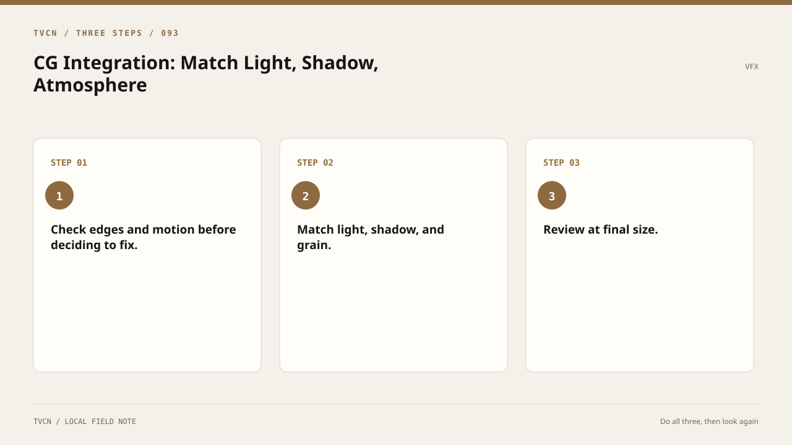

CG-live integration fails at light direction and lens distortion. Record the live key position, color temperature, focal length and aperture, then render CG with the same set. Color can be graded; light position cannot.

<!-- DIAGRAM_START -->
<h2>Diagram</h2>
<figure>
  
  <figcaption>Watch “Match the key direction so CG and live” and “Match shadow softness and atmospheric haze to set”; judge whether removing one shot makes the scene faster rather than muddier.</figcaption>
</figure>
<!-- DIAGRAM_END -->
<section><h2 id="section-1">Share light and lens before color</h2>
Compare a gray ball and chart before comp; match CG reflection, shadow and grain to the plate.
<h2 id="section-2">Limits</h2>
CG cannot save a bad plate. Wrong motion blur or perspective makes effects look worse; shoot it right first.
</section><section><h2 id="section-3">On set</h2>
Match three things first: key direction, shadow softness, and atmospheric haze. Then grain and lens distortion; detail comes last.
</section><section><h2 id="section-4">Do this</h2>
CG integration matches light direction, shadow softness, and haze before detail.
<ol><li>Match the key direction so CG and live plate receive the same light.</li><li>Match shadow softness and atmospheric haze to set depth.</li><li>Match grain and lens distortion last, then add detail.</li></ol></section><section><h2 id="section-5">Avoid</h2>
Do not start with detail; if light and shadow are wrong, more detail looks faker.
</section><section><h2>Judge</h2>
This page passes on three observable checks, not slogans:
<ul><li><strong>1.</strong> CG and plate share the key direction and shadows fall on the same side.</li><li><strong>2.</strong> Shadow softness and haze match so the layers do not look pasted.</li><li><strong>3.</strong> Grain and distortion align and the CG boundary disappears at delivery size.</li></ul></section><section><h2>Failures</h2>
Any one of these means stop and fix it before post:
<ul><li><strong>1.</strong> Check 1 is only staged (“CG and plate share the key direction and shado…”); another camera position or location exposes it.</li><li><strong>2.</strong> Check 2 is left to post or a verbal explanation (“Shadow softness and haze match so the layers d…”); nothing on set can be rechecked.</li><li><strong>3.</strong> Do not start with detail; if light and shadow are wrong, more detail looks faker.</li></ul></section><section><h2>Extend</h2>
<strong>10-minute exercise:</strong> Take 30 seconds of footage and make an A/B, changing only “Match the key direction so CG and live”. Note one timecode and one difference before keeping it.
</section>
<h2>Check</h2><ul><li>CG and plate share the key direction and shadows fall on the same side.</li><li>Shadow softness and haze match so the layers do not look pasted.</li><li>Grain and distortion align and the CG boundary disappears at delivery size.</li></ul>

> Intent split: this page covers the practical details of “CG Integration: Match Light, Shadow, Atmosphere”; start with <a href="https://post.tvcn.org/article/tracking/">Tracking: Put the Point on Something Real</a> for the cluster-level judgement, then return here.

<!-- INTENT_SCOPE -->

<!-- SOURCES_START -->
## Experience note

Experience note:This page draws on 4 post-production reviews under the listed software versions, source formats and delivery platform; it covers the operating order for “CG Integration: Match Light, Shadow, Atmosphere”, not an external laboratory test, unlisted versions, cinema masters, broadcast safety certification or legal advice.
<!-- SOURCES_END -->

