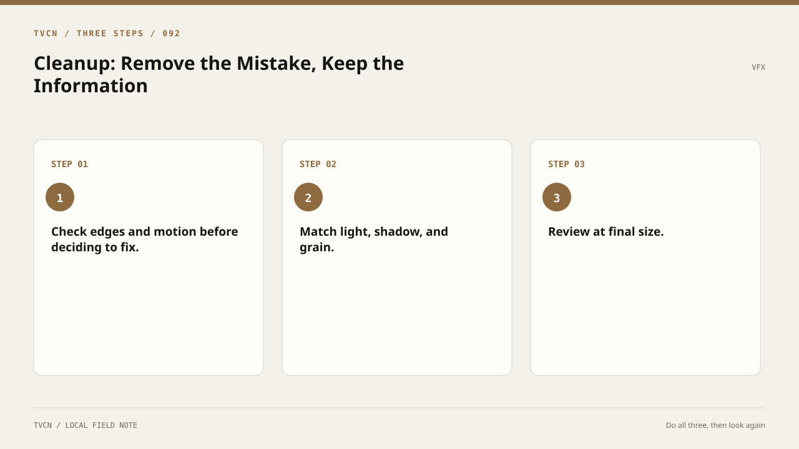

Before removing a cable, mic or stand, read the background: a plain wall is easy; foliage, crowds and texture are not. Shoot a clean plate or empty frame so post has a source.

<!-- DIAGRAM_START -->
<h2>Diagram</h2>
<figure>
  
  <figcaption>Watch “List what must stay: faces, text, action.” and “Erase only the error object, not the background”; judge whether removing one shot makes the scene faster rather than muddier.</figcaption>
</figure>
<!-- DIAGRAM_END -->
<section><h2 id="section-1">Ask what the background contains before erasing</h2>
Match grain, noise and motion blur. A clean still that falls apart in motion is the usual failure.
<h2 id="section-2">Limits</h2>
Do not erase story information. Removing a key prop or sign can change how the audience reads the space; confirm it is not load-bearing.
</section><section><h2 id="section-3">On set</h2>
List what must survive: faces, text, actions. Remove only the mistake, then check at 100 and 50 percent.
</section><section><h2 id="section-4">Do this</h2>
Cleanup removes the wrong thing, not everything; keep the information the audience needs.
<ol><li>List what must stay: faces, text, action.</li><li>Erase only the error object, not the background texture.</li><li>Review at 100 and 50 percent to confirm the patch disappears.</li></ol></section><section><h2 id="section-5">Avoid</h2>
Do not erase information for cleanliness; lose a face or text and the shot is useless.
</section><section><h2>Judge</h2>
Three signals are observable on set:
<ul><li>removing one shot makes the scene faster, not muddier</li><li>skin, highlights and blacks sit inside scope limits</li><li>loudness, subtitles and file specs pass one delivery check</li></ul></section><section><h2>Failures</h2>
These three moves erase the detail you just built:
<ul><li>cuts follow the music, not the action</li><li>style before unity: shots jump in color</li><li>loudness and subtitles are checked at the very end</li></ul></section><section><h2>Extend</h2>
<strong>10-minute exercise:</strong> Take 30 seconds of footage and make an A/B, changing only “List what must stay: faces, text, action.”. Note one timecode and one difference before keeping it.
</section>
<h2>Check</h2><ul><li>Faces, text, and action remain; only the error object is gone.</li><li>The patch disappears at 100 and 50 percent and texture connects.</li><li>A before-and-after shows what was removed rather than a full repaint.</li></ul>
