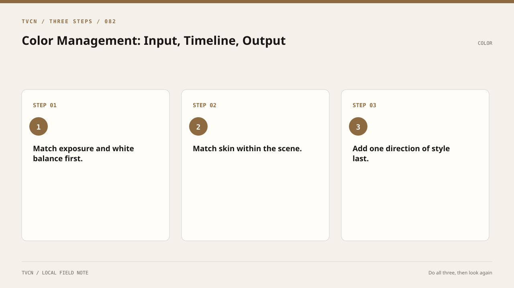

Set input, timeline, and output color spaces before monitors and LUTs.

<!-- DIAGRAM_START -->
<h2>Diagram</h2>
<figure>
  
  <figcaption>Do the three steps in order, then look again at the image or file.</figcaption>
</figure>
<!-- DIAGRAM_END -->
<h2>On set</h2>

Confirm whether the footage is S-Log3, HLG, or Rec.709, set the timeline input to match, output Rec.709 2.4, and monitor through a calibration LUT.

<h2>Do this</h2>

Color management fixes input, timeline, and output before monitoring or LUTs.
<ol><li>Identify the footage: S-Log3, HLG, or Rec.709.</li><li>Set the matching timeline input and output Rec.709 2.4.</li><li>Monitor through a calibration LUT and check once with it off before delivery.</li></ol>
<h2>Avoid</h2>

Do not use the wrong input LUT; once color is wrong, every later match is fake.

<h2>Check</h2>
<ul><li>Timeline input matches the footage format; Log is not treated as Rec.709.</li><li>Output space matches the platform and scopes read correctly.</li><li>Turn off the monitor LUT and black or highlight levels do not jump.</li></ul>
