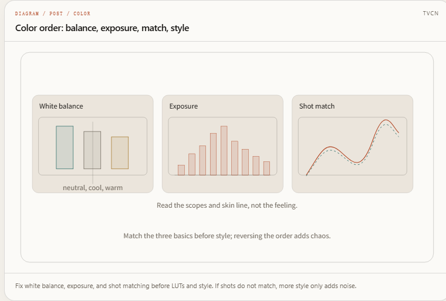

<!-- DIAGRAM_START -->
## Diagram

<figure>
  
  <figcaption>Fix white balance, exposure, and shot matching before LUTs and style. If shots do not match, more style only adds noise.</figcaption>
</figure>
<!-- DIAGRAM_END -->

## Match the shots first

In one scene, shots may come from different times, lenses, and white balance. View them side by side and bring exposure, temperature, and contrast close before anything else.

Matching does not mean identical; it means the cut is invisible. Half a stop of face brightness makes the audience feel a jump.

## Skin is the anchor

Audiences are most sensitive to skin. Keep faces from going green, gray, or too red before choosing an overall warm or cool look. The skin line on a scope is more reliable than mood.

A look can lean, but skin must stay consistent within a scene. Ads can be cool, docs can be warm, but one film cannot have two skin tones.

## One direction of style

Style is not maxing every tool. Pick one direction: low saturation, high contrast, cool shadows, warm highlights, or the reverse. Let the other controls serve it.

A LUT is a starting point, not a finish. After applying it, return to primary correction and check crushed shadows and clipped highlights.

## Three checks

- Face brightness and temperature match within a scene.
- White objects read neutral.
- The look has one main direction, not a new one per shot.
