<!-- DIAGRAM_START -->
<h2>Diagram</h2>
<figure>
  
  <figcaption>Diagram: a round-trip is not “it opened.” Every cut returns to source with handles.</figcaption>
</figure>
<!-- DIAGRAM_END -->
<h2>First decision: when Online is needed</h2>
Online is needed when the film gets a grade, VFX, or multiple platform versions. A straight cut with no grade can finish in the NLE. The test is not runtime; it is whether the timeline returns to original media.

If the edit used proxies, transcodes, speed changes, or nests, Online must rebuild from source. Grading a proxy timeline is judging at low resolution.
<h2>Round-trip: EDL/XML is an address, not media</h2>
When exporting EDL/XML/AAF, confirm reel name, timecode, frame rate, and clip name. Filenames can change; timecode cannot. Leave at least 12–24 frames of handles at every cut for transitions, stabilization, denoise, and grading.

Check shot by shot after relink: source file, in point, out point, speed, transform, audio sync. Total duration matching does not mean every cut matches.
<h2>Order of grade and VFX</h2>
Do VFX before the final grade unless the VFX needs a graded background as reference. VFX before grade gives the compositor neutral footage; after grade means chasing a locked look and repeating notes.

Build separate versions for VFX shots instead of editing the master timeline. Label each version with VFX on/off, captions on/off, titles on/off. One master, many versions.
<h2>Master and versions: naming beats software</h2>
Keep one master: highest quality, no captions, no titles, no platform compression. Platform versions derive from it and never modify it. Filenames carry project, date, version, status; no final/final2.

Watch the master end to end before delivery: no black frames, offline media, wrong captions, or drift. Archive LUTs, fonts, music licenses, and output presets with the project.
<h2>Failure case: the round-trip opened, every cut was wrong</h2>
An ad edit used 120% speed changes and heavy nesting. The XML opened in the grade with the right duration, but every speed change pulled the wrong frames and transitions stretched. Two days of grading were wasted when the client saw the action was wrong.

The problem was not the software; speed and nests were not flattened and handles were missing. Conform starts with whether the timeline can be reconstructed, not whether it opens.
<h2>Cost and acceptance</h2>
Low: single-seat relink and basic check, ¥2,000–5,000. Mid: full conform, grade, VFX round-trip, version outputs, ¥5,000–20,000. High: multicam, multiple versions, HDR, separate captions/titles, ¥20,000–60,000+.
<h2>Check</h2><ul><li>EDL/XML timecode, frame rate, and reel match.</li><li>Every cut has at least 12 frames of handles.</li><li>Shot check covers source, in/out, speed, and transform.</li><li>VFX versions are separate from the master.</li><li>One master; platform versions trace back.</li><li>Watch the master end to end before delivery.</li></ul>
<!-- SOURCES_START -->
<h2>Sources</h2>

Experience: TVCN field notes and project reviews; tested: the review setup and reproducible exercises noted on the page; references: public links below.

<ul><li>[S23] SMPTE Standards</li><li>[S30] DaVinci Resolve</li><li>[S34] Adobe Premiere Pro Guide</li></ul>

<a href="../../SOURCES.md">Full links and notes in SOURCES.md</a>

<!-- SOURCES_END -->
