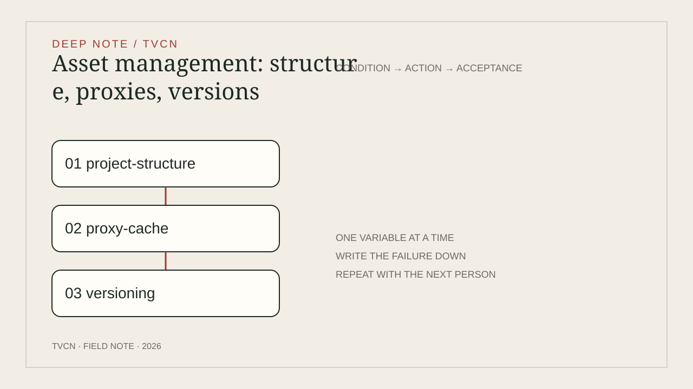

Post speed is not software; project structure, proxies and versions tell everyone where the latest file is. One page of &amp;quot;Project Structure: Folders Beat Software&amp;quot; solves one local problem; joining &amp;quot;Project Structure: Folders Beat Software&amp;quot;, &amp;quot;Proxy and Cache: Do Not Fill the Drive First&amp;quot; and &amp;quot;Versioning: Never Name It Final&amp;quot; exposes the real failure: conditions are missing, too many variables move, and the result cannot be reproduced.

<!-- DEEP_DIVE_START -->
<!-- DIAGRAM_START -->
<h2>图解</h2>
<figure>
  
  <figcaption>Read &quot;Project Structure: Folders Beat Software&quot; and &quot;Proxy and Cache: Do Not Fill the Drive First&quot;: write the condition first, then check whether the failure can be recorded.</figcaption>
</figure>
<!-- DIAGRAM_END -->

<section><h2 id="section-1">Problem</h2>
The problem is not a lack of methods; each step works alone, but together they fail because the condition was not written, too many variables moved and the result cannot be reproduced.

The order is condition, judgement, one variable and evidence. A step is complete only when the next person can repeat it.
</section>
<section><h2 id="section-2">Judgement</h2><ul><li>First gate in &quot;Project Structure: Folders Beat Software&quot;: The four root folders exist and media, project, exports, and docs each live in place.</li><li>Second gate in &quot;Proxy and Cache: Do Not Fill the Drive First&quot;: Filenames carry date, scene, and camera and sort cleanly.</li><li>Third gate in &quot;Versioning: Never Name It Final&quot;: On another machine or app, the path still leads to the original media.</li></ul>
If one gate fails, return to its single page; do not hide an unsolved point inside a longer chain.
</section>
<section><h2 id="section-3">Method</h2><ol><li>Write the condition first: turn &quot;Create 01_media, 02_project, 03_exports, and 04_docs at the root.&quot; from &quot;Project Structure: Folders Beat Software&quot; into three rows: material, environment, acceptance.</li><li>Run one minimal action: follow &quot;Project Structure: Folders Beat Software&quot; for 30 seconds and do not add the second page yet.</li><li>Attach the second page: Name files date_scene_camera, never “final”..</li><li>Use the third page as a control: Keep proxies and originals separate and back up the same day..</li><li>Change one variable at a time; write the other conditions down instead of remembering them.</li><li>Film the failure too: put failure and success side by side to see which step cannot be skipped.</li><li>Ask the next person to reproduce from the record; if they cannot, the record is not finished.</li></ol></section>
<section><h2 id="section-4">Field test</h2>
A reproducible test, not a client case: take 30 seconds of material, make version A using &quot;The four root folders exist and media, project, exports, and docs…&quot; from &quot;Project Structure: Folders Beat Software&quot;, then version B using &quot;Filenames carry date, scene, and camera and sort cleanly.&quot; from &quot;Proxy and Cache: Do Not Fill the Drive First&quot;; only one variable may differ. Put them side by side and record what breaks first in &quot;Versioning: Never Name It Final&quot;: condition, action or acceptance. If it works on the first try, add one real constraint and run it again.
</section>
<section><h2 id="section-5">Failure table</h2>
<table class="data-table"><thead><tr><th>Symptom</th><th>Cause</th><th>Replacement action</th></tr></thead><tbody><tr><td>Do not leave media on the desktop; a system reinstall erases it.</td><td>Condition was not written</td><td>Return to page one and rewrite the three rows</td></tr><tr><td>Do not delete originals for space; cache can be rebuilt, media ca…</td><td>Condition was not written</td><td>Return to page one and rewrite the three rows</td></tr><tr><td>Do not use “latest” as a filename; in three months nobody knows w…</td><td>Condition was not written</td><td>Return to page one and rewrite the three rows</td></tr></tbody></table>
</section>
<section><h2 id="section-6">Acceptance</h2><ul><li>The four root folders exist and media, project, exports, and docs each live in place.</li><li>Filenames carry date, scene, and camera and sort cleanly.</li><li>On another machine or app, the path still leads to the original media.</li><li>Proxies and cache sit on the second drive and the edit drive still has free space.</li><li>The system drive keeps at least twenty percent free with no red warning.</li><li>After clearing cache, the project rebuilds and every original remains.</li><li>The filename contains date, platform, duration, and version and sorts cleanly.</li><li>The log shows why each change happened and who approved it.</li><li>Pick an old version and you can state how it differs from the current one.</li><li>Filename has project, date, version, status</li></ul></section>
<section><h2 id="section-7">Alternatives</h2><ul><li>For a single-point problem in "Project Structure: Folders Beat Software", go back to <a href="https://post.tvcn.org/en/article/project-structure/">Project Structure: Folders Beat Software</a>; do not use the whole chain.</li><li>To compare two actions, read <a href="https://post.tvcn.org/en/article/proxy-cache/">Proxy and Cache: Do Not Fill the Drive First</a> and leave the third page alone.</li><li>For acceptance only, use <a href="https://post.tvcn.org/en/article/versioning/">Versioning: Never Name It Final</a> as a self-test sheet.</li></ul></section>

<!-- SOURCES_START -->
## References and further reading

- [S17] [Reuters Trust Principles](https://reutersagency.com/about/our-trust-principles/) — Accessed 2026-11-26. Used to check the terminology and public context in the opening paragraph (“Post speed is not software; project structure, proxies and v”) against The agency's public commitment to independence, accuracy and freedom from bias; not a substitute for an on-set test.
- [S30] [DaVinci Resolve](https://www.blackmagicdesign.com/products/davinciresolve) — Accessed 2026-11-26. Used to check the terminology and public context in the opening paragraph (“Post speed is not software; project structure, proxies and v”) against Official entry for editing, grading, Fusion and delivery; not a substitute for an on-set test.
- [S34] [Adobe Premiere Pro Guide](https://helpx.adobe.com/premiere-pro/user-guide.html) — Accessed 2026-11-26. Used to check the terminology and public context in the opening paragraph (“Post speed is not software; project structure, proxies and v”) against Official docs for editing, proxies, color and export; not a substitute for an on-set test.
- [S27] [EBU R128 Loudness](https://tech.ebu.ch/publications/r128) — Accessed 2026-11-26. Used to check the terminology and public context in the opening paragraph (“Post speed is not software; project structure, proxies and v”) against Broadcast loudness targets, true peak and measurement; not a substitute for an on-set test.
- [S35] [Avid Resource Center](https://www.avid.com/resource-center) — Accessed 2026-11-26. Used to check the terminology and public context in the opening paragraph (“Post speed is not software; project structure, proxies and v”) against Resources for Media Composer, collaboration and delivery; not a substitute for an on-set test.
<!-- SOURCES_END -->

