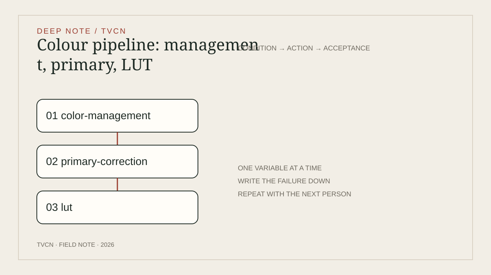

Colour is not a LUT; wrong order of management, primary and LUT makes it dirtier. One page of &amp;quot;Color Management: Put the LUT in the Right Place&amp;quot; solves one local problem; joining &amp;quot;Color Management: Put the LUT in the Right Place&amp;quot;, &amp;quot;Primary Correction: Exposure and White Balance&amp;quot; and &amp;quot;LUT: A Starting Point, Not a Finish&amp;quot; exposes the real failure: conditions are missing, too many variables move, and the result cannot be reproduced.

<!-- DEEP_DIVE_START -->
<!-- DIAGRAM_START -->
<h2>图解</h2>
<figure>
  
  <figcaption>Read &quot;Color Management: Put the LUT in the Right Place&quot; and &quot;Primary Correction: Exposure and White Balance&quot;: write the condition first, then check whether the failure can be recorded.</figcaption>
</figure>
<!-- DIAGRAM_END -->

<section><h2 id="section-1">Problem</h2>
The problem is not a lack of methods; each step works alone, but together they fail because the condition was not written, too many variables moved and the result cannot be reproduced.

The order is condition, judgement, one variable and evidence. A step is complete only when the next person can repeat it.
</section>
<section><h2 id="section-2">Judgement</h2><ul><li>First gate in &quot;Color Management: Put the LUT in the Right Place&quot;: Every source has a named input transform.</li><li>Second gate in &quot;Primary Correction: Exposure and White Balance&quot;: Working, display, and delivery spaces are written separately.</li><li>Third gate in &quot;LUT: A Starting Point, Not a Finish&quot;: One creative LUT sits on the correct node.</li></ul>
If one gate fails, return to its single page; do not hide an unsolved point inside a longer chain.
</section>
<section><h2 id="section-3">Method</h2><ol><li>Write the condition first: turn &quot;Shoot a gray or color chart; set black to 0 to 5 and white below 100.&quot; from &quot;Color Management: Put the LUT in the Right Place&quot; into three rows: material, environment, acceptance.</li><li>Run one minimal action: follow &quot;Color Management: Put the LUT in the Right Place&quot; for 30 seconds and do not add the second page yet.</li><li>Attach the second page: Match every shot in the scene for exposure and white balance, then check the ski….</li><li>Use the third page as a control: Add contrast and style only after the technical problems are gone..</li><li>Change one variable at a time; write the other conditions down instead of remembering them.</li><li>Film the failure too: put failure and success side by side to see which step cannot be skipped.</li><li>Ask the next person to reproduce from the record; if they cannot, the record is not finished.</li></ol></section>
<section><h2 id="section-4">Field test</h2>
A reproducible test, not a client case: take 30 seconds of material, make version A using &quot;Every source has a named input transform.&quot; from &quot;Color Management: Put the LUT in the Right Place&quot;, then version B using &quot;Working, display, and delivery spaces are written separately.&quot; from &quot;Primary Correction: Exposure and White Balance&quot;; only one variable may differ. Put them side by side and record what breaks first in &quot;LUT: A Starting Point, Not a Finish&quot;: condition, action or acceptance. If it works on the first try, add one real constraint and run it again.
</section>
<section><h2 id="section-5">Failure table</h2>
<table class="data-table"><thead><tr><th>Symptom</th><th>Cause</th><th>Replacement action</th></tr></thead><tbody><tr><td>Do not use a LUT to hide technical problems; it makes them look p…</td><td>Condition was not written</td><td>Return to page one and rewrite the three rows</td></tr><tr><td>Do not use a LUT as a repair; it only tints the problem one color…</td><td>Condition was not written</td><td>Return to page one and rewrite the three rows</td></tr><tr><td>Only the result is kept, not the condition</td><td>Condition was not written</td><td>Return to page one and rewrite the three rows</td></tr></tbody></table>
</section>
<section><h2 id="section-6">Acceptance</h2><ul><li>Every source has a named input transform.</li><li>Working, display, and delivery spaces are written separately.</li><li>One creative LUT sits on the correct node.</li><li>Monitor is calibrated; grey ramp and color chart pass.</li><li>References are marked light or color.</li><li>Handoff includes LUTs, node tree, and limits.</li><li>Black and white levels match across the scene and cuts do not jump.</li><li>Skin sits on the same vector line with no green or red drift between shots.</li><li>Turn off the style LUT and the image still holds technically.</li><li>Choose one reference shot per scene</li></ul></section>
<section><h2 id="section-7">Alternatives</h2><ul><li>For a single-point problem in "Color Management: Put the LUT in the Right Place", go back to <a href="https://post.tvcn.org/en/article/color-management/">Color Management: Put the LUT in the Right Place</a>; do not use the whole chain.</li><li>To compare two actions, read <a href="https://post.tvcn.org/en/article/primary-correction/">Primary Correction: Exposure and White Balance</a> and leave the third page alone.</li><li>For acceptance only, use <a href="https://post.tvcn.org/en/article/lut/">LUT: A Starting Point, Not a Finish</a> as a self-test sheet.</li></ul></section>

<!-- SOURCES_START -->
## References and further reading

- [S19] [Generative Adversarial Nets (2014)](https://arxiv.org/abs/1406.2661) — Accessed 2026-11-26. Used to check the terminology and public context in the opening paragraph (“Colour is not a LUT; wrong order of management, primary and ”) against The original GAN paper: a generator and discriminator trained against each other; not a substitute for an on-set test.
- [S30] [DaVinci Resolve](https://www.blackmagicdesign.com/products/davinciresolve) — Accessed 2026-11-26. Used to check the terminology and public context in the opening paragraph (“Colour is not a LUT; wrong order of management, primary and ”) against Official entry for editing, grading, Fusion and delivery; not a substitute for an on-set test.
- [S34] [Adobe Premiere Pro Guide](https://helpx.adobe.com/premiere-pro/user-guide.html) — Accessed 2026-11-26. Used to check the terminology and public context in the opening paragraph (“Colour is not a LUT; wrong order of management, primary and ”) against Official docs for editing, proxies, color and export; not a substitute for an on-set test.
- [S27] [ITU-R: BS.1770 音频响度与真峰值测量](https://www.itu.int/rec/R-REC-BS.1770/en) — Accessed 2026-11-27. Used to check the terminology and public context in the opening paragraph (“Colour is not a LUT; wrong order of management, primary and ”) against ITU algorithms for loudness measurement and true peak, the basis referenced by EBU R128; not a substitute for an on-set test.
- [S35] [Avid Resource Center](https://www.avid.com/resource-center) — Accessed 2026-11-26. Used to check the terminology and public context in the opening paragraph (“Colour is not a LUT; wrong order of management, primary and ”) against Resources for Media Composer, collaboration and delivery; not a substitute for an on-set test.
<!-- SOURCES_END -->

