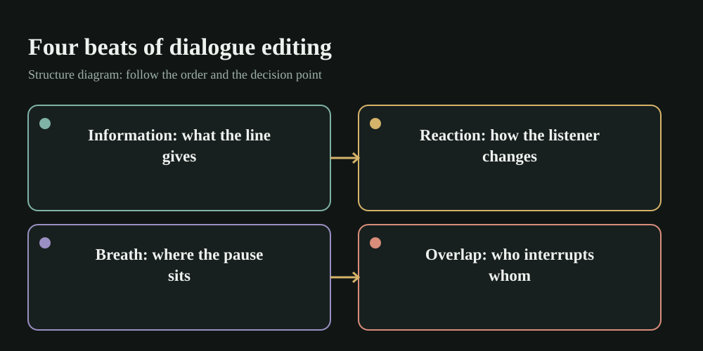

The easiest way to cut dialogue is to remove every breath and make the lines bounce like a ping-pong ball. It sounds “smooth”, but there is no reaction and no time for thought. The audience hears a relay race of lines, not a conversation.

<!-- DIAGRAM_START -->
<h2 id="diagram">Diagram</h2>
<figure class="diagram">
  
  <figcaption>Check information, reaction, breath and overlap. If every line is cut clean, the characters sound like they are reading, not talking.</figcaption>
</figure>
<!-- DIAGRAM_END -->

<section><h2 id="section-1">On location</h2>
A kitchen argument, two angles, one overlap: the wife says “you never listen” while the husband says “I did”. The rough cut cleans both lines, so the audience hears the wife finish, then the husband start. The argument becomes two people taking turns. The director says it is not real but does not know the cut caused it.
</section>
<section><h2 id="section-2">What to look for</h2><ul><li><strong>Does the pause carry information:</strong> after the pause, the listener changes; a pause with no change is only empty time.</li><li><strong>Enough reaction shots:</strong> the speaker can be off-screen, but the listener must be on; the audience needs to see where the line lands.</li><li><strong>Breath removed:</strong> every line butts against the next and the characters have no lungs; one breath gives the audience time to judge.</li><li><strong>Overlap flattened:</strong> real arguments interrupt; turning everything into turns lowers the conflict.</li></ul></section>
<section><h2 id="section-3">What to do</h2><ol><li>Rough-cut information first: each line keeps who wants what and who blocks whom; remove repeated explanation. Do not fix sound first.</li><li>Keep one overlap: let two people fight for the same sentence so the audience hears conflict, not lines.</li><li>Cut on reaction: halfway through a line, cut to the listener's face; show what the line does.</li><li>Keep breath: at least 0.3–0.5 seconds per exchange; place the pause around an action, not inside a sentence.</li><li>Mix last: match dialogue levels, then handle sibilance and room tone; do not fill pauses with music.</li></ol></section>
<section><h2 id="section-4">Failure modes</h2><ul><li><strong>Every line cut clean:</strong> the scene sounds like a news read; nobody interrupts, and the conflict is edited away.</li><li><strong>Music fills the pause:</strong> the audience hears mood, not thought; once music enters, the pause stops working.</li><li><strong>All breath removed:</strong> the characters sound like machines and the audience holds its breath too.</li></ul></section>
<section><h2 id="section-5">Limits</h2>
This suits performed dialogue with exchanges. It is not for fast commercial voice-over, and it does not replace the mix. Editing cannot save a performance: if the actor has no reaction, better cutting only moves the emptiness. Check whether the listener is on camera before designing pauses.
</section>
<section><h2 id="section-6">Check</h2><ul><li>At least one overlap remains, and the audience can hear who interrupts whom.</li><li>Each exchange has a reaction shot, not only the speaker.</li><li>The pause changes the character, not just the timing.</li><li>With music off, the dialogue still works.</li></ul></section>
<!-- DEEP_DIVE_START -->
## Deep dive

<strong>About 8 minutes.</strong> This section places the same judgement in two different conditions, then gives a counterexample and a reusable model. It does not repeat the page; it decides when to change the method.

### Condition A: argument or conflict

The core of an argument is interruption. Do not give every line a complete turn; let the next line enter before the previous ends. One overlap tells the audience neither will yield. You do not need many: one is enough; the second is shorter and harder; the third can go suddenly quiet and let silence become pressure.

A pause in an argument is not rest; it is a wind-up. One person stops, the other thinks they have won; the longer the pause, the heavier the next line. Put the pause on an action: put down a cup, turn, open a door. Do not put it inside a sentence, or it looks like a forgotten line.

### Condition B: intimate or quiet dialogue

The core of intimate dialogue is listening. The speaker can turn away or leave frame; the camera stays on the listener's face. The audience needs to see what the line did to the other person. Pauses can be long, but they need micro-actions: fingers, a swallow, a shift of the eyes. A long pause with no micro-action becomes awkward.

Do not use music to carry quiet dialogue; use room tone: a fridge, a distant car, rain. Room tone gives silence space; music turns silence into score. Dialogue can sit lower, but not so low that the audience reaches for the volume. Intimacy is not inaudibility.

### Counterexample: the pause becomes awkward

A break-up scene holds four seconds after “this is where we end”. The director wants weight; the audience sees two people standing still and starts noticing the clock in the background. The pause has duration but no information.

The fix is not to cut it to one second. Give the pause an action: one person pushes the keys to the middle of the table, the other does not take them. The action uses two seconds, and the remaining two have weight. A pause is not an empty shot; it is a character doing something they cannot say.

### Reusable model

<strong>Information → reaction → breath → overlap.</strong> First make sure each line gives new information, then that the listener reacts, then decide where breath sits, and only then allow interruption. The order cannot reverse: designing overlap first hides information; adding music first hides reaction.

After the rough cut, watch with sound off: if the faces alone tell who has the upper hand, the cut works. If you need the lines to know, go back and shoot or find reactions.

<!-- DEEP_DIVE_END -->
<!-- SOURCES_START -->
## Further reading

- [S35] [Avid Resource Center: Avid Resource Center](https://www.avid.com/resource-center) — accessed 2026-11-26. Used to check the terms, method or rule in the “What to look for” section; not the page's field numbers, gear models or conclusions, and not a substitute for a test or contract.
- [S34] [Adobe Premiere Pro Guide: Adobe Premiere Pro Guide](https://helpx.adobe.com/premiere-pro/user-guide.html) — accessed 2026-11-26. Used to check the terms, method or rule in the “Limits” section; not the page's field numbers, gear models or conclusions, and not a substitute for a test or contract.
<!-- SOURCES_END -->
