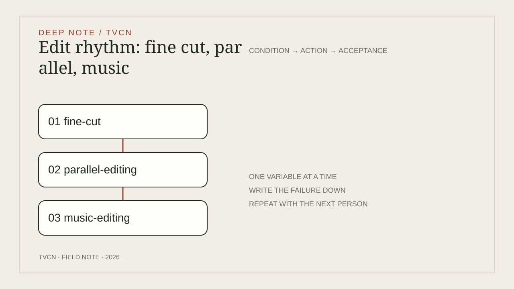

Rhythm is not fast cutting; fine cut, parallel scenes and music advance on the same beat. One page of &amp;quot;Fine Cut: Remove the Rough Edges&amp;quot; solves one local problem; joining &amp;quot;Fine Cut: Remove the Rough Edges&amp;quot;, &amp;quot;Parallel Editing: When Do Two Lines Meet?&amp;quot; and &amp;quot;Music Editing: Let the Music Follow the Action&amp;quot; exposes the real failure: conditions are missing, too many variables move, and the result cannot be reproduced.

<!-- DEEP_DIVE_START -->
<!-- DIAGRAM_START -->
<h2>图解</h2>
<figure>
  
  <figcaption>Read &quot;Fine Cut: Remove the Rough Edges&quot; and &quot;Parallel Editing: When Do Two Lines Meet?&quot;: write the condition first, then check whether the failure can be recorded.</figcaption>
</figure>
<!-- DIAGRAM_END -->

<section><h2 id="section-1">Problem</h2>
The problem is not a lack of methods; each step works alone, but together they fail because the condition was not written, too many variables moved and the result cannot be reproduced.

The order is condition, judgement, one variable and evidence. A step is complete only when the next person can repeat it.
</section>
<section><h2 id="section-2">Judgement</h2><ul><li>First gate in &quot;Fine Cut: Remove the Rough Edges&quot;: Each scene loses at least three specific burrs and cuts no longer bite.</li><li>Second gate in &quot;Parallel Editing: When Do Two Lines Meet?&quot;: Breaths and pauses connect without a line being cut in half.</li><li>Third gate in &quot;Music Editing: Let the Music Follow the Action&quot;: The stranger checks the phone less, or you can name why the drag remains.</li></ul>
If one gate fails, return to its single page; do not hide an unsolved point inside a longer chain.
</section>
<section><h2 id="section-3">Method</h2><ol><li>Write the condition first: turn &quot;Find three burrs per scene: a cut half a frame early, overlapping breath, an emp…&quot; from &quot;Fine Cut: Remove the Rough Edges&quot; into three rows: material, environment, acceptance.</li><li>Run one minimal action: follow &quot;Fine Cut: Remove the Rough Edges&quot; for 30 seconds and do not add the second page yet.</li><li>Attach the second page: Fix only those three categories without adding shots..</li><li>Use the third page as a control: Show a stranger and note when they check their phone; fix that second..</li><li>Change one variable at a time; write the other conditions down instead of remembering them.</li><li>Film the failure too: put failure and success side by side to see which step cannot be skipped.</li><li>Ask the next person to reproduce from the record; if they cannot, the record is not finished.</li></ol></section>
<section><h2 id="section-4">Field test</h2>
A reproducible test, not a client case: take 30 seconds of material, make version A using &quot;Each scene loses at least three specific burrs and cuts no longer…&quot; from &quot;Fine Cut: Remove the Rough Edges&quot;, then version B using &quot;Breaths and pauses connect without a line being cut in half.&quot; from &quot;Parallel Editing: When Do Two Lines Meet?&quot;; only one variable may differ. Put them side by side and record what breaks first in &quot;Music Editing: Let the Music Follow the Action&quot;: condition, action or acceptance. If it works on the first try, add one real constraint and run it again.
</section>
<section><h2 id="section-5">Failure table</h2>
<table class="data-table"><thead><tr><th>Symptom</th><th>Cause</th><th>Replacement action</th></tr></thead><tbody><tr><td>Do not hide structure problems with fancy transitions; a wipe can…</td><td>Condition was not written</td><td>Return to page one and rewrite the three rows</td></tr><tr><td>Do not cut back and forth for technique; without a countdown, the…</td><td>Condition was not written</td><td>Return to page one and rewrite the three rows</td></tr><tr><td>Do not fill every gap with music; without an exit, the entrance h…</td><td>Condition was not written</td><td>Return to page one and rewrite the three rows</td></tr></tbody></table>
</section>
<section><h2 id="section-6">Acceptance</h2><ul><li>Each scene loses at least three specific burrs and cuts no longer bite.</li><li>Breaths and pauses connect without a line being cut in half.</li><li>The stranger checks the phone less, or you can name why the drag remains.</li><li>Cut halfway through a reach</li><li>Cut between the looker and the looked-at</li><li>Let a line tail cover the picture change</li><li>Align a door, table edge, or shoulder across the cut</li><li>Delete repeated information</li><li>Each line has a readable countdown so the audience can calculate who arrives first.</li><li>The cross happens at rising pressure, not at even intervals.</li></ul></section>
<section><h2 id="section-7">Alternatives</h2><ul><li>For a single-point problem in "Fine Cut: Remove the Rough Edges", go back to <a href="https://post.tvcn.org/en/article/fine-cut/">Fine Cut: Remove the Rough Edges</a>; do not use the whole chain.</li><li>To compare two actions, read <a href="https://post.tvcn.org/en/article/parallel-editing/">Parallel Editing: When Do Two Lines Meet?</a> and leave the third page alone.</li><li>For acceptance only, use <a href="https://post.tvcn.org/en/article/music-editing/">Music Editing: Let the Music Follow the Action</a> as a self-test sheet.</li></ul></section>

<!-- SOURCES_START -->
## References and further reading

- [S18] [Dangerous Documentaries (CMSI)](https://cmsimpact.org/wp-content/uploads/2015/12/dangerousdocs-feb2015.pdf) — Accessed 2026-11-26. Used to check the terminology and public context in the opening paragraph (“Rhythm is not fast cutting; fine cut, parallel scenes and mu”) against Informed consent, risk and ethical decisions in documentary production; not a substitute for an on-set test.
- [S30] [DaVinci Resolve](https://www.blackmagicdesign.com/products/davinciresolve) — Accessed 2026-11-26. Used to check the terminology and public context in the opening paragraph (“Rhythm is not fast cutting; fine cut, parallel scenes and mu”) against Official entry for editing, grading, Fusion and delivery; not a substitute for an on-set test.
- [S34] [Adobe Premiere Pro Guide](https://helpx.adobe.com/premiere-pro/user-guide.html) — Accessed 2026-11-26. Used to check the terminology and public context in the opening paragraph (“Rhythm is not fast cutting; fine cut, parallel scenes and mu”) against Official docs for editing, proxies, color and export; not a substitute for an on-set test.
- [S27] [EBU R128 Loudness](https://tech.ebu.ch/publications/r128) — Accessed 2026-11-26. Used to check the terminology and public context in the opening paragraph (“Rhythm is not fast cutting; fine cut, parallel scenes and mu”) against Broadcast loudness targets, true peak and measurement; not a substitute for an on-set test.
- [S35] [Avid Resource Center](https://www.avid.com/resource-center) — Accessed 2026-11-26. Used to check the terminology and public context in the opening paragraph (“Rhythm is not fast cutting; fine cut, parallel scenes and mu”) against Resources for Media Composer, collaboration and delivery; not a substitute for an on-set test.
<!-- SOURCES_END -->

