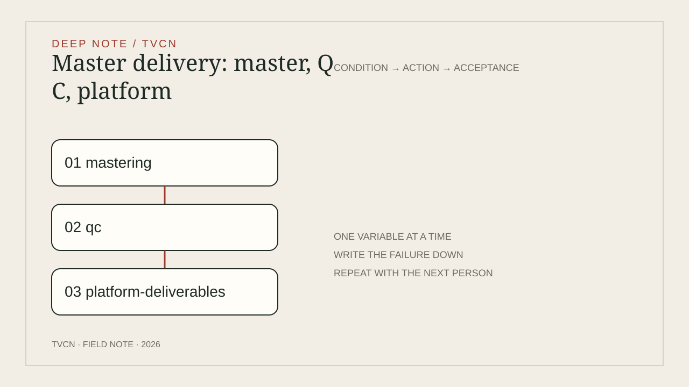

Delivery is not one export; master, QC and platform specs must align once or the launch comes back. One page of &amp;quot;Mastering: One File to Rule the Delivery&amp;quot; solves one local problem; joining &amp;quot;Mastering: One File to Rule the Delivery&amp;quot;, &amp;quot;QC: Black Frames, Frozen Frames, Dead Audio&amp;quot; and &amp;quot;Platform Deliverables: One Master, Many Safe Areas&amp;quot; exposes the real failure: conditions are missing, too many variables move, and the result cannot be reproduced.

<!-- DEEP_DIVE_START -->
<!-- DIAGRAM_START -->
<h2>图解</h2>
<figure>
  
  <figcaption>Read &quot;Mastering: One File to Rule the Delivery&quot; and &quot;QC: Black Frames, Frozen Frames, Dead Audio&quot;: write the condition first, then check whether the failure can be recorded.</figcaption>
</figure>
<!-- DIAGRAM_END -->

<section><h2 id="section-1">Problem</h2>
The problem is not a lack of methods; each step works alone, but together they fail because the condition was not written, too many variables moved and the result cannot be reproduced.

The order is condition, judgement, one variable and evidence. A step is complete only when the next person can repeat it.
</section>
<section><h2 id="section-2">Judgement</h2><ul><li>First gate in &quot;Mastering: One File to Rule the Delivery&quot;: The master is the highest-quality format and its filename says master.</li><li>Second gate in &quot;QC: Black Frames, Frozen Frames, Dead Audio&quot;: Every platform version traces back to the same master with no backward overwrite.</li><li>Third gate in &quot;Platform Deliverables: One Master, Many Safe Areas&quot;: The master opens, plays, and relinks on a clean machine.</li></ul>
If one gate fails, return to its single page; do not hide an unsolved point inside a longer chain.
</section>
<section><h2 id="section-3">Method</h2><ol><li>Write the condition first: turn &quot;Make the master in the highest-quality ProRes or DNxHR and name it master.&quot; from &quot;Mastering: One File to Rule the Delivery&quot; into three rows: material, environment, acceptance.</li><li>Run one minimal action: follow &quot;Mastering: One File to Rule the Delivery&quot; for 30 seconds and do not add the second page yet.</li><li>Attach the second page: Derive platform, vertical, and subtitle versions from it; never edit backward..</li><li>Use the third page as a control: Confirm the master opens, plays, and relinks before delivery..</li><li>Change one variable at a time; write the other conditions down instead of remembering them.</li><li>Film the failure too: put failure and success side by side to see which step cannot be skipped.</li><li>Ask the next person to reproduce from the record; if they cannot, the record is not finished.</li></ol></section>
<section><h2 id="section-4">Field test</h2>
A reproducible test, not a client case: take 30 seconds of material, make version A using &quot;The master is the highest-quality format and its filename says ma…&quot; from &quot;Mastering: One File to Rule the Delivery&quot;, then version B using &quot;Every platform version traces back to the same master with no bac…&quot; from &quot;QC: Black Frames, Frozen Frames, Dead Audio&quot;; only one variable may differ. Put them side by side and record what breaks first in &quot;Platform Deliverables: One Master, Many Safe Areas&quot;: condition, action or acceptance. If it works on the first try, add one real constraint and run it again.
</section>
<section><h2 id="section-5">Failure table</h2>
<table class="data-table"><thead><tr><th>Symptom</th><th>Cause</th><th>Replacement action</th></tr></thead><tbody><tr><td>Do not use “latest” as the filename; delivery must be traceable.</td><td>Condition was not written</td><td>Return to page one and rewrite the three rows</td></tr><tr><td>Do not judge sound on laptop speakers; you will miss low end and …</td><td>Condition was not written</td><td>Return to page one and rewrite the three rows</td></tr><tr><td>Only the result is kept, not the condition</td><td>Condition was not written</td><td>Return to page one and rewrite the three rows</td></tr></tbody></table>
</section>
<section><h2 id="section-6">Acceptance</h2><ul><li>The master is the highest-quality format and its filename says master.</li><li>Every platform version traces back to the same master with no backward overwrite.</li><li>The master opens, plays, and relinks on a clean machine.</li><li>Black frames and freezes: watch from head to tail at 1x and log timecode.</li><li>Dropouts and peaks: listen with headphones, not just the waveform; check left/right and phase.</li><li>Subtitles: check safe area, typos, line breaks, timing and forced subtitles.</li><li>One master; every platform version traces back.</li><li>Each platform has frame, runtime, caption, and loudness specs.</li><li>Vertical is recomposed, not center-cropped.</li><li>All three caption types are played.</li></ul></section>
<section><h2 id="section-7">Alternatives</h2><ul><li>For a single-point problem in "Mastering: One File to Rule the Delivery", go back to <a href="https://post.tvcn.org/en/article/mastering/">Mastering: One File to Rule the Delivery</a>; do not use the whole chain.</li><li>To compare two actions, read <a href="https://post.tvcn.org/en/article/qc/">QC: Black Frames, Frozen Frames, Dead Audio</a> and leave the third page alone.</li><li>For acceptance only, use <a href="https://post.tvcn.org/en/article/platform-deliverables/">Platform Deliverables: One Master, Many Safe Areas</a> as a self-test sheet.</li></ul></section>

<!-- SOURCES_START -->
## References and further reading

- [S28] [Netflix: Partner Help](https://partnerhelp.netflixstudios.com/) — Accessed 2026-11-26. Used to check the terminology/method/rule in the “Problem” section against Netflix delivery help, not general platform rules; it does not verify numbers, model choices or on-set conclusions derived from this page, and is not a substitute for a test.
- [S29] [YouTube: Upload Encoding Specs](https://support.google.com/youtube/answer/1722171) — Accessed 2026-11-26. Used to check the terminology/method/rule in the “Judgement” section against YouTube upload encoding recommendations, not creative standards; it does not verify numbers, model choices or on-set conclusions derived from this page, and is not a substitute for a test.
- [S13] [DCI: Digital Cinema System Specification](https://www.dcimovies.com/dci-specification/) — Accessed 2026-11-26. Used to check the terminology/method/rule in the “Method” section against DCI digital-cinema specification, not streaming upload rules; it does not verify numbers, model choices or on-set conclusions derived from this page, and is not a substitute for a test.
<!-- SOURCES_END -->

