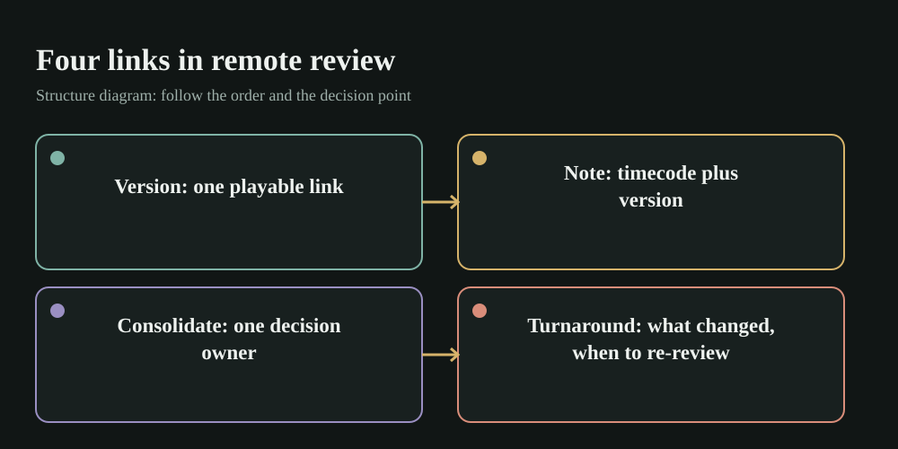

Remote review is exhausting not because of distance but because information scatters. The client is in three cities, notes live in chat, email, voice messages and screenshots; every time the editor opens the project, they have to guess which version and which minute a note refers to.

<!-- DIAGRAM_START -->
<h2 id="diagram">Diagram</h2>
<figure class="diagram">
  
  <figcaption>Check whether version, note, consolidation and turnaround close the loop. If any link depends on voice messages, remote review becomes endless rework.</figcaption>
</figure>
<!-- DIAGRAM_END -->

<section><h2 id="section-1">On location</h2>
A six-minute brand film has three client decision-makers: brand manager, founder and platform operator. The editor sends a cloud link named `final.mp4`. Two days later come twenty-seven voice messages, nine screenshots and four emails; three notes contradict each other. By version four the founder says he has never seen this cut.
</section>
<section><h2 id="section-2">What to look for</h2><ul><li><strong>Version is not unique:</strong> the link overwrites, the filename has no version, and the client is not watching what the editor is changing.</li><li><strong>Notes have no timecode:</strong> “too slow here” has no minute and second, so the editor guesses across the whole film.</li><li><strong>No decision owner:</strong> three people can comment and nobody can say “this does not change”.</li><li><strong>No turnaround record:</strong> after the fix the editor only sends “done”; the client does not know which notes were addressed and raises them again.</li></ul></section>
<section><h2 id="section-3">What to do</h2><ol><li>Lock the version: each review gets a read-only link with version, date and duration, for example `brand_v3_20261126_6m.mp4`.</li><li>Burn in timecode: the review copy shows TC, and notes use minute:second; screenshots must include TC.</li><li>One intake: only a table with timecode, problem, desired result and priority. Voice messages and private chats do not enter the change list.</li><li>One owner: the client names a decision-maker who merges the three parties' notes and rules on conflicts.</li><li>Turnaround: send a comparison table that marks each note fixed, not fixed or why, and set the next review. Unfixed items need client confirmation.</li></ol></section>
<section><h2 id="section-4">Failure modes</h2><ul><li><strong>File named `final`:</strong> three days later come `final2` and `final_really`; nobody knows which version was approved.</li><li><strong>Screenshots without TC:</strong> the client circles an area; the editor cannot tell 2:10 from 2:14 and changes the wrong spot.</li><li><strong>Multiple people edit:</strong> the brand manager asks for one change, the founder asks to reverse it; the editor becomes the battlefield.</li></ul></section>
<section><h2 id="section-5">Limits</h2>
This suits commercial projects with multiple decision-makers and versions. It is not for confidential unreleased material and does not replace a formal acceptance contract. For confidential footage use local encrypted review or a screening; do not put a link on a public cloud drive. If the client refuses the table, give them a three-line template first, not every field at once.
</section>
<section><h2 id="section-6">Check</h2><ul><li>Each review has one read-only link with version and date in the filename.</li><li>Every note maps to a timecode and a version.</li><li>There is one consolidated table signed off by a decision owner.</li><li>The turnaround table marks each note fixed, not fixed or why, with the next review time.</li></ul></section>
<!-- DEEP_DIVE_START -->
## Deep dive

<strong>About 8 minutes.</strong> This section places the same judgement in two different conditions, then gives a counterexample and a reusable model. It does not repeat the page; it decides when to change the method.

### Condition A: commercial client with many decision-makers

For multi-decision projects, put “who approves” in the contract or email before the third version, not after. Each review gets one window, say forty-eight hours; notes after the window go to the next round, not into this one. The window is not pressure; it makes everyone watch the same version instead of A finishing, B changing and C never looking.

Sort notes into three levels: must fix (wrong information or platform rejection), should fix (pace or performance), optional (taste). The editor does must-fix first, should-fix second, optional last. The levels do not limit the client; they give changes an order.

### Condition B: internal team or confidential project

An internal team does not need an external review platform, but it needs the same version discipline. Use a read-only folder on internal storage, one subfolder per version; write notes in a shared document, not in chat. For confidential footage, do not create a public link; use a watermarked local screening with the reviewer's name in the watermark so leaks are traceable.

Internal review easily becomes “watching while editing”: the director stands behind the editor and says “try this here”. That is collaboration, not review. Collaboration is fine, but mark it on the timeline; do not let verbal notes overwrite an approved version.

### Counterexample: the client sends voice notes

The client sends eighteen voice messages, thirty to sixty seconds each. The editor spends two hours transcribing and still cannot place four timecodes. After the changes the client says “that is not what I meant”. The client is not lazy; the process allowed voice to replace a note.

The fix is not to refuse the client; give them an easier entry: a thirty-second screen recording where they point at the frame and speak, with automatic timecode. Screen recording is faster than typing and more precise than voice. Teach it once and they will use it next time.

### Reusable model

<strong>Version → note → consolidation → turnaround.</strong> Version makes everyone watch the same cut; notes make comments locatable; consolidation gives conflict a ruling; turnaround makes changes traceable. When the four close, remote review is not “send link, wait for voice, guess”.

At the end of each round write one line: version, number of notes, number of must-fix, who approved, when the next review. At wrap that line is delivery evidence and the basis for the next quote.

<!-- DEEP_DIVE_END -->
<!-- SOURCES_START -->
## Further reading

- [S35] [Avid Resource Center: Avid Resource Center](https://www.avid.com/resource-center) — accessed 2026-11-26. Used to check the terms, method or rule in the “What to look for” section; not the page's field numbers, gear models or conclusions, and not a substitute for a test or contract.
- [S28] [Netflix Partner Help: Netflix Partner Help](https://partnerhelp.netflixstudios.com/) — accessed 2026-11-26. Used to check the terms, method or rule in the “Limits” section; not the page's field numbers, gear models or conclusions, and not a substitute for a test or contract.
<!-- SOURCES_END -->
