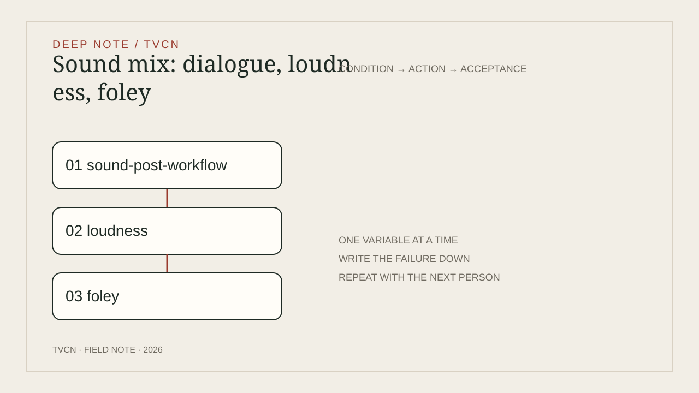

Mixing is not making it louder; dialogue, loudness and foley need their places so the audience is not tired. One page of &amp;quot;Sound Post: The Order from Dialogue to Final Mix&amp;quot; solves one local problem; joining &amp;quot;Sound Post: The Order from Dialogue to Final Mix&amp;quot;, &amp;quot;Loudness: Platform Target and True Peak&amp;quot; and &amp;quot;Foley: Steps, Cloth, Doors&amp;quot; exposes the real failure: conditions are missing, too many variables move, and the result cannot be reproduced.

<!-- DEEP_DIVE_START -->
<!-- DIAGRAM_START -->
<h2>图解</h2>
<figure>
  
  <figcaption>Read &quot;Sound Post: The Order from Dialogue to Final Mix&quot; and &quot;Loudness: Platform Target and True Peak&quot;: write the condition first, then check whether the failure can be recorded.</figcaption>
</figure>
<!-- DIAGRAM_END -->

<section><h2 id="section-1">Problem</h2>
The problem is not a lack of methods; each step works alone, but together they fail because the condition was not written, too many variables moved and the result cannot be reproduced.

The order is condition, judgement, one variable and evidence. A step is complete only when the next person can repeat it.
</section>
<section><h2 id="section-2">Judgement</h2><ul><li>First gate in &quot;Sound Post: The Order from Dialogue to Final Mix&quot;: Dialogue is clear without captions.</li><li>Second gate in &quot;Loudness: Platform Target and True Peak&quot;: Ambience is continuous across every cut.</li><li>Third gate in &quot;Foley: Steps, Cloth, Doors&quot;: Effects match screen direction.</li></ul>
If one gate fails, return to its single page; do not hide an unsolved point inside a longer chain.
</section>
<section><h2 id="section-3">Method</h2><ol><li>Write the condition first: turn &quot;Mix to the platform target, commonly -14 LUFS.&quot; from &quot;Sound Post: The Order from Dialogue to Final Mix&quot; into three rows: material, environment, acceptance.</li><li>Run one minimal action: follow &quot;Sound Post: The Order from Dialogue to Final Mix&quot; for 30 seconds and do not add the second page yet.</li><li>Attach the second page: Set true peak at -1 dB and leave another 0.5 to 1 dB of margin..</li><li>Use the third page as a control: Do not slam the limiter; go back to dialogue and dynamics..</li><li>Change one variable at a time; write the other conditions down instead of remembering them.</li><li>Film the failure too: put failure and success side by side to see which step cannot be skipped.</li><li>Ask the next person to reproduce from the record; if they cannot, the record is not finished.</li></ol></section>
<section><h2 id="section-4">Field test</h2>
A reproducible test, not a client case: take 30 seconds of material, make version A using &quot;Dialogue is clear without captions.&quot; from &quot;Sound Post: The Order from Dialogue to Final Mix&quot;, then version B using &quot;Ambience is continuous across every cut.&quot; from &quot;Loudness: Platform Target and True Peak&quot;; only one variable may differ. Put them side by side and record what breaks first in &quot;Foley: Steps, Cloth, Doors&quot;: condition, action or acceptance. If it works on the first try, add one real constraint and run it again.
</section>
<section><h2 id="section-5">Failure table</h2>
<table class="data-table"><thead><tr><th>Symptom</th><th>Cause</th><th>Replacement action</th></tr></thead><tbody><tr><td>Do not treat loudness as competition; a flattened limiter makes d…</td><td>Condition was not written</td><td>Return to page one and rewrite the three rows</td></tr><tr><td>Do not fill every quiet beat with Foley; silence has weight too.</td><td>Condition was not written</td><td>Return to page one and rewrite the three rows</td></tr><tr><td>Only the result is kept, not the condition</td><td>Condition was not written</td><td>Return to page one and rewrite the three rows</td></tr></tbody></table>
</section>
<section><h2 id="section-6">Acceptance</h2><ul><li>Dialogue is clear without captions.</li><li>Ambience is continuous across every cut.</li><li>Effects match screen direction.</li><li>Music never buries a key line.</li><li>Loudness matches platform; three devices checked.</li><li>DX/AMB/SFX/MX delivered as stems.</li><li>Integrated loudness sits near the platform target, not guessed by ear.</li><li>True peak stays at or below -1 dB with no continuous red.</li><li>Dialogue stays clear and music or ambience does not flatten the dynamics.</li><li>Solo dialogue and confirm every line is intelligible</li></ul></section>
<section><h2 id="section-7">Alternatives</h2><ul><li>For a single-point problem in "Sound Post: The Order from Dialogue to Final Mix", go back to <a href="https://post.tvcn.org/en/article/sound-post-workflow/">Sound Post: The Order from Dialogue to Final Mix</a>; do not use the whole chain.</li><li>To compare two actions, read <a href="https://post.tvcn.org/en/article/loudness/">Loudness: Platform Target and True Peak</a> and leave the third page alone.</li><li>For acceptance only, use <a href="https://post.tvcn.org/en/article/foley/">Foley: Steps, Cloth, Doors</a> as a self-test sheet.</li></ul></section>

<!-- SOURCES_START -->
## References and further reading

- [S18] [Dangerous Documentaries (CMSI)](https://cmsimpact.org/wp-content/uploads/2015/12/dangerousdocs-feb2015.pdf) — Accessed 2026-11-26. Used to check the terminology and public context in the opening paragraph (“Mixing is not making it louder; dialogue, loudness and foley”) against Informed consent, risk and ethical decisions in documentary production; not a substitute for an on-set test.
- [S30] [DaVinci Resolve](https://www.blackmagicdesign.com/products/davinciresolve) — Accessed 2026-11-26. Used to check the terminology and public context in the opening paragraph (“Mixing is not making it louder; dialogue, loudness and foley”) against Official entry for editing, grading, Fusion and delivery; not a substitute for an on-set test.
- [S34] [Adobe Premiere Pro Guide](https://helpx.adobe.com/premiere-pro/user-guide.html) — Accessed 2026-11-26. Used to check the terminology and public context in the opening paragraph (“Mixing is not making it louder; dialogue, loudness and foley”) against Official docs for editing, proxies, color and export; not a substitute for an on-set test.
- [S27] [ITU-R: BS.1770 音频响度与真峰值测量](https://www.itu.int/rec/R-REC-BS.1770/en) — Accessed 2026-11-27. Used to check the terminology and public context in the opening paragraph (“Mixing is not making it louder; dialogue, loudness and foley”) against ITU algorithms for loudness measurement and true peak, the basis referenced by EBU R128; not a substitute for an on-set test.
- [S35] [Avid Resource Center](https://www.avid.com/resource-center) — Accessed 2026-11-26. Used to check the terminology and public context in the opening paragraph (“Mixing is not making it louder; dialogue, loudness and foley”) against Resources for Media Composer, collaboration and delivery; not a substitute for an on-set test.
<!-- SOURCES_END -->

