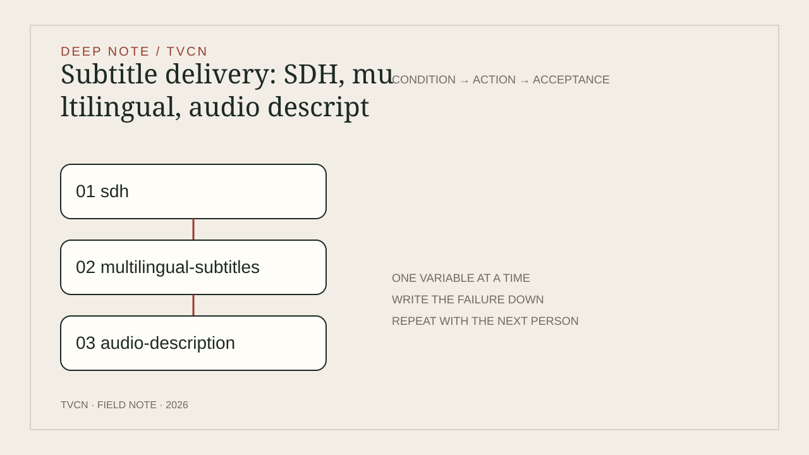

Subtitles are not typing; SDH, multilingual and audio description are three different audience tasks. One page of &amp;quot;SDH: More Than Dialogue&amp;quot; solves one local problem; joining &amp;quot;SDH: More Than Dialogue&amp;quot;, &amp;quot;Multilingual Subtitles: One Language at a Time&amp;quot; and &amp;quot;Audio Description: Say What Matters&amp;quot; exposes the real failure: conditions are missing, too many variables move, and the result cannot be reproduced.

<!-- DEEP_DIVE_START -->
<!-- DIAGRAM_START -->
<h2>图解</h2>
<figure>
  
  <figcaption>Read &quot;SDH: More Than Dialogue&quot; and &quot;Multilingual Subtitles: One Language at a Time&quot;: write the condition first, then check whether the failure can be recorded.</figcaption>
</figure>
<!-- DIAGRAM_END -->

<section><h2 id="section-1">Problem</h2>
The problem is not a lack of methods; each step works alone, but together they fail because the condition was not written, too many variables moved and the result cannot be reproduced.

The order is condition, judgement, one variable and evidence. A step is complete only when the next person can repeat it.
</section>
<section><h2 id="section-2">Judgement</h2><ul><li>First gate in &quot;SDH: More Than Dialogue&quot;: Each caption identifies the speaker and distinguishes phone or off-screen voice.</li><li>Second gate in &quot;Multilingual Subtitles: One Language at a Time&quot;: Door, rain, music, and other key sounds appear in the captions.</li><li>Third gate in &quot;Audio Description: Say What Matters&quot;: Captions stay off mouths and hands, within two lines, and read at pace.</li></ul>
If one gate fails, return to its single page; do not hide an unsolved point inside a longer chain.
</section>
<section><h2 id="section-3">Method</h2><ol><li>Write the condition first: turn &quot;Label speakers: male, female, phone.&quot; from &quot;SDH: More Than Dialogue&quot; into three rows: material, environment, acceptance.</li><li>Run one minimal action: follow &quot;SDH: More Than Dialogue&quot; for 30 seconds and do not add the second page yet.</li><li>Attach the second page: Write ambience as [door], [rain], and music as [music]..</li><li>Use the third page as a control: Check placement and reading speed; captions never cover mouths or hands..</li><li>Change one variable at a time; write the other conditions down instead of remembering them.</li><li>Film the failure too: put failure and success side by side to see which step cannot be skipped.</li><li>Ask the next person to reproduce from the record; if they cannot, the record is not finished.</li></ol></section>
<section><h2 id="section-4">Field test</h2>
A reproducible test, not a client case: take 30 seconds of material, make version A using &quot;Each caption identifies the speaker and distinguishes phone or of…&quot; from &quot;SDH: More Than Dialogue&quot;, then version B using &quot;Door, rain, music, and other key sounds appear in the captions.&quot; from &quot;Multilingual Subtitles: One Language at a Time&quot;; only one variable may differ. Put them side by side and record what breaks first in &quot;Audio Description: Say What Matters&quot;: condition, action or acceptance. If it works on the first try, add one real constraint and run it again.
</section>
<section><h2 id="section-5">Failure table</h2>
<table class="data-table"><thead><tr><th>Symptom</th><th>Cause</th><th>Replacement action</th></tr></thead><tbody><tr><td>Do not place captions over mouths or hands; the audience needs th…</td><td>Condition was not written</td><td>Return to page one and rewrite the three rows</td></tr><tr><td>Do not squeeze bilingual text into two small lines; neither reads…</td><td>Condition was not written</td><td>Return to page one and rewrite the three rows</td></tr><tr><td>Do not say “he is sad”; let action and sound say it.</td><td>Condition was not written</td><td>Return to page one and rewrite the three rows</td></tr></tbody></table>
</section>
<section><h2 id="section-6">Acceptance</h2><ul><li>Each caption identifies the speaker and distinguishes phone or off-screen voice.</li><li>Door, rain, music, and other key sounds appear in the captions.</li><li>Captions stay off mouths and hands, within two lines, and read at pace.</li><li>Each line holds one language with no stacked bilingual text.</li><li>Tracks switch independently, or each version is complete on its own.</li><li>Type size and line count remain readable on a phone without shrinking for both languages.</li><li>Description lands in dialogue gaps and never covers a key line.</li><li>Each passage names who moves, where, and what is held.</li><li>No emotion is interpreted; the listener can judge from action and sound.</li><li>The condition from SDH: More Than Dialogue fits on one line and can be repeated by someone else.</li></ul></section>
<section><h2 id="section-7">Alternatives</h2><ul><li>For a single-point problem in "SDH: More Than Dialogue", go back to <a href="https://post.tvcn.org/en/article/sdh/">SDH: More Than Dialogue</a>; do not use the whole chain.</li><li>To compare two actions, read <a href="https://post.tvcn.org/en/article/multilingual-subtitles/">Multilingual Subtitles: One Language at a Time</a> and leave the third page alone.</li><li>For acceptance only, use <a href="https://post.tvcn.org/en/article/audio-description/">Audio Description: Say What Matters</a> as a self-test sheet.</li></ul></section>

<!-- SOURCES_START -->
## References and further reading

- [S06] [Captions and subtitles](https://www.w3.org/WAI/media/av/captions/) — Accessed 2026-11-26. Used to check the terminology and public context in the opening paragraph (“Subtitles are not typing; SDH, multilingual and audio descri”) against 1.2.4。 / Accessibility requirements for prerecorded and live captions; WCAG 1.2.2 / 1.2.4; not a substitute for an on-set test.
- [S20] [Denoising Diffusion Probabilistic Models (2020)](https://arxiv.org/abs/2006.11239) — Accessed 2026-11-26. Used to check the terminology and public context in the opening paragraph (“Subtitles are not typing; SDH, multilingual and audio descri”) against Diffusion models: the noising-to-denoising generation path; not a substitute for an on-set test.
- [S30] [DaVinci Resolve](https://www.blackmagicdesign.com/products/davinciresolve) — Accessed 2026-11-26. Used to check the terminology and public context in the opening paragraph (“Subtitles are not typing; SDH, multilingual and audio descri”) against Official entry for editing, grading, Fusion and delivery; not a substitute for an on-set test.
- [S34] [Adobe Premiere Pro Guide](https://helpx.adobe.com/premiere-pro/user-guide.html) — Accessed 2026-11-26. Used to check the terminology and public context in the opening paragraph (“Subtitles are not typing; SDH, multilingual and audio descri”) against Official docs for editing, proxies, color and export; not a substitute for an on-set test.
- [S27] [ITU-R: BS.1770 音频响度与真峰值测量](https://www.itu.int/rec/R-REC-BS.1770/en) — Accessed 2026-11-27. Used to check the terminology and public context in the opening paragraph (“Subtitles are not typing; SDH, multilingual and audio descri”) against ITU algorithms for loudness measurement and true peak, the basis referenced by EBU R128; not a substitute for an on-set test.
<!-- SOURCES_END -->

