<!-- DIAGRAM_START -->
<h2>Diagram</h2>
<figure>
  
  <figcaption>Diagram: checksum, backup locations, proxy paths, and script notes belong in one handoff report.</figcaption>
</figure>
<!-- DIAGRAM_END -->
<h2>First decision: who owns the media</h2>
The first DIT job is not inserting a card; it is assigning responsibility: who copies, who verifies, who transports, who receives. “Media is backed up” is not enough; write where, when, and who confirmed. If there is no DIT, the camera assistant can cover, but the duty goes on the call sheet.

Before any card is formatted, at least two complete copies must exist off the same computer or drive. Formatting after one copy is the least forgivable set error.
<h2>Copy and verify: checksums are not optional</h2>
Use software that verifies and generate an MD5/xxHash manifest. Do not judge by file count; run the checksum. If it fails, copy again; do not “try once more and hope.” Keep the card’s original folder structure; do not rename during copy.

Rename after copy: project_date_camera_card_clip. Log the rename so it stays traceable. Keep the original card until wrap; do not reuse early.
<h2>Three copies: two on set, one off set</h2>
Three copies are not three drives in one bag. At least one lives in a different physical location or goes back to the office that day. Do not format before backup; do not format immediately after either—wait for next-day confirmation.

Label each copy: project, date, contents, checksum filename. Avoid “primary/secondary”; write the location and the owner.
<h2>Proxies and handoff: make the edit open ready</h2>
Proxies must match source frame rate, timecode, and filename or the round-trip fails. Choose proxy resolution for the edit machine, 1080p or 720p; too low a bitrate makes the editor misjudge noise.

Handoff: source, proxies, checksum manifest, script notes, audio, LUTs, report. The report lists card numbers, clip counts, total duration, and anomalies (bad frames, dropped frames, audio gaps).
<h2>Failure case: three backups in one room</h2>
On a location shoot, the DIT made three copies, all in one hotel room: two drives and a laptop. The next day the room lost power, the laptop drained, and both drives were soaked in the same bag. All three copies failed together.

The only fix was a re-shoot. Real three-copy backup separates locations: one carried, one in the hotel safe, one shipped or uploaded that day. Backup is location, not count.
<h2>Cost and acceptance</h2>
Low: camera assistant doubles as DIT, two SSDs plus checksum software, ¥1,000–3,000/day. Mid: dedicated DIT, three copies, proxies, report, ¥3,000–8,000/day. High: multicam, on-set grade/comp, LTO archive, ¥8,000–20,000/day.
<h2>Check</h2><ul><li>Every card copy has a checksum manifest.</li><li>At least three copies, not in one physical location.</li><li>Original folders kept; renames logged.</li><li>Proxies match source frame rate, timecode, and filename.</li><li>Handoff report lists cards, clips, duration, anomalies.</li><li>Written confirmation before any card is formatted.</li></ul>

<!-- SOURCES_START -->
## References and further reading

- [S23] [SMPTE Standards](https://www.smpte.org/standards) — Accessed 2026-11-26. Used to check the terminology and public context in the opening paragraph (“DIT is not card copying. It guarantees checksums, three copi”) against Entry point for timecode, color, cinema and signal-chain standards; not a substitute for an on-set test.
- [S28] [Netflix Partner Help](https://partnerhelp.netflixstudios.com/) — Accessed 2026-11-26. Used to check the terminology and public context in the opening paragraph (“DIT is not card copying. It guarantees checksums, three copi”) against Public entry for delivery specs, HDR/SDR and QC; not a substitute for an on-set test.
- [S30] [DaVinci Resolve](https://www.blackmagicdesign.com/products/davinciresolve) — Accessed 2026-11-26. Used to check the terminology and public context in the opening paragraph (“DIT is not card copying. It guarantees checksums, three copi”) against Official entry for editing, grading, Fusion and delivery; not a substitute for an on-set test.
- [S34] [Adobe Premiere Pro Guide](https://helpx.adobe.com/premiere-pro/user-guide.html) — Accessed 2026-11-26. Used to check the terminology and public context in the opening paragraph (“DIT is not card copying. It guarantees checksums, three copi”) against Official docs for editing, proxies, color and export; not a substitute for an on-set test.
- [S27] [ITU-R: BS.1770 音频响度与真峰值测量](https://www.itu.int/rec/R-REC-BS.1770/en) — Accessed 2026-11-27. Used to check the terminology and public context in the opening paragraph (“DIT is not card copying. It guarantees checksums, three copi”) against ITU algorithms for loudness measurement and true peak, the basis referenced by EBU R128; not a substitute for an on-set test.
<!-- SOURCES_END -->

