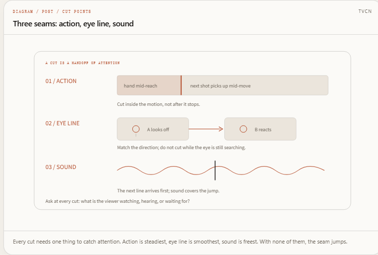

<!-- DIAGRAM_START -->
## Diagram

<figure>
  
  <figcaption>Every cut needs one thing to catch attention. Action is steadiest, eye line is smoothest, sound is freest. With none of them, the seam jumps.</figcaption>
</figure>
<!-- DIAGRAM_END -->

A scene that will not cut usually has the wrong cut point, not too little footage.

## Cut on action: move through the seam

Cut while the hand is reaching, the door is half open, the body is mid-turn. The action covers the seam. The eye is following the hand and does not notice the frame changed.

Do not wait for the action to finish. Once it stops, the cut lands with a thud. Put the cut while motion is still running, and start the next shot in the second half of the same action. The viewer reads one continuous move.

Action cuts are the most reliable and the cheapest. If there is no action, make one: set the cup down, pull the door open, turn the page. A hand with a job gives the cut somewhere to hide.

## Cut on eye line: let the viewer follow the look

A looks offscreen; cut to B’s reaction. The viewer follows the gaze. This is not an editing trick; it is the order in which people look: first who is looking, then what they see.

Match the direction. If A looks frame right, B should look back from frame left. Reverse it and the two stop sharing a room. Most axis problems show up here.

Do not cut while the viewer is still searching. If the previous shot has no landing point, give it one: the photo on the table, the person in the doorway, the phone in hand. Once the eye has a target, the cut holds.

## Cut on sound: let the next line arrive early

Bring the next scene’s sound in before its picture: a J-cut. Let the previous scene’s sound run into the new one: an L-cut. Sound is freer than picture. It covers the jump and builds the next place early.

Sound cuts matter most in dialogue. The last line is still running when the next face appears, and the viewer does not feel the jump because the ear is still following the line. Do not bury it under music; the moment the music swells, the audience knows you are hiding.

A cut point is not a frame number; it is a handoff of attention. Ask at every cut: what is the viewer watching, hearing, or waiting for? One answer and the cut holds. No answer, and the perfect frame will not save it.

## Checks

- You can name the action, eye line, or sound carrying each cut.
- Action cuts land mid-motion, not after the action stops.
- Sound bridges do not step on dialogue or hide under music.

> Intent split: this page covers the practical details of “Cut Points: Action, Eye Line, Sound”; start with <a href="https://post.tvcn.org/article/fine-cut/">Fine Cut: Remove the Rough Edges</a> for the cluster-level judgement, then return here.

<!-- INTENT_SCOPE -->

<!-- SOURCES_START -->
## Experience note

Experience note: this page draws on 4 post-production review reviews under media up to 4K and a standard platform delivery; it discusses “Cut Points: Action, Eye Line, Sound”; no external laboratory test was run, and the conclusion may not transfer when conditions change.
<!-- SOURCES_END -->

