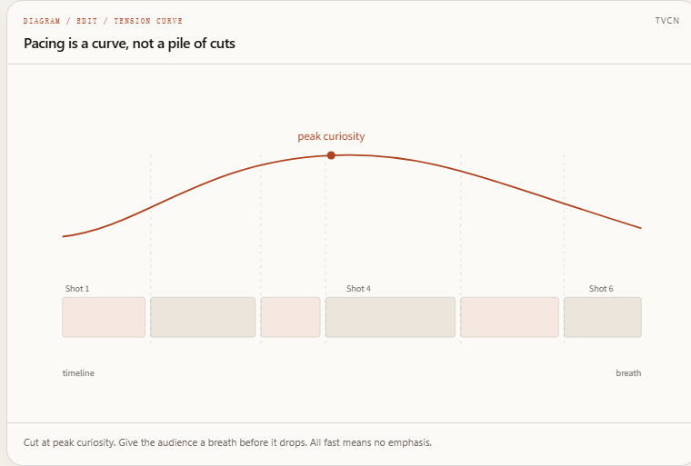

<!-- DIAGRAM_START -->
## Diagram

<figure>
  
  <figcaption>Cut at peak curiosity. Give the audience a breath before it drops. All fast means no emphasis.</figcaption>
</figure>
<!-- DIAGRAM_END -->

## Cut the explanation first

Watch it with the voice-over muted. If the action still reads, the narration is doing too much. The audience does not need to be told “he is sad”; they need to see him put the chopsticks down.

Cutting one line of explanation usually opens two seconds. Do not fill those two seconds with music right away. Let the image carry them.

## Cut on movement, not after it

A hand reaching for a handle, a foot leaving frame, a head turning: these are cut points. Cut late and the audience waits; cut early and the action never completes.

Dialogue can enter before the picture and leave after it. Hear the next line while the previous face is still on screen; the audience will bridge the two spaces.

## Silence is pacing too

Not every gap needs music. Five seconds of two people not talking can be tenser than a drum cue. Let room tone hold the scene before the score enters.

If a scene feels long no matter what, check whether it delivers new information. Without new information, even a short shot drags; with it, a long take can hold.

## Three checks

- The story reads with the voice-over muted.
- At least three cuts land on movement.
- One silent beat is left without music.

<!-- DEEP_DIVE_START -->
## Deep dive

<strong>About 6 minutes.</strong> Pace is not cutting fast. It is making the audience want the next line at the right moment.

### Pace lives in the information gap

At the end of a shot, leave a small question in the audience’s mind: will he come in? did she hear it? The next shot answers it. Answer too fast and there is no wait; too slow and attention is gone.

Link scenes as question, answer, new question, not as one long acceleration. If everything is fast, nothing has pace.

Keep one main question per scene. Sub-questions can coexist, but do not ask them all in the same second.

### Alternate long and short shots

Three shots of the same length feel flat; hold one two seconds longer, shorten the other two, and the scene breathes.

Action can use short shots, but after every three or four, leave a slightly longer reaction or the audience only feels dizziness.

A long shot is not slow; it gives the audience time to finish an action. A short shot is not fast; it gives them no time to think. Each should explain the other.

### A music hit is not a cut point

Do not cut on every drumbeat. Music is background; picture has its own cause and effect. Cut the action first, then align the music; reverse it and the track drags the scene.

Leave at least one two-second passage without music so the audience hears the room. Silence makes the next passage push.

If a sequence only works with music, ask whether it has any action. Music cannot make a decision for the character.

### Five-minute drill: one long, two short

Take thirty seconds of footage and cut three shots of equal length, then recut as two short and one long. Compare both and ask which makes you want the next line sooner.

Do not add music; watch picture only. If the pace is wrong, music only covers it. Make a third version with one shot removed and see whether the story still stands.

### Ten pacing checks
<ul><li>Ask what the scene wants the audience to wait for</li><li>Leave one question at each cut</li><li>Do not answer too early</li><li>Alternate long and short shots</li><li>After three or four shorts, hold a reaction</li><li>Cut action before music</li><li>Do not cut on every beat</li><li>Keep one two-second silence</li><li>Cut repeated information</li><li>Watch once on a phone speaker</li></ul>
Pace is not making the picture faster; it is making the audience want to keep watching.

<!-- DEEP_DIVE_END -->

> Intent split: this page covers the practical details of “Pacing Is Not Speed; It Is When They Want the Next Line”; start with <a href="https://post.tvcn.org/article/fine-cut/">Fine Cut: Remove the Rough Edges</a> for the cluster-level judgement, then return here.

<!-- INTENT_SCOPE -->

<!-- SOURCES_START -->
## References and further reading

- [S30] [DaVinci Resolve](https://www.blackmagicdesign.com/products/davinciresolve) — Accessed 2026-11-26. Used to check the terminology and public context in the opening paragraph (“Fast cuts do not make a film good. Cut the explanation, land”) against Official entry for editing, grading, Fusion and delivery; not a substitute for an on-set test.
- [S27] [ITU-R: BS.1770 音频响度与真峰值测量](https://www.itu.int/rec/R-REC-BS.1770/en) — Accessed 2026-11-27. Used to check the terminology and public context in the opening paragraph (“Fast cuts do not make a film good. Cut the explanation, land”) against ITU algorithms for loudness measurement and true peak, the basis referenced by EBU R128; not a substitute for an on-set test.
- [S67] [IETF: RFC 8216: HTTP Live Streaming](https://datatracker.ietf.org/doc/html/rfc8216) — Accessed 2026-11-26. Used to check the terminology and public context in the opening paragraph (“Fast cuts do not make a film good. Cut the explanation, land”) against HLS segments, playlists and playback; not a substitute for an on-set test.
<!-- SOURCES_END -->

