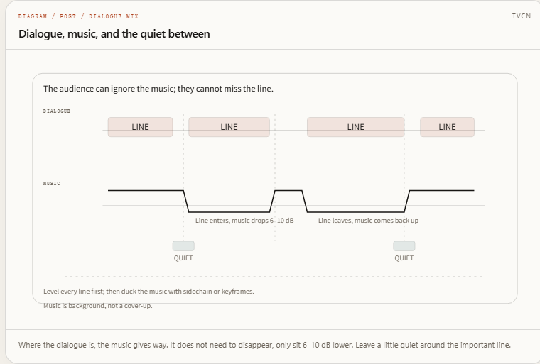

<!-- DIAGRAM_START -->
## Diagram

<figure>
  
  <figcaption>Where the dialogue is, the music gives way. It does not need to disappear, only sit 6–10 dB lower. Leave a little quiet around the important line.</figcaption>
</figure>
<!-- DIAGRAM_END -->

The audience can ignore the music. They cannot afford to miss the line. Level the dialogue first, then push the music down. Music is background, not a cover-up.

## Level the dialogue first

Listen line by line. Remove pops, mouth noise, and obvious room tone; match every take and every microphone to the same level. Do not ride one master track: pull it up for the quiet line and the next line will blow out.

Play the dialogue track alone, without picture. Listen for clarity, not beauty. Mark every word you cannot hear and fix it in the cut or with an alternate take.

## Make music give way

Duck music 6–10 dB under dialogue. Do not start at full and stay there. Use sidechain or manual keyframes: drop when the line enters, come back when it leaves.

Music should enter for a reason: an action, a turn, a scene change, a jump in time. Do not lay it under everything or the audience hears “this is the part where I should feel something” before they hear the story.

## Silence is part of the mix

Not every minute needs music. Leave half a second of quiet before or after an important line so it can land. Keep room tone underneath; do not create a vacuum. A fridge hum or distant traffic is more real than total silence.

At the end, let the music leave before the picture does. The last bit of quiet is what people remember.

## Checks

- Every line is clear without relying on subtitles.
- Music clearly gives way under dialogue, not just turned down once.
- There is at least one deliberate pause that is not filled with music.
