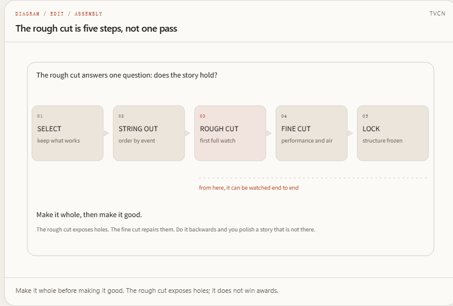

<!-- DIAGRAM_START -->
## Diagram

<figure>
  
  <figcaption>Make it whole before making it good. The rough cut exposes holes; it does not win awards.</figcaption>
</figure>
<!-- DIAGRAM_END -->

A rough cut does one thing: let a stranger understand who wants what and what blocks them. Rhythm, grade, and score come later.

## Structure before rhythm

Lay the shots on the timeline in order and set in and out points. Do not grade while cutting, and do not hunt for music while cutting; that turns structural problems into mood problems.

The first cut asks one question: does the audience know what is happening? If not, add or remove shots. Do not rescue it with transitions.

## Cut three kinds of shots

First, repeats: the second shot adds no new information. Second, decoration: beautiful but does not move the action. Third, explanation: dialogue repeats what the image already says.

Mark before deleting. Put “maybe” shots on a trash track, watch the whole cut, then decide.

## Write three notes

After each screening, write only three notes, each with a timecode: 00:12 the audience does not know why she leaves; 00:38 the reaction shot is too long; 00:51 the ending has no cost.

Do not write “it feels off.” “Feels off” is not a problem. The second and the missing information are.

## Three checks

- A stranger can say who wants what.
- No meaningless shot runs longer than three seconds.
- Three notes, each with a timecode.
<!-- SOURCES_START -->
<h2>Sources</h2>

Experience: TVCN field notes and project reviews; tested: the review setup and reproducible exercises noted on the page; references: public links below.

<ul><li>[S24] ACES Color Management</li><li>[S27] EBU R128 Loudness</li><li>[S28] Netflix Partner Help</li><li>[S30] DaVinci Resolve</li><li>[S34] Adobe Premiere Pro Guide</li><li>[S35] Avid Resource Center</li></ul>

<a href="../../SOURCES.md">Full links and notes in SOURCES.md</a>

<!-- SOURCES_END -->
